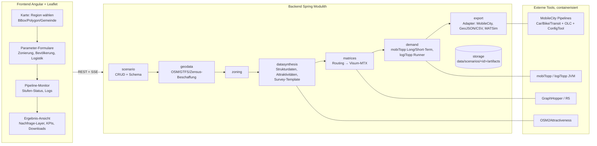
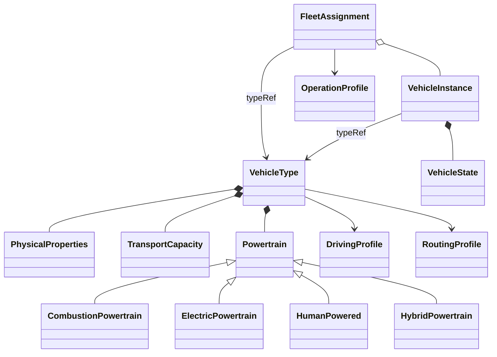

# 03 – Technische Zielarchitektur

Grundidee: simudrive-Muster übernehmen (Angular/Leaflet-Frontend, Spring-Modulith-Backend,
dateibasierter Artefakt-Store, externe Toolchain als Prozesse), aber die Generierung als
**explizite Pipeline aus Stufen mit definierten Artefakten** modellieren – jede Stufe einzeln
ausführbar, cachebar und durch andere Implementierungen ersetzbar.

## Konfigurierbare Datenquellen je fachlichem Aspekt — Konzept (2026-10-28)

Die aktuelle Quellenwahl ist über Orchestrator, Generatoren, Uploads und Zieladapter
verteilt. Der [Architekturvorschlag mit Quelleninventar](22-datenquellen-adapter-und-fallbackkonzept.md)
trennt Quelladapter, typisierte fachliche Beiträge, Auswahl-/Fallbackregeln,
Nachfragemodule und Zieladapter. Quellen sollen je Aspekt auswählbar sein, etwa
kommunale Arbeitsplätze statt OSM-Gewichten bei weiterhin aktivem OSM-Straßennetz.
Der Vorschlag umfasst Teilabdeckung, explizite Ersatzannahmen für Schwerlastverkehr,
Herkunft und eine verhaltensgleiche erste Migrationsstufe. Der experimentelle Importkern
und Quellenplan für Bevölkerung, Arbeitsplatzgewichte und schwere Fahrzeug-OD sind
inzwischen umgesetzt; [Umfang und Verifikation](22-datenquellen-adapter-und-fallbackkonzept.md#19-erste-experimentelle-umsetzung-und-verifikation) grenzen sie vom weiteren Zielbild ab.

Das nachgeschärfte Konzept begrenzt M0 auf drei Aspekte. Geordnete Providerprofile
und Datenpakete bilden M1 und sind für diese drei Verträge szenariolokal verfügbar; die übrigen Aspekte sind Erweiterungskatalog. Teileherkunft
ist verpflichtend, `mixed` nur eine mögliche Anzeige. Punktdaten und kommunale
Gebietsaggregate haben unterschiedliche Raumverträge. Die technische Lkw-
Mengendemonstration erfüllt den vorgesehenen strukturellen Ersatz noch nicht.
[Entscheidungen und offene Gates](22-datenquellen-adapter-und-fallbackkonzept.md).

Der Gemeindeimport erhält Aggregate auf AGS-/Gebietsstandsebene und referenziert
separate räumliche Gewichtsdaten. Ein begrenzter, typgeprüfter Revisionsgraph friert
Referenzen vor dem Queueing ein; die Verteilung bleibt eine Modellannahme mit
Mengenbilanz einschließlich Außenanteilen. Ein zusätzlicher Laufzweck sperrt die
technische Lkw-Demonstration für fachliche Auswertungen. Zusätzlich kann der Import versionierte GeoJSON-Polygone mit Flächenverschneidung nutzen; die Verteilung bleibt modelliert. Amtliche
Gebietsgeometrieprüfung und der fachliche Güterfallback sind weiterhin offen.

Die nativen Providerfamilien Bevölkerung und Work sind separat auflösbar: Für Bevölkerung kann der
Quellenplan Upload, Zensus, OSM-Siedlungen, POI-Ersatz und Ersatz ohne Ortsdaten
ordnen und abwählen. `PopulationSources` lädt nur benötigte Kandidaten und trennt
Gesamtzahl-/Verteilungsherkunft. Die bisherige Standardauswahl bleibt verfügbar.
[Bedienung, Eingabelock und Grenzen](examples/population-sources/README.md).

`ProviderChain<T>` liefert die gemeinsame typisierte Auswahllogik. Für Work sind
OSM-Ableitung und explizites synthetisches Modell getrennt konfigurierbar; die
anderen Aktivitätszwecke bleiben erhalten. Gemischte Profile kombinieren native und importierte Kandidaten; explizite native
Lückenfüller ergänzen nur nicht übernommene Registerzonen. Die gesamte Work-Komposition
wird vor ihrer Anwendung auf Zonenkopien geprüft.
[Work-Provider und Grenzen](examples/workplace-sources/README.md).

Die explizite Profilstrategie `fill-gaps` ergänzt mehrere Work-Register nach Vorrang.
Registerbeiträge haben disjunkte tatsächliche Scopes; verdeckte Mengen bleiben pro
Quelle bilanziert. Native Modelle füllen nur Restlücken. Die Berechnung ist atomar.
[Regionaler Vertrag und Grenzen](examples/regional-registers/README.md).

Typisierte EPSG:3035-Zellverträge unterscheiden bekannte Null, fehlend, nicht erhoben
und unterdrückt. Nur vollständig bekannte Zonen werden übernommen. Population
modelliert bei explizitem Mengenanker ausschließlich die unbekannte Restmenge;
Work ergänzt offene Zonen über die vorhandene atomare Komposition. Der gemeinsame
Import normalisiert domänenspezifisch vor Validierung und Revisionshash.
[Zellvertrag und Grenzen](examples/masked-cells/README.md).

`DataPackLibrary` verwaltet installationsweit portable Pakete unter `source-library/`.
`DataPacks` prüft vor Veröffentlichung auch deren interne Referenzen. Szenarien
übernehmen konkrete Kopien, deren Versions- und Revisionshashes erhalten bleiben;
Quellenauswahl und Laufresolver lesen weiterhin nur den Szenariobestand. Die
Bibliothek wird nicht zur neuen Laufzeitabhängigkeit der Generierung.
[Vertrag und Betriebsgrenzen](examples/source-library/README.md).

`SourceProfileLibrary` ergänzt versionierte Auswahlregeln unter `source-library/profiles/`.
Die vorhandene kanonische Profilserialisierung wird wiederverwendet. Vor Übernahme
werden alle aktiven Paketversionen geprüft/eingelesen; das Ziel erhält eigene Kopien
mit identischen Hashes. Es gibt keine automatische Aktivierung oder neue zentrale
Laufzeitabhängigkeit. Native Provider bleiben Regeln zur Auflösung im Zielscenario.
[Portable Profile und Grenzen](examples/shared-source-profiles/README.md).

`FreightSources` bilanziert gebundene Schwerlastrelationen gegen erzeugte Fahrten
unter `sources/resolution.json.freight`. Die Zuordnung verweist auf das vollständige
Fahrtenledger; Quellenevidenz, modellierte Abfahrten und native Routing-/
Ausführungsevidenz bleiben getrennt. Unternehmensbeiträge werden dadurch nicht
ersetzt. [Vertrag und begrenzte native Abnahme](examples/source-plan-traffic/README.md).

`SourceRunReport` bindet die bestehenden Teilberichte an Laufstatus, Zeitpunkte und
Plan-/Quellenhashes. Er publiziert auch frühe Teilfehler atomar; Zielberichte werden
nur für die erfolgreich beendete Stufe gebunden. `SourceRunReportComponent` zeigt
die Laufbilanz im Datenarbeitsbereich, getrennt von der Eingangsprüfung.
[Vertrag und Grenzen](examples/source-run-report/README.md).

## Globale Werkzeugkonfiguration

Die eigene Angular-Route `/einstellungen` erreicht über `GET/PUT /api/settings/tools` ein
begrenztes Settings-DTO. `ToolSettingsController` speichert außerhalb der Szenarien atomar
`<synthesis.data-dir>/tool-settings.json`. `ToolSettingsConfiguration` lädt die Datei nach
Spring-Binding in `SynthesisProperties`, bevor Konsumenten die Bean erhalten. Eine Änderung
über die API verändert die aktive Konfiguration nicht; die Antwort unterscheidet gespeicherte
und aktive Werte und meldet `restartRequired`. So kann ein Job nicht zwischen zwei
Werkzeugkonfigurationen wechseln. Szenariofelder und nicht angebotene Betriebs-Properties
bleiben in ihren bisherigen Verträgen. Bedienung, Vorrang und Verifikation stehen in
[docs/06, Phase 4](06-gta-integration-konzept.md#phase-4--produktiv-härtung-querschnittlich).

## Überblick



### Regionale Strukturgewichtung (implementiert, experimentell, 2026-09-21)

Die bestehende Bevölkerungssynthese kann mit `population.useCensusStructure=true`
zusätzlich `CensusStructureSource` und `CensusHouseholdSampler` verwenden. Voraussetzung:
KIT-Haushaltspool. Hashgeprüfte Zensus-2022-Raster liefern Alters- und Haushaltsgrößenanteile
für interne Zonen; der Adapter gewichtet vorhandene Haushalte. Daten- und Fitfehler fallen
mit Diagnose auf die bisherige Ziehung zurück. Die resultierenden Personen sind die
Eingabe für Aktivitäten und MobileCity. Cache unter `data/census-cache/structure/`,
Laufbericht unter `population/census-structure.json`; keine zusätzliche Pipeline-Stufe.
[Schwellen, Bedienung und Grenzen](06-gta-integration-konzept.md#regionale-zensus-struktur).

## Backend-Module (Spring Modulith, analog simudrive)

| Modul | Verantwortung |
|---|---|
| `scenario` | Szenario-Aggregat, REST-API, Validierung, Metadaten-Endpoint für UI-Formulare |
| `geodata` | Rohdaten-Beschaffung mit Cache: OSM-Extrakt (Overpass / Geofabrik-PBF-Clip), GTFS-Feed-Clip, amtliches Zensus-2022-Raster (`CensusPopulationSource`: URL+SHA-256, zentral unter `data/census-cache/`, regionaler 100-m-Filter) |
| `zoning` | Zonen aus OSM-Admin-Grenzen oder H3/Grid; erzeugt `zones.csv`, GeoJSON, MobileCity-District-Artefakte |
| `datasynthesis` | Provider-Slots je Datenebene (echt/öffentlich/synthetisch, siehe 02): Strukturdaten, Attraktivitäten, Survey-Template, Pendler, Depots |
| `matrices` | Zentroid-Bestimmung, Matrix-Berechnung via GraphHopper/R5, Visum-MTX-Export + Matrix-YAMLs |
| `demand` | Generierung der mobiTopp-Projektstruktur (Configs, Wahlmodell-Parameter), Ausführung Long-Term → Short-Term → logiTopp als externe JVM-Prozesse, Normalisierung in `synthesis-travel-demand-v1`, Ergebnis-Ingestion |
| `export` | Export-Adapter-SPI; erste Adapter: GeoJSON/CSV (Visualisierung), MobileCity (siehe unten) |
| `jobs` | Asynchrone Pipeline-Ausführung: Stufengraph, Status, Logs, Abbruch; Fortschritt per SSE/WebSocket ans Frontend |
| `storage` | Dateibasierter Artefakt-Store `data/scenarios/<id>/<stage>/…` mit Manifest (Hash der Eingaben → Cache/Re-Run-Entscheidung) |

**Warum Modulith statt Microservices:** identische Begründung wie simudrive – ein Deployable,
klare Modulgrenzen per Test erzwungen, externe Rechenlast liegt ohnehin in eigenständigen
Prozessen/Containern (GraphHopper, mobiTopp-JVM, Python-Pipelines).

**Polyglott-Strategie:** Alles Geo-/Daten-lastige, das in Python deutlich billiger ist
(OSM-POI-Aggregation, Zensus-Verschnitt, GTFS-Handling), läuft als containerisierte
**Worker-Skripte mit CLI-Kontrakt** (Eingabe-/Ausgabedateien + JSON-Config), orchestriert vom
`jobs`-Modul. Damit lassen sich auch OSM2Attractiveness und später die MobileCity-Python-Pipelines
ohne Umschreiben einhängen.

## Pipeline-Stufen und Artefakte

Jede Stufe: deklarierte Inputs/Outputs, idempotent, Seed-gesteuert reproduzierbar.

| Stufe | Input | Output (Artefakte) |
|---|---|---|
| 1 Region | BBox/Polygon | `region.geojson`, OSM-PBF-Clip, GTFS-Clip, Zensus-Clip |
| 2 Zonierung | Region, Modus, Auflösung | `zones.geojson`, `zones.csv`, `zone-to-community.csv`, `districts.gpkg`+`districts.xlsx` (MC) |
| 3 Strukturdaten | Zonen + Zensus/Synthese | `SynthesisZoneTargets.csv` |
| 4 Attraktivitäten | Zonen + OSM-POIs | `attractivities.csv` |
| 5 Pendler | Zonen + normalisierte Koordinaten-OD oder amtlicher BA-Export `Auspendler Gemeinden` (AGS-Auflösung über BKG VG250); der BA-Export erhält automatisch seinen Wohnort-Randwert aus den versionierten BA-Gemeindedaten 2025. Randwert entscheidet innen/außen, BA verteilt bedingt die Außenziele; ohne veröffentlichten Randwert bleibt die fixierte WORK-Gravitation aktiv. Zusätzlich wird ein noch nicht verhaltenswirksamer OSM-Außenzielkandidat erzeugt und bei vorhandener OD automatisch dagegen bewertet. | `population/commuters.csv`, `uploads/workplace-margins.csv`, `population/external-destination-candidates.json`, Manifest-/Job-Provenienz |
| 6 Matrizen | Zonen + OSM/GTFS-Routing | `*_TTC/COST/DIS.mtx.bz2`, Matrix-YAMLs |
| 7 Long-Term | 3–6 + Survey-Template | `person/household/activity/car/fixedDestination.csv` |
| 8 Short-Term + logiTopp | 7 + Matrizen + Logistik-Parameter | Raw-Wege-/Touren-CSVs, Zustell-, Abhol- und Paketstatus-Events; native Wege/Legs sowie 15-Minuten-Zonen-/OD-Profile unter `demand/` |
| 9 Export | 8 + Adapterwahl | GeoJSON-Layer, KPI-JSON, MobileCity-Paket, … |

## Szenario-Schema (Generik-Achse 2)

Ein Szenario ist ein versioniertes JSON/YAML-Dokument; die UI-Formulare werden aus einem
Metadaten-Endpoint generiert (simudrive-Muster), sodass neue Parameter ohne Frontend-Änderung
auftauchen. Skizze:

```yaml
scenario:
  name: "KA-Südstadt Lastenrad-Depot"
  seed: 42
  region: { type: polygon, geometry: …, source: map-selection }
  zoning: { mode: grid | epsg3035 | inspire, cellSizeMeters: 700, maxZones: 600 }
  population:
    structuralData: { provider: zensus2022 | synthetic | upload }
    surveyTemplate: { provider: synthetic-default | upload }
    samplingFraction: 0.25        # Anteil, den SyntheSis synthetisiert/exportiert;
                                  # Downstream-Modelle verarbeiten diesen Export vollständig
  logistics:
    parcelDemand: { meanPerPersonWeek: 0.75, stdDev: 0.5, max: 10 }
    destinationShares: { home: 0.8, work: 0.1, packstation: 0.1 }
    returns:                       # experimentell; Details und Stufenplan in docs/06, Abschnitt G
      enabled: false              # experimentell und rückwärtskompatibel
      model: exogenous-share      # MVP: unabhängige Rücksende-Nachfrage, kein Paket-Lebenszyklus
      shareOfPrivateOrders: 0.0   # explizite Szenarioannahme; kein unkalibrierter Produktiv-Default
      pickupShares: { home: 1.0, work: 0.0 }
    depots:                        # auf Karte gesetzt oder provider: osm | random
      - { location: [8.4, 49.0], employees: 25, share: 0.6, fleet: cargo-bike }
    services: [{ name: DHL, share: 0.45 }, …]
  simulation: { days: 7, engine: legacy-logitopp | mobitopp-ng }
  exports: [geojson, mobilecity]
```

Die produktive Rasterzonierung bietet drei bewusst getrennte Varianten: `grid` beginnt an der
jeweiligen Regions-Bbox und erlaubt freie 50-m-Schritte; `epsg3035` rastet europaweit stabil auf
ETRS89-LAEA ein und erlaubt flexible 100-m-Schritte (z. B. 700 m); `inspire` verwendet nur die
amtlichen Stufen 100 m, 1 km und 10 km und vergibt INSPIRE-Zellcodes. `maxZones` ist eine
szenariospezifische Rechenobergrenze (Default 600, harte Schutzgrenze 1.200), da die nachfolgenden
OD-Matrizen quadratisch wachsen. Eine geänderte Zonierung erfordert eine neue Generierung aller
zonenabhängigen Artefakte.

Die experimentelle Retourenlogistik erweitert die bestehenden Stufen „Logistik",
„Short-Term + logiTopp" und „Export"; sie benötigt **keine zusätzliche Pipeline-Stufe**.
Kundenretouren werden als logiTopp-Abholaufträge (`IsPickup=true`) modelliert und in Ergebnissen
strikt von nicht zustellbaren Paketen im Status `RETURNING` getrennt. Das vollständige
Fach-, Daten-, KPI- und Validierungskonzept steht in `docs/06-gta-integration-konzept.md`,
Abschnitt G.

Die externe Prozessgrenze ist seit 2026-07-29 durch zwei gekoppelte Verträge abgesichert:
SyntheSis schreibt `synthesis-parcel-demand-v1` in die Paketkonfiguration und fordert in der
Run-Config `synthesis-logitopp-returns-v1` an. `SimulationRunner` startet nur einen Harness mit
passendem Marker; fehlende oder abweichende Versionen schlagen sichtbar fehl. Der reproduzierbare
GPL-Patch-/Build-Vertrag liegt unter `legacy/logitopp-returns-v1/` und publiziert logiTopp unter
einer eindeutigen Maven-Version. Der SUMO-Adapter schließt jede normale logiTopp-Tour vom letzten
Stopp zurück zum ersten Depot, sofern kein explizites Rückkehr-Leg vorhanden ist. Szenario-API
und Frontend spiegeln den Vertrag mit `enabled=false` als rückwärtskompatiblem Default.
`SimulationResultIngestor` schreibt den additiven Vertrag
`synthesis-logistics-kpis-v1`, trennt Zustellung, Zustell-Rückläufer und Kundenretoure und
verifiziert Richtung, Ziehregel sowie Pickup→Depot-Unload vor der Ergebnisfreigabe.

Die Personenverkehrsnachfrage besitzt seit 2026-07-30 ebenfalls eine explizite interne
Prozessgrenze. Nur `LogitoppDemandAdapter` kennt das Legacy-Schema
`demandsimulationResult.csv`; danach arbeiten KPI-Ingestion, Distanzkalibrierung,
LLM-Auswertung und SUMO mit `TravelDemand`. Ein Weg wird über `(personOid, tripId)`
identifiziert, seine Legs nach `legId` geordnet, seine Distanz über alle Legs summiert und
sein Ursprung/Ziel aus erstem/letztem Leg abgeleitet. Ungültige Pflichtfelder, doppelte oder
lückenhafte Legs und nicht-endliche Werte schlagen sichtbar fehl. Unbekannte Moduscodes
bleiben als Code erhalten und werden kontrolliert als `other` ausgewiesen.

Eine wichtige Provenienzgrenze bleibt explizit: mobiTopp 0.3.580 schreibt je Leg dessen
Modus, Quell-/Zielzone, Distanz und Endzeit, die Koordinaten `fromX…toY` und `tripBegin`
stammen aber aus den umschließenden Aktivitäten. `TravelDemand.Leg` behauptet deshalb keine
Leg-Geometrie oder eigene Leg-Abfahrtszeit; diese Felder werden nur am vollständigen
`PersonTrip` geführt.

Der versionierte Artefaktvertrag `synthesis-travel-demand-v1` liegt unter
`artifacts/demand/`: `person-trips.csv`, `legs.csv`, `zone-flows.csv`, `od-flows.csv` und
`metadata.json`. Die Profile verwenden halboffene 15-Minuten-Intervalle auf der absoluten
Wochenzeit; `Zone.id` wird unverändert verwendet, nicht aus Listenindex oder Matrixspalte
abgeleitet. Es handelt sich um **simulierte Stichprobenwege**, nicht um hochgerechnete
Prognosewerte. Der kanonische Hauptmodus stammt aus `mainMode`; die potenziell intermodale
`tripMode`-Sequenz bleibt separat für Audits erhalten. Die Zeitstempel sind geplante
logiTopp-Zeiten, keine beobachteten Ankunftszeiten. Die Dateien werden deterministisch sortiert
und atomar ersetzt.

## Fahrzeugtypen und externe Fahrzeugkonfigurationen — Entwurf (2026-09-17)

**Status: geprüftes Konzept, noch nicht implementiert.** Anlass ist eine externe
`vehicle.json` mit Diesel-Lieferwagen und elektrischem Lastenrad. Ziel ist ein
simulatorunabhängiger Fahrzeugkatalog mit mitgelieferten Standardtypen und importierbaren
Sondertypen, etwa autonomen Leichtfahrzeugen. Ein erfolgreich eingelesener Parameter gilt
erst dann als simulationswirksam, wenn der jeweilige Zielmodell-Adapter ihn nachweislich nutzt.

### Befund zur Beispieldatei und zum aktuellen Code

Die Datei ist syntaktisch gültiges JSON, enthält zwei eindeutige IDs und keine doppelten
Objektschlüssel. Bei beiden Einträgen liegen aktuelle Masse und Volumen der Ladung innerhalb
der angegebenen Ladekapazität. Fachliche Vollständigkeit oder Messwertqualität folgt daraus
nicht. Es fehlen insbesondere Schema-/Typversionen, eindeutige Energieeinheiten und die
Trennung zwischen Typdefinition und Fahrzeugzustand.

| Eingabefeld | Bewertung und vorgesehene Abbildung |
|---|---|
| `id`, `type` | Typ-ID und Fahrzeug-ID unterscheiden. `veh_001` könnte beides meinen. Katalogtypen erhalten stabile `id` + `version`, Instanzen eine eigene `vehicleId` + `typeRef`. `type` wird zur Fahrzeugkategorie. |
| `domain`, `modality` | Einsatzzweck, Fahrzeugkategorie und Verkehrsmodus getrennt halten. Ein Pkw kann Personen oder Güter transportieren; ein autonomes Fahrzeug begründet allein keinen neuen Nachfrage-Modus. |
| `physical_properties.mass_kg` | Leer-/Betriebsmasse, aktuelle Gesamtmasse und maximale Gesamtmasse unterscheiden. Es ist unklar, ob 2.500 kg bzw. 120 kg Fahrer und Ladung bereits enthalten. Keine automatische Übernahme als Leermasse. |
| `max_speed_kmh` | Technische Höchstgeschwindigkeit; Adapter konvertiert bei Bedarf. 130 km/h entsprechen ca. 36,111 m/s, 25 km/h ca. 6,944 m/s. Beim Pedelec eine mögliche Unterstützungsgrenze separat erfassen. |
| `acceleration_mps2` | Technische Fähigkeit oder gewähltes Fahrverhalten klären; Bremsverzögerung, Notbremsverzögerung und Fahrverhaltensprofil ergänzen. |
| `size_m.length/width/height` | Als Abmessungen des Typs übernehmen; positive Werte und Einheiten validieren. |
| `energy_profile.energy_type` | `diesel` ist ein Energieträger, `electric` beschreibt einen Antrieb. Antriebsvariante und Energieträger explizit typisieren. Muskelkraft, elektrische Unterstützung und später Hybrid berücksichtigen. |
| `consumption_per_km` | Ohne Einheit nicht automatisch verwendbar. **Falls** Diesel in l/km und Strom in kWh/km gemeint sind: 0,08 → 8 l/100 km; 0,01 → 10 Wh/km. Mess-/Referenzbedingungen und Bilanzgrenze fehlen. |
| `co2_per_km_g` | Referenzfaktor mit Bilanzgrenze speichern: direkte Emissionen, Energiebereitstellung oder Lebenszyklus; CO₂ von CO₂e unterscheiden. Die 5 g/km beim E-Lastenrad nicht als direkte Abgasemission übernehmen. |
| `noise_db` | Bewertungsverfahren, Gewichtung, Abstand, Geschwindigkeit und Lastzustand fehlen. Zunächst Referenzangabe; kein allgemeingültiger konstanter Simulationsparameter. |
| `logistics.cargo_capacity` | Maximale Nutzlast in kg und nutzbares Ladevolumen in m³ am Typ; später ggf. Paketplätze und Abmessungsgrenzen. |
| `logistics.current_load` | Gehört zum Zustand einer Instanz bzw. ihrer Initialisierung, nicht zum Typ. Ladungswechsel müssen auftrags-/ereignisbezogen bilanziert werden. |
| `delivery_mode`, `loading_time_s`, `unloading_time_s` | Zum Einsatz-/Serviceprofil. Für Zeiten festlegen, ob je Halt, Paket oder kg; die Datei sagt dies nicht. Technik kann Servicezeiten begrenzen, ein Betrieb kann andere Abläufe wählen. |
| `allowed_networks` | Gewünschte Netznutzung als Routingprofil; tatsächliche Kantenfreigaben, Fahrzeugklasse und Abmessungen gemeinsam prüfen. `road`/`bike` reichen als Ausführungsvertrag nicht aus. |
| `parking_behavior` | Betriebs-/Verhaltensprofil mit definierter Semantik; `search` oder `flexible` bewirken ohne entsprechenden Adapter keine Parkplatzsuche. |
| `charging.required`, `charging_speed_kw` | Ladefähigkeit am Antrieb; aktueller Ladebedarf am Fahrzeugzustand bzw. in der Strategie. Maximale Aufnahmeleistung des Fahrzeugs von Stationsleistung unterscheiden; nutzbare Batteriekapazität, Ladeverluste und Anschlüsse ergänzen. |

Der aktuelle Code besitzt noch keinen gemeinsamen konfigurierbaren Fahrzeugtypvertrag:

- `Scenario.Depot.vehicleType` und das Frontend kennen `TRUCK`/`CARGO_BIKE`.
- `PopulationGenerator` zieht gegenwärtig mit Wahrscheinlichkeit 0,08 `bev`, sonst
  `conventional`; Segment, Sitzplatzzahl und Reichweite sind fest vorgegeben.
  `LegacyExportGenerator.convertCars` exportiert anschließend ausdrücklich alle Pkw als
  `conventional`. Eine durchgängig wirksame elektrische Flotte ist damit nicht nachgewiesen.
- Der Depotexport leitet die Fahrzeugzahl aus `employees` ab und schreibt `volume=150.0`
  unabhängig vom Typ. Die Einheit/Semantik dieses Legacy-Feldes muss am Fremdparser bewiesen
  werden, bevor es mit `cargoCapacity.volumeM3` belegt wird.
- `SumoRunner.writeTripsXml` definiert `pkw`, `fahrrad`, `lkw` und `lastenrad` fest;
  Typabmessungen, Batterie und externe Konfigurationen werden dort nicht eingelesen.
- `SumoRunner.Trip` enthält keine dauerhafte Fahrzeug-ID. Jeder Abschnitt bekommt im Export
  eine neue `vN`-ID. Für fahrtenübergreifende Batterie-, Beladungs- und Flottenzustände braucht
  es zuerst eine belastbare Fahrzeug-/Tourzuordnung; die Typklasse allein löst das nicht.
- `SumoRunner.parseEmissions` erkennt Typnamen aktuell nur mit `\w+`; frei gewählte IDs mit
  Bindestrich oder Namensraum würden in dieser Auswertung verloren gehen. Adapter-IDs und
  Rückzuordnung zum Katalog sind Teil des neuen Vertrags.
- Der aktuelle `MobileCityExporter` liefert in `TECCarFleet` den Pkw-Bestand pro Bezirk,
  aber keinen frei konfigurierbaren Antriebsmix.

### Metamodell: Typ, Instanz und Betrieb trennen

Empfohlen wird eine gemeinsame `VehicleType`-Klasse mit komponierten Profilen.
Vererbung bzw. eine geschlossene Variantenfamilie ist beim **Antrieb** sinnvoll; eine
Kreuzhierarchie wie `AutonomousElectricCargoBike` würde unabhängige Eigenschaften koppeln.



| Baustein | Wesentliche Attribute |
|---|---|
| `VehicleType` | `id`, `version`, `name`, `category`, Quellen-/Qualitätsangaben, physische Eigenschaften, Kapazität, Antrieb, Profilreferenzen |
| `PhysicalProperties` | `curbMassKg` mit festgelegter Bezugsdefinition, optional `maxGrossMassKg`, `lengthM`, `widthM`, `heightM`, `maxSpeedKmh`, technische Beschleunigungs-/Bremsgrenzen |
| `TransportCapacity` | `passengerSeats` ohne Bedienperson, `operatorSeats`, `payloadKg`, `cargoVolumeM3`; Personengewicht und Nutzlastgrenze gemeinsam prüfen |
| `CombustionPowertrain` | Kraftstoff, `tankCapacityL`, optionaler Referenzverbrauch `litresPerKm`, Emissionsprofil mit Quellen und Geltungsbereich |
| `ElectricPowertrain` | `usableBatteryCapacityKwh`, `maxChargePowerKw`, Anschlüsse, Lade-/Rekuperationswirkungsgrad, optionaler Referenzverbrauch `kwhPerKm`; `assistanceMode` trennt Vollantrieb von Pedalunterstützung |
| `HumanPowered` / `HybridPowertrain` | Muskelkraft ohne erfundene Batterie; Hybrid als explizite Kombination aus Verbrenner, E-Antrieb und Betriebsstrategie. Hybrid zunächst nur als Ausbaupunkt, nicht als unterstützte Simulation ausweisen. |
| `DrivingProfile` | `controlMode` (menschlich/automatisiert/ferngesteuert), Verhaltensmodell, Zeitabstand, Mindestabstand, gewünschte Beschleunigung/Bremsung; automatisierte Betriebsgrenzen separat beschreiben |
| `RoutingProfile` | Verkehrsklasse, zugelassene Netztypen, zusätzliche Restriktionen; Adapter übersetzt in Modell-/Netzberechtigungen |
| `OperationProfile` | Einsatzart, Lade-/Entladezeitmodell mit Bezugsgröße, Parkstrategie, Lade-/Tankstrategie |
| `FleetAssignment` | Zuordnung zu Depot, Haushalt oder Dienst, referenzierter Typ mit Version, Anzahl bzw. explizite Instanzen; Bestandsanteile für private Pkw als eigene Allokationsregel |
| `VehicleInstance` / `VehicleState` | `vehicleId`, `typeRef`, Betreiber/Standort, aktuelle Ladung, Belegung, Batterieenergie bzw. Tankfüllung, Verfügbarkeit; Anfangszustand getrennt vom späteren Zustand |

Ein Fahrzeugkatalog definiert verfügbare Typen; er erzeugt noch keine Nachfrage oder Flotte.
Szenarien benötigen deshalb zusätzlich Zuordnungen und Mengen/Anteile. Autonome
Leichtfahrzeuge können auf dieser Basis konfiguriert werden; Disposition, Leerfahrten,
Ladeentscheidungen oder ein neues Mobilitätsangebot benötigen jeweils eigene Betriebslogik.
Ein `controlMode=automated` beweist deren Umsetzung nicht.

### Externer Vertrag und Standardkatalog

Vorgeschlagen wird `synthesis-vehicle-configuration-v1`, mit JSON-Schema und fachlicher
Validierung. Die folgende **Strukturskizze** ist noch kein vollständiges Importschema:

```json
{
  "schemaVersion": "synthesis-vehicle-configuration-v1",
  "vehicleTypes": [],
  "catalogRefs": [
    { "id": "standard.pkw.benzin", "version": "1" }
  ],
  "fleetAssignments": [],
  "initialVehicles": []
}
```

`vehicleTypes` enthält vollständige externe Typdefinitionen, `catalogRefs` ausdrücklich
gewählte unveränderliche Standardversionen. Alle `typeRef`-Referenzen aus Zuordnungen und
Instanzen müssen innerhalb dieser aufgelösten Konfiguration existieren. Der kanonische
API-Vertrag verwendet wie `Scenario` camelCase. Ein separater Importadapter kann die
angelieferte snake_case-Datei normalisieren, muss aber fehlende Einheiten, die Massendefinition
und die Typ-/Instanzentscheidung als offene Eingaben melden statt sie still zu erraten.

| Vorgeschlagener Endpunkt | Zweck |
|---|---|
| `GET /api/vehicle-types` | Mitgelieferte Standardtypen mit Version, Quellen, Annahmen und Unterstützung pro Zielmodell auflisten |
| `GET /api/vehicle-configurations/schema` | Versioniertes JSON-Schema für externe Anbieter bereitstellen |
| `POST /api/vehicle-configurations/validate` | Konfiguration ohne Speicherung prüfen; normalisierte Vorschau, Fehlerpfade, Warnungen und Zielmodell-Kompatibilität zurückgeben |
| `GET /api/scenarios/{id}/vehicle-configuration` | Vollständige aktuell gespeicherte Szenario-Konfiguration lesen |
| `PUT /api/scenarios/{id}/vehicle-configuration` | Typen, Referenzen, Zuordnungen und Anfangszustände gemeinsam validieren und atomar als vollständige Konfiguration ersetzen |

Die Studio-Dateiauswahl nutzt denselben JSON-Vertrag wie externe HTTP-Clients. Ungültige
Eingaben verändern keine gespeicherte Konfiguration. Ein vorgeschalteter Validierungsaufruf
ist optional; `PUT` validiert immer selbst. Vorgesehene Antworten: `400` für ungültiges JSON,
`422` für Schema-/Fachfehler, `404` für unbekannte Szenarien und `409` für Versionskonflikte.
Ein ETag mit `If-Match` verhindert verlorene parallele Änderungen. Imports sind zunächst
szenariolokal; sie überschreiben keine globalen Standardtypen.

Mitgelieferte Vorlagen sollten mindestens Pkw Benzin, Pkw Diesel, Pkw elektrisch,
Lieferwagen Diesel/elektrisch, Fahrrad sowie Lastenrad mit/ohne elektrische Unterstützung
abdecken. Autonome Leichtfahrzeuge können als explizit experimentelle Vorlagen ergänzt
werden. Es gibt keinen universell kalibrierten „Standard-Pkw“: jede Vorlage braucht eine
Version und Kennzeichnung ihrer Parameter als gemessen, aus einer Quelle übernommen oder
angenommen. Eine Vorlagenkopie erhält eine neue Typidentität. Unbekannte Werte bleiben
unbekannt; Nullwerte dürfen nicht fehlende Batterie-, Emissions- oder Kapazitätsdaten verdecken.

Zu validieren sind insbesondere eindeutige IDs/Versionen, Referenzen, endliche Zahlen,
positive Abmessungen, nichtnegative Mengen, aktive antriebsspezifische Pflichtfelder,
Ladung ≤ Kapazität, Batterieenergie ≤ nutzbare Kapazität und widerspruchsfreie
Antriebs-/Ladeangaben. Unbekannte Kernfelder werden abgelehnt; Erweiterungen gehören in
einen ausdrücklich definierten Namensraum. Strukturprüfung und physikalische Plausibilität
sind getrennte Prüfungen; widersprüchliche Verbrauchs-/Emissionswerte brauchen Quellenklärung.

Der Start eines Jobs friert die aufgelöste Konfiguration einschließlich Standardversionen
und Inhaltshash ein. Vorgesehene Ablage: Szenarioeingabe unter
`uploads/vehicle-configuration.json`, verwendeter Snapshot und Adapterbericht unter
`artifacts/vehicles/`, Hash/Vertragsversion im Manifest. Ein späterer Katalogwechsel verändert
keinen bereits gestarteten Lauf. Eine deterministische Allokation erhält einen eigenen aus
dem Szenario-Seed abgeleiteten Zufallsstrom, damit sie nicht die Bevölkerungssynthese verändert.

### Wirkung in den Zielmodellen und Umsetzungsschnitt

SUMO kann Typabmessungen, Leermasse, Höchstgeschwindigkeit und Fahrverhaltensparameter
abbilden; Geschwindigkeiten stehen dort in m/s. Breite wirkt beim Standardmodell nur in
der Darstellung und beim Sublane-Modell auch im Fahrverhalten. Technische Maximalbeschleunigung
und gewünschte Beschleunigung sind zu unterscheiden. Diese Grenzen sind im Adapterbericht
auszuweisen. Siehe [SUMO-Fahrzeugtypen](https://sumo.dlr.de/docs/Definition_of_Vehicles,_Vehicle_Types,_and_Routes.html).

Für Batteriestand und Laden benötigt SUMO ein Battery-Device, ein Verbrauchsmodell und
Ladeinfrastruktur; die aktuelle Dokumentation verwendet Wh für Kapazität und W für
Ladeleistung. Der Adapter muss die tatsächlich installierte Version berücksichtigen.
Ein konstantes `kwhPerKm` kann separat eine Referenzbilanz liefern, ersetzt aber kein
fahrzustandsabhängiges Energiemodell. Siehe [SUMO-Elektromodell](https://sumo.dlr.de/docs/Models/Electric.html).
Fahrfolgemodelle wie [ACC](https://sumo.dlr.de/docs/Car-Following-Models/ACC.html) beschreiben
Teilmechanismen; daraus folgt keine vollständige autonome Betriebsführung.

Jeder Adapter meldet pro Parameter und ausgewählter Funktion `applied`, `approximated`,
`metadataOnly` oder `unsupported`, jeweils mit Begründung. Nicht unterstützte angeforderte
Simulationsfunktionen blockieren die Ausführung; reine Katalogmetadaten dürfen gespeichert
bleiben. Eine Näherung erfordert eine explizite Szenarioentscheidung und erscheint im
Ergebnisbericht. Diesel- und Elektrofahrzeuge dürfen insbesondere nicht still gleichgesetzt
werden. Vorhandene Szenarien ohne neue Konfiguration behalten zunächst ihr bisheriges Verhalten.

1. **Katalog und Import:** Typ-/Profilklassen, JSON-Schema, Standardversionen, Validierung,
   API und UI-Vorschau; Frontend-Vertrag parallel spiegeln. Speicherung allein als solche
   kennzeichnen, noch keine simulierte Wirkung behaupten.
2. **Durchgängige Typzuordnung:** Typreferenzen bei Population, Depot-/Flottenerzeugung,
   Legacy-Export, Tourergebnis und SUMO erhalten. Eindeutige dauerhafte Depot-/Fahrzeug-IDs
   ergänzen, wo sie fehlen. Die Legacy-Parser einschließlich Kapazitäts- und BEV-Format
   zuerst am lokalen Fremdcode prüfen; Änderungen am GPL-Tool über den versionierten
   Patch-/Build-Vertrag statt durch unversionierte Eingriffe in `validation/`.
3. **Verkehrsparameter:** Konfigurierbare SUMO-Typen einschließlich ID-Rückzuordnung,
   Routingberechtigungen und Emissionsauswertung. Nachweisen, dass eine gezielte Änderung
   etwa an Länge/Höchstgeschwindigkeit tatsächlich im Routing und Lauf ankommt.
4. **Zustand und Betrieb:** Durchgehende Fahrzeugidentität über Fahrten/Stopps, Batterie,
   Laden, Beladung und autonome Betriebsstrategie als getrennt nachgewiesene Ausbaustufen.
   Zuerst vollständige kleine Prozesskette erproben; neue experimentelle Laufzeitfähigkeit
   bleibt bis zur Abnahme ausgeschaltet.

Abnahme: Import→Persistierung→Export erhält Werte und Einheiten; ungültiger Import lässt
den Vorgänger unverändert; gleiche Konfiguration/Seeds liefern gleiche Typzuordnung;
gemischte Flotten verlieren keine Typidentität; unbekannte Zielmodellfähigkeiten werden
sichtbar zurückgewiesen. Ein Batterietest muss mindestens zwei Abschnitte desselben Fahrzeugs
umfassen, damit ein irrtümlicher Reset am zweiten Abschnitt auffällt. Bestandsregression,
Backend-Suite und Frontend-Tests/AOT-Build ergänzen diese Wirkungsnachweise.

## Frontend (Angular, wie simudrive)

*Stand 2026-11-04:* Angular 21 (standalone, Signals), Leaflet, Design-Tokens in `styles.css`;
Anmeldeseite, Benutzerverwaltung (ADMIN), Kopfzeile mit Nutzerchip. Das Studio stapelt unter
1100 px Breite seine drei Spalten, zeigt Statusmeldungen als Banner mit Art (Erfolg/Hinweis/Fehler),
fasst experimentelle Optionen in „Erweiterte und experimentelle Optionen“ zusammen, blendet eine
Kartenlegende für aktive Ebenen ein und ergänzt Modal-Split-/Distanz-Tabellen um Balken. Der
ursprüngliche Zielentwurf folgt:

1. **Region wählen:** Leaflet + Zeichenwerkzeuge (BBox/Polygon) + Nominatim-Gemeindesuche;
   Anzeige der abgeleiteten Zonierung als Vorschau-Layer (sofortiges Feedback vor dem teuren Lauf).
2. **Parametrieren:** Formulargruppen Bevölkerung / Verkehr / Logistik; Depots als Karten-Marker
   mit Eigenschaften-Popup; Datenqualitäts-Ampel je Ebene (echt/öffentlich/synthetisch).
3. **Ausführen & beobachten:** Pipeline-Graph mit Stufenstatus, Logs, Laufzeit; Wiederaufnahme
   ab fehlgeschlagener Stufe (Artefakt-Cache).
4. **Ergebnisse:** Choroplethen (Wege je Zone, Paketdichte), Depot-Einzugsgebiete, Touren auf der
   Karte, KPI-Kacheln (Wege/Tag, Modal Split, Zustellpakete, Kundenretouren, fehlgeschlagene
   Zustellungen, Tourlängen, Stopps/Tour), Downloads je Artefakt.

## MobileCity-Integration (Export-Adapter)

**Stand 2026-09-22:** Die Übergabe erfolgt von SyntheSis nach MobileCity als aggregierte
District-Tabellen und Netze. Der vorhandene Export liefert einen Teilbeitrag oder ergänzt
eine vorbereitete TRAMIGO-Vorlage oder erzeugt ein eigenständiges Regionalpaket mit
eigenen Districts und aus OD-Matrizen abgeleiteten Verbindungsnetzen. KBA/BKG liefert
optional private BEV-Anteile, Zensus-Struktur die Populationsgewichtung. Quellen,
Modellannahmen und Hashes werden mit dem Paket gespeichert. `data-inventory.json` hält je
Bereich Status, Auflösungsweg, Abdeckung und wirksamen Wert fest; gebietsbezogene BKG- und
weitere verfügbare Quellantworten werden als Lauf-Snapshots kopiert. Einzelwege und
Logistiktouren haben darin noch keinen bestätigten Zielvertrag. Das Transitnetz wird im
Regionalmodus aus einem Volltages-GTFS erzeugt. Der Java-Adapter
wählt deterministisch einen repräsentativen Mittwoch, mappt die etablierte Route-Type-
Kodierung der mitgelieferten Network Pipeline, bildet Fahrzeiten/Frequenzen und GTFS-Transfers
ab und verbindet jeden District über einen abgeleiteten Fußzugang mit der größten
Servicekomponente. MobileCity arbeitet intern mit ungerichteten Kanten; deshalb wird je Kante
die größere der beiden Richtungsfrequenzen exportiert. Fehlt ein Feed, ist der synthetische
Matrix-Fallback nur bei gesetzter Szenariofreigabe zulässig.

Öffentliche Ladeinfrastruktur wird in einem eigenen Quellenadapter vor dem Schreiben der
Zieltabellen aufgelöst. `MobileCityChargingSource` liest den hashgeprüften BNetzA-Snapshot
vom 01.09.2026, ordnet die Koordinaten mit den tatsächlichen District-Geometrien zu und
aggregiert die veröffentlichte Spalte `Anzahl Ladepunkte`. `REGchargers` enthält damit
Ladepunkte, nicht Standorte oder einzelne Steckertypen. Inbetriebnahmejahre liefern eine
kumulative, als Untergrenze gekennzeichnete Historie der im Snapshot noch geführten Anlagen.
Nach dem letzten beobachteten Jahr bleiben Zellen leer, sodass MobileCity seinen eigenen
Ausbaupfad verwendet. Alternativ kann der Nutzer eine Ladepunktzahl je 1.000 Einwohner als
Annahme oder Fallback angeben. Quellmetadaten und der regionale Ausschnitt liegen in
`charging-provenance.json` und `charging-points.csv`.

Carsharing wird mangels einer kleinräumig vollständigen, allgemein nutzbaren Quelle als
explizite Szenarioannahme modelliert. `carsharingVehiclesPer1000` wird anhand der erzeugten
District-Bevölkerung auf `carsharing.stock.total` verteilt; `carsharingMemberShare` wird als
gebietsweite Zahl in `carsharing.member` geschrieben. Beide Werte bleiben über den
Exporthorizont konstant. Leere Eingaben bedeuten die im Dateninventar ausgewiesene
Nullannahme. So kopiert der Regionalexport weder Karlsruher Bestände noch Servicegebiete.

Umland ist ein eigener, optionaler Szenariovertrag. Manuell aktiviert eine positive
`surroundingPopulation` die Richtungsanker als `districtType=0`. Automatisch erzeugen
`autoSurrounding=true` und `surroundingBufferKm` einen in EPSG:3035 gepufferten Ring um den
Kartenausschnitt, schneiden ihn überlappungsfrei in N/NE/E/SE/S/SW/W/NW und aggregieren
Zensus-2022-Bevölkerung sowie Altersgruppen. Die externen Netzanker liegen im jeweiligen
Sektor; eine manuelle Gesamtsumme skaliert dessen beobachtete Gewichte exakt. Ohne beide
Aktivierungen bleiben die Anker reine Ziele der SyntheSis-Außenbeziehungen. Pkw- und
BEV-Struktur werden weiterhin aus der Binnenbevölkerung extrapoliert und als Annahme
protokolliert. Vier Pflichtanteile für Bildung, Arbeit, Einkauf und Freizeit schreiben den
nativen Vertrag `tripShareToStudyArea`: Wege von Umlandbewohnern in das Untersuchungsgebiet.
Study-Area-Zähler sowie gebietsweite Finanz-, Transit- und Sharing-Größen schließen das
Umland aus. BA-Pendlerdaten dürfen künftig ausschließlich den Arbeitszweck belegen.

**Ausbauziel:** Aus der Kartenauswahl werden regionale Daten automatisch ermittelt und mit
versionierten Modellprofilen sowie gezielten Nutzervorgaben zusammengeführt. Der Export
erhält die aufgelösten Werte einschließlich Quelle, Datenjahr, räumlicher Abdeckung und
Annahmen. Die UI bietet Rücksetzen auf Automatik und kennzeichnet fehlende Werte.
Regions-, Jahres- oder Konfigurationswechsel markieren ein vorhandenes Paket im Studio als
veraltet; laufende Jobs verwenden einen festen Szenariostand. Die optionale Stufe 10
`MobileCity-Validierung` startet nach einem vollständigen Export den echten ConfigTool-Import,
lädt die erzeugten Binärdateien erneut und simuliert den Prüfhorizont. Fehlende lokale
Laufzeit ergibt `SKIPPED`, ein fachlicher oder technischer Prüffehler `FAILED`. Bericht und
Logs liegen getrennt unter `mobilecity-validation/`.

### Offline-Abnahme mit realen Quellen: Rastatt

`scripts/check-mobilecity-rastatt-sources.py --work-dir /private/tmp/mobilecity-rastatt-check`
führt einen reproduzierbaren, opt-in Prüffall für eine kleine Zone in der Rastatter Innenstadt aus.
Benötigt werden die lokal vorbereitete `tramigo-v2`-Profilmappe, das amtliche
Zensus-2022-Bevölkerungsraster und dessen Alters-/Haushaltsarchive, der KVV-GTFS-Feed,
.NET 8 und der MobileCity ConfigTool-Quellstand. Die Pfade lassen sich mit `--help`
anpassen. Das Skript lädt keine Quellen aus dem Netz: Es verwendet KBA- und
BNetzA-Referenzstände aus dem Backend sowie eine festgehaltene BKG-WFS-Antwort
für Rastatt. Damit prüft es die Datenabbildung, aber nicht die heutige Verfügbarkeit
des BKG-Dienstes. Der Ausgabeordner muss neu sein und enthält Eingabe-Hashes,
Quellenstände, Abdeckungen, exportierte Summen, Importpaket, native Logs und
`rastatt-source-report.json`. Fehlende lokale Eingaben beenden den Lauf mit Fehler.
Auch fehlender GTFS-Upload und eine nicht belegbare KBA/BKG-Zuordnung werden
im Java-Prüffall als Fehlerfälle geprüft; es gibt hier keine manuelle BEV-Annahme
und keinen synthetischen ÖV-Fallback.

Referenzlauf vom 25.09.2026: 21 Bevölkerungszellen, 1.639 Einwohner,
21 Alters- und 20 Haushaltszellen mit einer gewichteten Zone, 100 %
BKG-Flächenabdeckung, 6 KVV-Haltestellen im Ausschnitt, 233 geplante
Fahrten am repräsentativen Mittwoch (08.07.2026) und 6 öffentliche
Ladepunkte. Der ConfigTool-Import und die Simulation 2026–2036 bestanden.
Die Quelle für Pkw-Bestände bleibt die synthetische Haushaltsstichprobe;
KBA liefert den BEV-Anteil. Das Modellprofil ist unkalibriert, das Netz
besteht aus aggregierten OD-Verbindungen, und weder Logistik noch eine
Umlandbevölkerung sind in diesem Prüffall modelliert.

Für die gemeindeübergreifende Live-Prüfung:

```bash
python3 scripts/check-mobilecity-rastatt-sources.py --case cross-municipality \
  --work-dir /private/tmp/mobilecity-cross-municipality-neuer-lauf
```

Der Vier-Zonen-Ausschnitt wird über den aktuellen BKG-VG250-WFS abgerufen.
Der Lauf hält dessen unveränderte Antwort samt Zeitstempel und SHA-256 im Paket
und Prüfbericht fest. Je Zone weist der Bericht Zensus-Einwohner und
Strukturauflösung, zugeordnete KBA-Gemeinden und Flächenabdeckung, öffentliche
Ladepunkte, KVV-Haltestellen im Zonenausschnitt und den GTFS-Zugangsknoten aus.
Er fordert volle KBA/BKG-Abdeckung und reale KVV-Halte in jeder Zone. Eine
simulierte Teilantwort nur für Rastatt lässt drei Zonen unbelegt; der Export
bricht dann ohne stillen BEV-Ersatz ab. Der Live-Lauf setzt Netzverfügbarkeit
des BKG-Dienstes voraus und kann bei einer Quellenänderung andere Werte liefern.

Der umgesetzte Stand und die weiteren Arbeitspakete mit Abnahmekriterien stehen im
[MobileCity-Konzept](06-gta-integration-konzept.md#mobilecity-naechste-schritte).
Die GTFS-Netzabbildung, der BNetzA-Ladepunktadapter, die manuelle Carsharing-Modellierung
sowie manuelles und Zensus-basiertes Umland sind umgesetzt. Abnahmen über weitere
Regionstypen, automatische Wegeanteile/Sharing-Quellen und weitere Regionalprofile bleiben
Ausbauziele.

## Deployment

**Stand 2026-11-04 (umgesetzt):** ein Container aus `Dockerfile`/`docker-compose.yml` — das
Spring-Boot-Backend liefert den Angular-Build selbst aus (`FrontendConfig`), schützt die API mit
Cookie-Session-Login (`de.synthesis.auth`) und hält Szenarien, `users.json` und das Startpasswort
im Volume `/app/data`. Externe Werkzeuge (SUMO optional per Build-Arg, KIT-Adapter, Ollama, .NET)
laufen weiterhin als Prozesse auf dem Host oder einem Self-hosted-Runner; Details in
[docs/08](08-reproduzierbare-laufumgebung.md#plattform-betrieb-im-container-2026-11-04).

*Ursprünglicher Entwurf (nicht umgesetzt):* Docker-Compose mit `frontend` (nginx), `backend`,
`graphhopper`, optional `r5`, `worker-python`, `worker-mobitopp`, später `worker-mobilecity`.
Die Aufteilung in Worker-Container bleibt eine mögliche Ausbaustufe, wenn Läufe auf mehrere
Maschinen verteilt werden sollen.

## Optionaler Straßenroutenadapter (07.10.2026)

`population.sharedRoadRoutes=false` ergänzt die bestehende SUMO-Stufe, ohne
eine zusätzliche Stufe oder parallele Generierung einzuführen. Der initiale
Matrizenpfad bleibt zonal. Innerhalb der optionalen SUMO-Ausführung berechnet
`RoutingEngine.roadPath` konkrete Wege auf demselben OSM-Snapshot;
`SumoRoadRouteMapper` übersetzt deren OSM-Bezüge auf zulässige gerichtete
SUMO-Kanten. `SharedRoadRoutes` schreibt Herkunft, Zuordnungen, Ersatzrouten
und Zeiten und prüft die Straßenfolge nach dem Router. KIT-Kerne bleiben
unverändert; das Routing innerhalb ihrer Tourplanung wird hiermit nicht ersetzt.
[Artefaktvertrag und Grenzen](20-erweiterungen-routenkonsistenz-und-zeitfeedback.md#experimenteller-adapter-umgesetzt-07102026).

## Import von Unternehmenstouren (14.10.2026, erste Stufe)

Ein vorgeschalteter Importdienst soll Unternehmensdateien über Parser und ein
lokal vorgeschlagenes, bestätigtes LLM-Mapping in einen versionierten Tourenvertrag
überführen. Die bestehende Logistik-/SUMO-Vorbereitung nutzt freigegebene Revisionen
als zusätzlichen Beitrag mit eigener Herkunft und durchgängiger Fahrzeugidentität.
Die Erweiterung bleibt opt-in und benötigt keine neue parallele Pipeline-Stufe.
CSV-/XLSX-Parser, Mappingvorschau, opt-in lokaler LLM-Regelvorschlag und atomar
gespeicherte Importentwürfe sind implementiert. Speichervertrag:
`uploads/company-tours/<source-sha256>.json` enthält die interne Originaltabelle und
das bestätigte Mapping. Unbekannte Kundenfelder gelangen nicht in den kanonischen
Entwurf. Seit 21.10.2026 ergänzt ein separat bestätigter Ausführungskontext Depot,
Fahrzeugidentität, Datum, Zeiten und Koordinaten. Exakt ausgewählte Revisionen werden
vor dem Einreihen als Batch eingefroren und in der bestehenden SUMO-Stufe zusätzlich
über native Fahrzeugketten ausgeführt. `companyTours.enabled=false` ist der Default;
`company-tours/{input,routing,execution}.json` dokumentieren Eingang, Netzprüfung und
Abschluss. Der Quellentwurf bleibt unverändert. Kein neuer Executor, keine neue Stufe.
[Ausführungsvertrag und Grenzen](21-gueterverkehr-konzept-und-datenquellen.md#28-unternehmenstouren-kontext-lokale-ortszuordnung-und-zusätzliche-sumo-ausführung-2026-10-21).
[Erster Implementierungsstand und API](21-gueterverkehr-konzept-und-datenquellen.md#16-unternehmenstouren-csv-excel-importentwurf--2026-10-14-experimentell).
[Datenvertrag, regionale Grenzen und Umsetzungspakete](21-gueterverkehr-konzept-und-datenquellen.md#15-unternehmenstouren-quellenstand-und-llm-gestützter-import-konzept-2026-10-13).

### Optionale Güterverkehrsprüfung in SUMO (2026-10-15)

`freight.profileChecksEnabled=false` ergänzt die bestehende SUMO-Stufe ohne neue
Pipeline-Stufe oder externe Laufzeit. `FreightProfileChecks` überträgt eindeutig
verletzte statische Standardprofilregeln vor dem Routing und schreibt danach
`freight/route-checks.json`, auch vor einem Fehler durch verworfene Fahrten.
Unbekannte Quellregeln werden nicht als erfüllt angenommen. Standortanbindung
erfolgt an Straßen; separate Betriebseinfahrten sind nicht Teil dieses Modells.
Der Overpass-Netzabruf enthält jetzt auch Abbiegerelationen samt Mitgliedern.
[Vertrag, Voraussetzungen und Grenzen](21-gueterverkehr-konzept-und-datenquellen.md#20-rückfahrten-abbiegerelationen-und-optionale-profilprüfung-2026-10-15).


### SUMO-Nachfragebilanz und Netzvorprüfung (2026-10-17)

Innerhalb der vorhandenen SUMO-Stufe prüft `TrafficEndpointMapper` klassenbezogene
Endpunkte und notwendige gerichtete Verbindungen. `TrafficExecutionAudit` verknüpft
Anfrage-, Routen- und Abschluss-IDs. Die additiven Verträge
`synthesis-network-coverage-v1`, `synthesis-traffic-routing-v1` und
`synthesis-traffic-execution-v1` liegen als `network-coverage.json`,
`traffic-routing.json` und `traffic-execution.json` unter `sumo/`.
`summary.json.accounting` übernimmt die Ausführungsbilanz; eingesetzte Fahrzeuge
schließen Fahrräder ein, mittlere Tripstatistiken bleiben motorisiert.
Im bestehenden vollständigen Gütermodus sind nicht zuordenbare Endpunkte,
nachweislich fehlende gerichtete Verbindungen und verlorene Anfragen Stufenfehler.
Berichte existieren jeweils erst nach Erreichen der zugehörigen Prüfung.
Unfertige Wege am festen Tagesende und Teleports werden separat bilanziert.
Keine neue Pipeline-Stufe, Abhängigkeit oder Nebenläufigkeit; explizite Kanten und
Quellrestriktionen bleiben verbindlich.
[Aussagegrenzen und Regionalnachweis](21-gueterverkehr-konzept-und-datenquellen.md#24-routingverluste-vorprüfung-und-vollständige-ausführungsbilanz-2026-10-17).


Der SUMO-Netzbericht enthält seit 2026-10-19 additive `endpointOrigins`-Metadaten
und `coordinateSources` an problematischen Endpunkten. `TrafficEndpointOrigins`
liest ausschließlich native Eingaben dieses Laufs, verbindet exakte numerische
Koordinaten und kennzeichnet mehrere mögliche Quellen sowie Lesefehler. Dies
ändert weder Geometrie noch Routing. Der Populations-/Legacy-Pkw-Vertrag verwendet
konsistent den Haushaltswohnort als Initialposition; OID/External-ID bleiben getrennt.
[Detailvertrag](21-gueterverkehr-konzept-und-datenquellen.md#25-quellorte-der-restfälle-und-konsistente-pkw-initialisierung-2026-10-19).


### Synthetische Orte an gemeinsamen Straßen (2026-10-19, experimentell)

`population.roadLocatedActivities=false` ergänzt die bestehende Matrizen-/
Bevölkerungs-/Legacy-Kette. Der bereits aufgebaute `RoutingEngine`-Graph liefert
kopierte Straßenabschnitte an `RoadLocations`, bevor er geschlossen wird. Es wird
kein zusätzlicher Graph importiert und keine Pipeline-Stufe oder Abhängigkeit
eingeführt. Kandidaten benötigen Pkw-, Fahrrad- und Fußfreigaben außerhalb der
jeweils markierten GraphHopper-Teilnetze; öffentliche gewöhnliche OSM-Straßen
werden zusätzlich konservativ anhand ihrer Tags gefiltert. Beschränkte oder
bedingte Zugänge sowie Brücken-/Tunnel-/höhergelegte Straßen sind als Ortskandidaten
ausgeschlossen. `service` und `track` sind ebenfalls ausgeschlossen: GraphHopper
und die native SUMO-Typmap unterscheiden sich hier bei Pkw-Freigaben.

Zusätzlich dürfen Kandidaten nur in den nach Straßenlänge jeweils größten
schwach zusammenhängenden Pkw- und Fußkomponenten liegen. Die Pkw-Verbinder sind konservativ auf
gewöhnliche Pkw-Straßentypen einschließlich Autobahnen, Brücken und Tunneln
beschränkt; `service`-/`track`-Verbinder zählen nicht. GraphHopper-Pkw-Zugang bleibt
zusätzlich erforderlich. Die Auswahl berücksichtigt das gesamte importierte Netz.
Die Fußkomponente verwendet begehbare Wege sowie Straßen innerhalb der nativen
Gehweg-Temposchwelle; schnelle Straßen verbinden keine Fußinseln. `service` und
`track` dürfen dabei Fußverbinder sein, bleiben aber als gemeinsame Orte ausgeschlossen.
Beide Hauptkomponenten werden unabhängig über das gesamte importierte Netz gewählt;
ihre Schnittmenge kann in getrennten Netzen leer sein.
Dadurch können isolierte Ortsteile oder zulässige lokale Inseln verworfen werden,
auch bei ausdrücklich freigegebenen `service`-Zufahrten. Ohne geeigneten Abschnitt
in einer Zone bricht die aktivierte Ortswahl ab. Diese konservative Modellpolitik
beweist weder Einbahn-/Abbiege-Erreichbarkeit noch native Gehwegverbindungen;
SUMO bleibt für diese Prüfung maßgeblich.

Die gemeinsame Ortswahl berücksichtigt zusätzlich die native Gehwegschätzung:
explizite numerische Höchstgeschwindigkeit höchstens 50 km/h, einschließlich
beider Richtungsangaben; ohne `maxspeed` nur `residential`, `living_street` und
`unclassified`, deren native Defaults die Gehwegschätzung zulassen. Unbekannte
Geschwindigkeitsformate und schnellere Straßen werden konservativ als Orte
verworfen. Für die Pkw-Komponenten bleiben schnelle Straßen als Verbinder
zugelassen. Diese Regel ändert keine SUMO-Berechtigung oder Gehwegoption.

Die bisherigen Ortsziehungen bleiben bestehen. Ohne weiteren Zufallszug wird der
nächste geeignete Abschnitt innerhalb derselben Zone gewählt. Abschnitte werden
im jeweiligen Zonenraum geschnitten; ein 1-m-Innenabstand und eine Prüfung mit
`Zone.contains` nach sechsstelliger WGS84-Serialisierung sichern insbesondere die
LAEA-Zugehörigkeit. Bevölkerung, Haushalte, Pkw-Zahl und Zielzonen bleiben erhalten;
externe Anker und Depotorte werden nicht verschoben. Ein fehlender Kandidat ist
ein Fehler mit Bericht; bei aktivierter Option gibt es keinen Luftlinien-/Ortsfallback.

Der additive Vertrag `synthesis-road-locations-v4` liegt unter
`population/road-locations.json`: Quellenhash des tatsächlich importierten OSM,
Kandidaten je Zone, schwache Pkw-/Fußkomponenten und je Filter verworfene Kandidaten,
ursprünglicher und gewählter Punkt, OSM-Weg, Verschiebung,
Verwendungszahlen und begrenzte Datensatzbeispiele. Der Bericht beschreibt
synthetische Straßenpunkte, keine beobachteten Adressen oder Betriebseinfahrten.
Die bestehende SUMO-Klassen-/Richtungs-/300-m-Prüfung bleibt nachgelagert verbindlich.

## Signalimport für reine Straßennachfrage (2026-10-20)

`SumoRunner` bestimmt vor dem ersten OSM-Import, ob die native Nachfrage
nachweislich nur Straßenfahrzeuge enthält. Ohne ÖV-Provider gilt dies direkt;
`GenerationService` deklariert seinen Provider nur bei ausschließlich `bus`
als `PtProvider.roadOnly`. Andere oder unbekannte Provider erhalten die bisherige
Bahnsignalsteuerung. Dies erweitert die Bus-Integration nicht um Schienenverkehr.

`RoadSignalPolicy` verwirft bei reiner Straßennachfrage importierte Bahnsignale
mit `--railway.signals.discard`. Die dadurch erhaltenen Teilkantenkennungen
vermeiden eine Umdeutung vorhandener Kantenbindungen. Quellenknoten mit
`highway=traffic_signals` und gleichzeitig `railway=signal` oder den nativen
Default-Regeln `railway:signal:main`/`:combined` werden, ausgenommen explizite
Bahnübergänge, beim selben Import über
`--tls.set` als Straßenampeln gesetzt. Bahnübergänge und gewöhnliche Straßenampeln
behalten ihre bisherige Importbehandlung. Es gibt keinen zweiten Netzimport mit
abweichender Signalpolitik und keine Änderung an Fahrberechtigungen,
Abbiegeverboten, Teleport-Einstellungen oder Tageslänge.

Der additive Bericht `sumo/road-signals.json` mit Vertrag
`synthesis-road-signal-import-v1` nennt Quellenhash, Geltungsbereich,
Importargumente, betroffene Quellenknoten, tatsächlich erhaltene Knotentypen und
nicht mehr unter ihrer Quellen-ID auffindbare Knoten. Verbliebene `rail_signal`
oder ein erhaltener dualer Knoten ohne Straßenampelsteuerung führen zum Fehler.
Bei nativer Übertragung eines Signals auf die folgende Kreuzung werden die
kurzen direkten Zufahrten zu deren tatsächlichen Ampelknoten geprüft und
protokolliert; eine entfernte beliebige Straßenampel genügt nicht.
Entfernte oder zusammengefasste Quellenknoten bleiben im Bericht und Job-Log
prüfpflichtig; ihre Ampelwirkung ist durch eine fehlende ID nicht nachgewiesen.
Der Bericht wird vor einem erneuten Lauf entfernt.

Eine `roadOnly`-Deklaration wird nach Erzeugung der ÖV-Infrastruktur und vor
Routing/Simulation anhand aller drei zusätzlichen XML-Artefakte geprüft.
Fahrzeugtypen müssen eindeutig im VType-Artefakt als bekannte Straßenklassen
definiert sein; jede Fahrzeug-/Trip-/Flow-Referenz muss auf einen geprüften Typ
oder den bekannten Straßen-Default zeigen. Typdefinitionen in Halte-/Fahrzeug-
Dateien, Typverteilungen und Includes werden abgewiesen, auch verschachtelt.
Unbekannte oder schienengebundene Typen dürfen keine Ausführung ohne Bahnsignale
erhalten. Die native Routen- und Ausführungsbilanz bleibt anschließend verbindlich.

## Öffentlicher Stationsbestand (2026-10-20, experimentell)

`energyInfrastructure` ist eine additive Szenariokonfiguration mit
`enabled=false`, `useBnetza=true`, `useOsm=true`. Bei Aktivierung muss mindestens
eine Quelle gewählt sein. `EnergyInfrastructure.generate` läuft innerhalb der
vorhandenen Stufe „OSM-Daten (POIs)“ nach den allgemeinen Ortsdaten; eine
stationäre Quelle darf auch ohne allgemeine Live-POIs verwendet werden. Ohne
OSM-Snapshot und bei abgeschalteten Live-Daten scheitert die gewählte
OSM-Stationsquelle sichtbar. Es gibt keine zusätzliche Pipeline-Stufe,
Nebenläufigkeit oder Änderung der Zufallsfolge/Nachfrage.

| Datei relativ zum Szenario | Rolle |
|---|---|
| `uploads/energy-stations.json` | Eingefrorene OSM-Eingabe, Vertrag `synthesis-energy-osm-snapshot-v1`, Region, Abrufzeit, Endpunkt und unveränderte Antwortdaten. |
| `artifacts/energy/osm-source.json` | Exakte Kopie des im Lauf konsumierten OSM-Eingabestands; SHA-256 wird auf diese Datei bezogen. |
| `artifacts/energy/stations.geojson` | Stationsmeldungen mit Vertrag `synthesis-energy-infrastructure-v1`, Region, Bezugsjahr und Quellenkonfiguration. |
| `artifacts/energy/quality.json` | Quellen-/Lizenz-/Hashangaben, Meldungen je Energieträger/Zugangsart, Ausschlüsse, Qualitätskennzeichen und Quellenfehler. |
| `artifacts/manifest.json` | Verweis auf Bestand und Qualitätsbericht sowie Quellenzusammenfassung bei erfolgreicher Quellenstufe. |

Stations-IDs sind `bnetza:<facilityId>` bzw. `osm:<node|way|relation>:<id>`.
Einrichtungen, Ladepunkte und alternative Anschlüsse werden getrennt geführt.
BNetzA-Anschlussdetails stammen aus demselben Rohsnapshot wie die bisherige
MobileCity-Quelle; der Import verifiziert Basisreferenz, Detailhash und globale
Einrichtungs-/Punktzahlen. Einrichtungsleistung und Anschlussleistung bleiben
getrennt, gemeinsame Leistungsbegrenzung unbekannt. MobileCity wird in dieser
Stufe noch nicht auf einen neuen GeoJSON-Leser umgestellt.

OSM wird mit `nwr["amenity"~"^(charging_station|fuel)$"](...);out meta center;`
abgerufen. Nodes behalten Originalkoordinaten, Ways/Relationen ihren ausdrücklich
als repräsentativ gekennzeichneten Mittelpunkt. Kraftstoff-/Socket-Tags und
bekannte Beschränkungen bleiben getrennt von einer Fahrzeugeignungsfreigabe.
Private/gesperrte und ausdrücklich inaktive Meldungen werden ausgeschlossen;
fehlender öffentlicher Zugang bleibt `unknown`, Kunden-/Genehmigungszugang
`restricted`. Die Karte zeigt standardmäßig nur `public`. Quelleninhalte werden
über DOM-Textknoten dargestellt, nicht als HTML ausgewertet.

Mögliche quellenübergreifende Dubletten werden anhand identischer EVSE-Referenz
oder höchstens 50 m Entfernung markiert, nicht automatisch zusammengeführt.
`stationRecords` zählt Quellenmeldungen, keine zertifizierten eindeutigen Orte.
`observedRegisterChargingPoints` zählt ausschließlich erfolgreich geladene
BNetzA-Punkte; bei abgewählter/fehlgeschlagener Registerquelle ist es `null`,
keine angenommene Nullversorgung. Geprüfte Netz-/Fahrzeugeignung,
Flächenabdeckung und simulierte Energiezustände bleiben ausdrücklich `false`.

`POST /api/scenarios/{id}/energy-infrastructure/osm-snapshot` akzeptiert als
Multipart-Feld `file` eine Overpass-JSON-Antwort oder einen exportierten
Stationssnapshot (höchstens 20 MB / 100.000 Objekte). Fehlerhinweise einer
Teilantwort, doppelte Objektidentitäten und falsche Snapshot-Region werden
abgewiesen, bevor eine gültige Eingabe ersetzt wird. `DELETE` am selben Pfad
gibt den Stand für den nächsten Abruf frei. Während eines als `QUEUED/RUNNING`
geführten Jobs antworten beide mit 409. Geschrieben wird atomar; der Lauf
konsumiert und prüft seine eigene Kopie. Bei jeder Generierung werden alte
Stationsausgaben entfernt; Abschalten entfernt sie ebenfalls. Die Karte verwirft
verspätete Antworten und Ergebnisse mit anderem Szenario, Jahr, Gebiet oder
Quellenauswahl. Fehlende Ergebnisdateien bedeuten keine beobachtete Nullversorgung.

Bei Quellenfehlern wird ein als `failed` gekennzeichneter Teilbestand samt
Qualitätsbericht geschrieben und anschließend die Quellenstufe abgebrochen.
Es gibt keinen synthetischen Infrastruktur-Fallback. Der Vertrag beweist weder
Zufahrt/Erreichbarkeit noch Live-Verfügbarkeit, HGV-Eignung oder historische
Vollständigkeit. H₂ stammt zunächst aus OSM; die Register-API und operative
Energieplanung sind [weitere Schritte](19-fahrzeugimport-und-modellbegriffe.md#konkrete-umsetzungsreihenfolge).

## Stations-Netzprüfung und Fahrzeugzustände (2026-10-20, erste Stufe)

Die beiden unabhängigen Opt-ins `energyInfrastructure.verifyNetworkAccess=false`
und `vehicleOperations.enabled=false` erweitern die bestehende SUMO-Stufe.
Die Netzprüfung benötigt außerdem einen aktiven Stationsbestand und das Ziel
SUMO. Der Suchradius `energyInfrastructure.maxSnapDistanceM` beträgt zunächst
50 m und ist auf 1–300 m begrenzt. Es gibt keine neue Pipeline-Stufe und keine
Änderung an Pool, Nachfrageziehung, Seed oder Teleportregeln.

`EnergyNetworkAccess` ordnet jeder Stationsmeldung und jedem geprüften
Fahrzeugtyp bis zu vier nahe, klassenzulässige gerichtete Kanten zu. Native
Fahrspurberechtigungen bestimmen die Fahrspur; eine geografische Projektion
liefert eine relative Position auf der Kante, die auf die native Spurlänge
übertragen wird. Originalkoordinate und projizierter Punkt bleiben getrennt.
Referenzprofile für Pkw, Lieferwagen, Lkw und Sattelzug sowie konfigurierte
Fahrzeugtypen behalten ihre Herkunft und Maße. Masse wird konservativ über die
zulässige Gesamtmasse geprüft; fehlende Werte bleiben unbekannt.

Bis zu acht Nachbarkanten je Richtung liefern separate native `duarouter`-Proben
für Zu- und Abfahrt. Sie verwenden den Szenario-Seed und werden niemals in
`sumo/routes.rou.xml` oder die Verkehrsnachfrage übernommen. Zusätzlich zum
nativen Klassenrouting werden bekannte Maß-/Zugangsregeln auf sämtlichen
Kanten des getesteten Pfads und passenden Quellknoten geprüft. Quellknoten
werden nur innerhalb 10 m der jeweiligen nativen Kantengeometrie berücksichtigt.
Bedingte Regeln, Schranken, unbekannte Quellenzuordnung und fehlende
Fahrzeugeigenschaften bleiben Prüfhinweise. Eine Verletzung verhindert einen
positiven Profilpfad-Nachweis; alternative Pfade jenseits der begrenzten Suche
werden damit nicht ausgeschlossen.

`energy/network-access.json` verwendet den Vertrag
`synthesis-energy-network-access-v1`. Er enthält Quellen-/Netz-/Inventar-/
Fahrzeughashes, Eingabekonfiguration, Profile, Kandidaten mit Kante/Spur/Position,
Routing-Proben, Regelbefunde und getrennte Mengen für zugeordnete, gesperrte
und nicht bestätigte Profilprüfungen. Proben und Routerausgaben bleiben als
`energy/access-probes.*.xml` erhalten. `mapped-review-required` bedeutet einen
lokalen gerichteten Routennachweis. Es bescheinigt weder eine physische Einfahrt
noch globale Erreichbarkeit, Live-Verfügbarkeit, Lkw-Bedienbarkeit oder nutzbare
Stationskapazität. Ein passender Elektrostecker ist gesondert als
`connector-match-only` gekennzeichnet. Bei Fehlern bleibt ein `failed`-Bericht;
die SUMO-Stufe meldet den Fehler nach ihrem bestehenden Statusvertrag.

### Explizite Fahrzeugzuordnungen und fortgeschriebene Referenzbilanz

`VehicleOperationsConfiguration` führt den additiven Vertrag
`synthesis-vehicle-operations-input-v1` ein. Der bestehende Fahrzeugkatalog v1
und dessen Einheiten bleiben erhalten. Felder: `enabled`, `reserveFraction`
(Default 0,1; 0–1) und `bindings` mit `sourceTripKey`/`vehicleId`. Fahrzeug-IDs
müssen in `vehicleConfiguration.initialVehicles` existieren; eine Fahrt darf
nur einmal zugeordnet sein. Aktive Zuordnungen benötigen `sumoTraffic` und
einen zur Verkehrsrolle passenden Fahrzeugtyp. Keine Zuordnung erzeugt einen
zusätzlichen Weg oder einen neuen Flottenbestand.

Quellschlüssel bleiben unabhängig von der laufenden SUMO-ID:

- Personen: `person:<base64url(personOid)>:<base64url(tripId)>`.
- Paketverkehr: `parcel:<base64url(tourId)>:<Quellzeilenordinal|return>`.
- Schwerer Güterverkehr: `freight:<base64url(tripId)>`.

Native Segmente erhalten `synthesis.sourceTripKey` und
`synthesis.physicalVehicleId` als XML-Parameter; der native Router erhält sie.
Eine explizite Zuordnung fixiert den Fahrzeugtyp über die gebundenen Fahrten.
Ungebundene Fahrten behalten ihre bisherige Typwahl. `VehicleContinuity` wird
pro SUMO-Lauf neu aufgebaut, auch bei Wiederholung/Netz-Feedback.

| Artefakt | Rolle |
|---|---|
| `vehicles/operations-input.json` | Verwendete Zuordnungen und Hash des aufgelösten Fahrzeugkatalogs. |
| `vehicles/trip-identities.json` | Ausgewählte Fahrtsegmente, native IDs, Quellschlüssel, physische IDs und Koordinaten; Grundlage für explizite Zuordnungen. |
| `vehicles/energy-ledger.json` | Vertrag `synthesis-vehicle-continuity-v1`, Beobachtungen, fortgeschriebene Bilanz je Fahrzeug, Einheiten, Reserve und Prüfhinweise. |

Die Bilanz verwendet den ausdrücklich hinterlegten `kwhPerKm`- bzw.
`litresPerKm`-Wert und die native `tripinfo.routeLength`. Anfangsenergie stammt
vom Fahrzeug, danach wird der vorherige Bilanzwert weitergeführt. Fehlende
Verbrauchswerte, fehlende/unvollständige Fahrten und Teleports führen zu
unbekannter Folgebilanz, nicht zu Nullverbrauch oder einem neuen vollen Akku.
Nicht endliche Rechenergebnisse werden ebenfalls unbekannt. Negative Werte
bleiben als **Bilanzdefizit** sichtbar; sie sind kein physisch negativer Tank.
Reserveunterschreitungen, zeitliche Überschneidungen und Ortsbrüche über 25 m
invalidieren die Kette. Ein nicht aufgelöster Anfangsort wird gemeldet;
`first-assigned-trip-origin` (Alias `first-trip-origin`) erlaubt ausdrücklich
den Start am Ursprung der ersten zugeordneten Fahrt ohne Gebäudeeinfahrtsmodell.

Dies ist eine Referenzbilanz über native Fahrtsegmente, keine native Batterie-,
Flotten- oder Dispositionssimulation. Dieselben physischen IDs teilen einen
externen Zustand; SUMO verwendet weiterhin einzelne native Fahrzeuge je
Fahrtsegment. `nativeFleetIdentitySimulated=false`, `energyConstrainsTraffic=false`
und `chargingSimulated=false` bleiben ausdrücklich gesetzt. Weder kWh noch Liter
werden als Gas-/H₂-Mengen umgedeutet. Lade-/Tankhalte, dynamische Energiegrenzen,
Beladungsänderungen und Folgeabfahrten bleiben der nächsten Stufe vorbehalten.

Im Studio können die beiden Prüfungen unabhängig aktiviert werden. Eine erste
Generierung ohne Bindungen liefert die Fahrtschlüssel. Ein JSON-Paket mit
`vehicleConfiguration` und `vehicleOperations` wird vor Übernahme über
`POST /api/vehicle-operations/validate` streng geprüft; das Beispiel liegt unter
`GET /api/vehicle-operations/example`. Gespeichert wird weiterhin über die
Szenario-API. Veraltete Berichte mit anderen Konfigurationshashes, Region oder
Bezugsjahr werden ausgeblendet; Szenariowechsel verwirft verspätete Antworten.
Beim Abschalten, erneuten Start oder übersprungener SUMO-Stufe bleiben keine
alten Netz-/Fahrzeugbilanzen als aktuelle Ergebnisse stehen. Das Manifest nennt
angeforderte Berichte mit `not-run-at-manifest-stage`, nicht als bereits ausgeführt.

## Native Fahrzeugketten für den Güterverkehr (2026-10-21)

`vehicleOperations.chainTrips=false` ergänzt die bestehenden expliziten
Fahrtzuordnungen um einen unabhängigen, abschaltbaren Ausführungsmodus. Er benötigt
`vehicleOperations.enabled`, SUMO und passende `initialVehicles`; alte Szenarien
behalten einzelne native Fahrtsegmente. Im Studio stehen Fahrzeugzuordnung und
Fahrzeugketten getrennt von der Stationsprüfung. Das validierte Lieferwagenbeispiel
kommt über `GET /api/vehicle-operations/freight-example`. Die vorhandene
Validierungs-API akzeptiert das zusätzliche boolesche Feld.

`NativeVehicleChains` gruppiert ausschließlich ausgewählte, explizit zugeordnete
Fahrten nach Fahrzeug-ID und geplanter Abfahrt. Ein Fahrzeugtypwechsel, fehlende
Route, nicht aufgelöster Startort oder Ortsbruch über 25 m führt mit Bericht zum
Fehler. Es werden weder zusätzliche Fahrzeuge noch automatische Leerfahrten
abgeleitet. Der erste Startort liegt auf der zulässigen Straßenkante der ersten
Fahrt. Jede Folgeetappe beginnt am vorherigen Halt, auch bei einer Rückfahrt.
Die Zielkante bleibt die ursprünglich geroutete Zielkante; die tatsächliche
Kantenfolge wird nativ neu geroutet und erneut der vorhandenen Güterprofilprüfung
zugeführt. Explizite Kettenfahrten verwenden keine vorgeschriebene GraphHopper-
Kantenfolge; nicht zugeordnete Fahrten behalten den bisherigen Routenpfad.

Ein Fahrzeug erhält eine kollisionsgeprüfte native ID `physical.<base64url(ID)>`.
`duarouter` routet die gesamte Kette mit geordneten Straßenhalten; diese liegen
auf einer für die Fahrzeugklasse zulässigen Spur. Der Halt dauert mindestens
eine Sekunde, bei Zustelltouren mindestens die übernommene Bedienzeit,
und bis zur geplanten nächsten Abfahrt. Verspätungen werden dadurch nativ
weitergegeben. `parking=true` modelliert unbegrenztes Parken neben der Straße;
Gebäudeeinfahrten, Parkkapazitäten, dynamische Ladung und Fahrerdisposition sind
nicht modelliert. Router und SUMO verwenden für Ketten den Szenario-Seed.

`sumo/routes.rou.xml` enthält weiterhin die logisch getrennten, nun auf die native
Kette abgestimmten Etappenrouten für Karte und Restriktionsprüfung. Die Simulation
lädt `sumo/simulation.rou.xml` mit einem Fahrzeug je Kette und den unveränderten
übrigen Fahrzeugen/Personen. `sumo/native-chains.trips.xml` und
`sumo/native-chains.rou.xml` bewahren die Routing-Eingaben/-Ergebnisse;
`sumo/chain-stops.xml` liefert tatsächliche Haltezeiten. Der versionierte Bericht
`vehicles/native-chains.json` (`synthesis-native-vehicle-chains-v1`) verknüpft
Quellfahrtschlüssel, logische Anfrage-ID und native Fahrzeug-ID, Zielspur/-position,
Soll-/Ist-Zeiten, Verspätung, Tagesende und Teleports. Das Manifest referenziert ihn.
Eigene Kettenartefakte werden auch bei späterer Abwahl vor einem neuen Lauf entfernt.

Die Ausführungsbilanz bewahrt die angeforderten Fahrtsegmente in `vehicles` und
zählt native Straßenfahrzeuge separat in `nativeVehicles`. Ein am Tagesende noch
parkendes Fahrzeug darf keine spätere Etappe als gestartet ausweisen. SUMOs
`vaporized="end"` ist ein Tagesabschluss, kein tatsächlicher Verlust des Fahrzeugs.
Zusätzliche Bus-Halte gehören nicht zur Kettenauswertung. Mittelwerte der nativen
Fahrzeuge umfassen ganze Ketten einschließlich Halten und werden entsprechend
beschriftet. Karte und Bilanz verknüpfen Etappen mit derselben nativen ID.

Die externe Energiebilanz bleibt getrennt: Für native Ketten wird keine
Etappendistanz aus der gesamten `tripinfo.routeLength` erfunden; Etappenverbrauch
und fortgeführte Energie bleiben unbekannt. Laden, Tanken und Energiegrenzen
beeinflussen diese Verkehrsausführung nicht. Deren Ausbau ist zurückgestellt;
Priorität haben Güternachfrage, Touren und Simulationsintegration.


## Gemeinsame Nachfrage vor den Zieladaptern (2026-10-21)

`TrafficDemand` (`synthesis-traffic-demand-v1`) vereinigt Personenwege, normalisierte
Pakettouren, allgemeine schwere Fahrten und bestätigte Unternehmenstouren vor der
Zielausführung. Die Logistikstufe erzeugt den verfügbaren Anfangsbestand; nach
logiTopp und bei Netz-Feedback wird derselbe Vertrag um aktuelle Ergebnisse ergänzt.
`demand/traffic-demand.json` ist die typisierte Schnittstelle; Bewegungen, Touren,
Herkunfts-/Verfügbarkeitsbilanz und als ungeroutet gekennzeichnete OD-Verbindungen
stehen daneben als neutrale Exporte. Der bestehende Personenvertrag bleibt erhalten.
Keine zusätzliche Pipeline-Stufe und keine Änderung des seriellen Executors.

SUMO liest den gemeinsamen Eingang und übernimmt nur noch seine Tagesauswahl,
Routen-/Netzregeln und Ausführung. Güter- und Unternehmensnachfrage verlangen kein
SUMO-Ziel mehr; fehlende Personen-/Paketquellen bleiben ausdrücklich unbekannt.
Andere Modelladapter können den Vertrag nutzen, unterstützen dadurch aber nicht
automatisch native individuelle Gütertouren.
[Verträge und Grenzen](21-gueterverkehr-konzept-und-datenquellen.md#30-gemeinsame-nachfrage-vor-den-zieladaptern-2026-10-21).

### Formatübergreifende Quellen für Unternehmenstouren (2026-10-22)

Vor dem bestehenden Tourenentwurf liegt der Vertrag `synthesis-tour-source-v1`:
Dateiadapter extrahieren Tabellen, Textblöcke und Quellreferenzen; anschließend
liefert die optionale lokale LLM-Analyse einen kontrollierten Mappingplan oder
belegte Dokumentzeilen (`synthesis-tour-analysis-v1`). Nur feste Feldzuordnungen,
Weiterführung leerer Zellen, Spaltenverbindungen und bekannte Datum-/Zeitformate
sind ausführbar. Dokumentwerte werden aus geprüften Quellzitaten materialisiert.
Vorschläge und bestätigte Mappings bleiben getrennt. Profile speichern Regeln,
keine alten Kundendaten; Dokumentprofile verlangen neue Belege. Kontextprüfung,
Aktivierung und die gemeinsame Verkehrsnachfrage bleiben nachgelagert.
Details, Grenzen und API: [Güterverkehr, Abschnitt 31](21-gueterverkehr-konzept-und-datenquellen.md#31-formatübergreifender-tourenimport--umgesetzt-2026-10-22).

### Eindeutige ausgewählte Unternehmensplanungen (2026-10-23)

`CompanyTourImportService.loadForGeneration` prüft vor der Batch-Bildung neben
Revisionen/Hashes und physischen Fahrzeugen auch die fachliche Eindeutigkeit:
Unternehmenskennung, tatsächliches Simulationsdatum und Quell-Tourkennung dürfen
für ausgewählte Touren nur einmal vorkommen. `CompanyTourRevisions` verwendet die
wirklich vorbereiteten Etappen zur Auswahl der relevanten Touren; ausgeschlossene
Touren bleiben unberücksichtigt. Dieselbe Prüfung läuft vor dem Speichern der
Aktivierung und schützt damit auch direkt eingereichte Generierungsauswahlen.
Dateiinhalte, Salts der Quell-IDs und Fahrzeugwechsel verändern diese fachliche
Identität nicht. [Bedienung und Grenzen](21-gueterverkehr-konzept-und-datenquellen.md#32-schutz-vor-mehrfach-ausgewählten-planrevisionen--umgesetzt-2026-10-23).

### Externe Originaltouren und regionale Projektion (2026-10-23)

Der Tourenkontext enthält das opt-in Feld `regionalProjectionConfirmed=false`.
Bei Freigabe bleiben externe Koordinaten und alle Originaletappen im gemeinsamen
Nachfragevertrag erhalten; `Prepared.regionalScope` fixiert die dafür bestätigte
Region. `CompanyTourRegion` erstellt separat die geometrische und zeitliche
Näherung der regionalen Etappen und schreibt den Projektionsbericht schon vor
den Zieladaptern. Der SUMO-Adapter konsumiert diese Projektion. Aus- und spätere
Wiedereinfahrten teilen native Ketten explizit in Gebietsbesuche; Quell- und
physische Fahrzeugidentität bleiben erhalten, externe Abschnitte werden nicht
als Netzfahrten erfunden. Regionale und vollständige Tourabschlüsse werden
getrennt bilanziert. [Vertrag, Bedienung und Näherungsgrenzen](21-gueterverkehr-konzept-und-datenquellen.md#34-touren-mit-externem-start-ende-und-zwischenhalten--erster-adapter-2026-10-23).


### Netzbasierte regionale Projektion (2026-10-23)

Das zusätzliche Kontext-Opt-in `networkProjectionRequested=false` verändert den
zielunabhängigen Nachfragebestand nicht. Vor dem Zielnetz steht die Projektion
auf `pending-network`. Innerhalb des SUMO-Adapters routet `CompanyTourNetwork`
die vollständigen Originaletappen mit dem vorhandenen `duarouter`, erzeugt alle
regionalen Besuche aus den gerichteten Polylinien und legt ihre Straßenfolgen
für Endpunktzuordnung und native Fahrzeugketten fest. Netzabdeckung und fehlende
Verbindungen werden vor Simulation abgewiesen. Keine neue Pipeline-Stufe,
kein eigener Executor, keine zusätzliche externe Laufzeit. Der zusätzliche
Bericht `company-tours/network-paths.json` enthält den verwendeten Netz-Hash.
Planzeiten werden nach freien Fahrzeitanteilen gewichtet; externe Ausführung
bleibt ungemessen. [Vertrag und Grenzen](21-gueterverkehr-konzept-und-datenquellen.md#35-netzbasierte-regionale-touren--umgesetzt-2026-10-23-experimentell).


### Betriebsantworten im Tourenimport (2026-10-24)

`CompanyTourExecution.Context.depotAddresses` speichert optionale Start-/Endadressen
je stabiler Tour-ID getrennt von den routbaren Koordinaten. Leere Antworten bleiben
abwärtskompatibel; vorhandene Antworten gehören zur ausgewählten Revision.
Die Frontendfunktion `tourContextQuestions` leitet Rückfragen aus dem bearbeiteten
Kontext ab. Sie benötigt keinen neuen LLM-Endpunkt und ersetzt nicht die bestehende
serverseitige Freigabeprüfung. [Fachlicher Vertrag](21-gueterverkehr-konzept-und-datenquellen.md#37-fehlende-betriebsangaben-als-rückfragen--umgesetzt-2026-10-24).


### Optionale lokale Ortsvorschläge (2026-10-24)

`CompanyTourGeocoder` ergänzt die Importschnittstelle um
`POST /api/scenarios/{id}/company-tours/{hash}/geocode`. Vorschläge ändern den
Ausführungskontext nicht. Nur konfigurierte Loopback-HTTP(S)-Endpunkte ohne
Weiterleitungen sind erlaubt; begrenzte Antwortgröße, Timeout und Batchgröße.
Der optionale Cache liegt unter `uploads/company-tour-geocoding/`, adressiert über
SHA-256 aus Endpunkt und Suchtext. Auch leere Antworten werden gecacht; eine
automatische Aktualisierung ist nicht implementiert. Netzaufrufe erfolgen außerhalb
der globalen Importsperre. `ImportView` enthält zusätzlich optionale Provider-
und Vorprüfungsinformationen; Netzabdeckung wird erst im Ausführungspfad geprüft.
Lokale NRW-Indexvorbereitung und Indexserver sind separate optionale Hilfsprogramme.
Keine neue Pipeline-Stufe und keine automatische Übernahme von Koordinaten.
[Fachlicher Vertrag](21-gueterverkehr-konzept-und-datenquellen.md#38-lokale-ortsvorschläge-und-regionaler-modellpilot--umgesetzt-2026-10-24).


### Fortsetzbare Geokodierungsanfragen (2026-10-26)

Der optionale Geokodierungsrequest ergänzt `targets` um `refresh=false`.
Explizites Aktualisieren umgeht für die gewählten Ziele den Dateicache und ersetzt
Antworten atomar, sobald die neue Anfrage erfolgreich ist; ein Prozessfehler
verwirft vorhandene Antworten nicht. Gleiche Suchtexte werden auch beim Aktualisieren
innerhalb eines Pakets dedupliziert. Die UI führt einen sitzungsbezogenen Suchstand
je Zielkennung und Suchtext. Dadurch blockieren erfolglose Adressen nachfolgende
Pakete nicht. Kontext-/Importspeicherung übernimmt weiterhin nur ausdrücklich
gewählte Punkte. Lokale NRW-/OSM-Vorbereitung bleibt außerhalb der Pipeline.
[Bedienung und Quellenvertrag](21-gueterverkehr-konzept-und-datenquellen.md#39-fortsetzbare-ortssuche-und-ergänzende-lokale-quellen--umgesetzt-2026-10-26).


### Kompakte Netzmetadaten für Unternehmenstouren (2026-10-26)

`CompanyTourNetwork` hält Länge und die drei klassenspezifischen Maximalgeschwindigkeiten
in einem primitiven Datensatz je Kante. Dadurch entfallen getrennte Maps mit
zusammengesetzten Kante/Klasse-Strings und geboxten Zahlen. Die Ermittlung aus
zulässigen Fahrstreifen sowie die nachfolgende Zeit- und Positionsberechnung bleiben
für die validierten Unternehmensklassen unverändert. Keine neue Cache-, Artefakt-
oder Pipeline-Schnittstelle.
