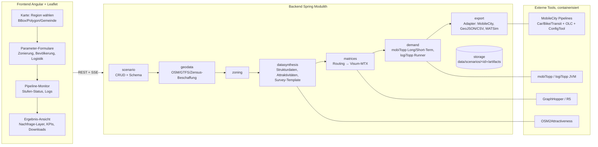

# 03 – Technische Zielarchitektur

Grundidee: simudrive-Muster übernehmen (Angular/Leaflet-Frontend, Spring-Modulith-Backend,
dateibasierter Artefakt-Store, externe Toolchain als Prozesse), aber die Generierung als
**explizite Pipeline aus Stufen mit definierten Artefakten** modellieren – jede Stufe einzeln
ausführbar, cachebar und durch andere Implementierungen ersetzbar.

## Überblick



## Backend-Module (Spring Modulith, analog simudrive)

| Modul | Verantwortung |
|---|---|
| `scenario` | Szenario-Aggregat, REST-API, Validierung, Metadaten-Endpoint für UI-Formulare |
| `geodata` | Rohdaten-Beschaffung mit Cache: OSM-Extrakt (Overpass / Geofabrik-PBF-Clip), GTFS-Feed-Clip, amtliches Zensus-2022-Raster (`CensusPopulationSource`: URL+SHA-256, zentral unter `data/census-cache/`, regionaler 100-m-Filter) |
| `zoning` | Zonen aus OSM-Admin-Grenzen oder H3/Grid; erzeugt `zones.csv`, GeoJSON, MobileCity-District-Artefakte |
| `datasynthesis` | Provider-Slots je Datenebene (echt/öffentlich/synthetisch, siehe 02): Strukturdaten, Attraktivitäten, Survey-Template, Pendler, Depots |
| `matrices` | Zentroid-Bestimmung, Matrix-Berechnung via GraphHopper/R5, Visum-MTX-Export + Matrix-YAMLs |
| `demand` | Generierung der mobiTopp-Projektstruktur (Configs, Wahlmodell-Parameter), Ausführung Long-Term → Short-Term → logiTopp als externe JVM-Prozesse, Normalisierung in `synthesis-travel-demand-v1`, Ergebnis-Ingestion |
| `export` | Export-Adapter-SPI; erste Adapter: GeoJSON/CSV (Visualisierung), MobileCity (siehe unten) |
| `jobs` | Asynchrone Pipeline-Ausführung: Stufengraph, Status, Logs, Abbruch; Fortschritt per SSE/WebSocket ans Frontend |
| `storage` | Dateibasierter Artefakt-Store `data/scenarios/<id>/<stage>/…` mit Manifest (Hash der Eingaben → Cache/Re-Run-Entscheidung) |

**Warum Modulith statt Microservices:** identische Begründung wie simudrive – ein Deployable,
klare Modulgrenzen per Test erzwungen, externe Rechenlast liegt ohnehin in eigenständigen
Prozessen/Containern (GraphHopper, mobiTopp-JVM, Python-Pipelines).

**Polyglott-Strategie:** Alles Geo-/Daten-lastige, das in Python deutlich billiger ist
(OSM-POI-Aggregation, Zensus-Verschnitt, GTFS-Handling), läuft als containerisierte
**Worker-Skripte mit CLI-Kontrakt** (Eingabe-/Ausgabedateien + JSON-Config), orchestriert vom
`jobs`-Modul. Damit lassen sich auch OSM2Attractiveness und später die MobileCity-Python-Pipelines
ohne Umschreiben einhängen.

## Pipeline-Stufen und Artefakte

Jede Stufe: deklarierte Inputs/Outputs, idempotent, Seed-gesteuert reproduzierbar.

| Stufe | Input | Output (Artefakte) |
|---|---|---|
| 1 Region | BBox/Polygon | `region.geojson`, OSM-PBF-Clip, GTFS-Clip, Zensus-Clip |
| 2 Zonierung | Region, Modus, Auflösung | `zones.geojson`, `zones.csv`, `zone-to-community.csv`, `districts.gpkg`+`districts.xlsx` (MC) |
| 3 Strukturdaten | Zonen + Zensus/Synthese | `SynthesisZoneTargets.csv` |
| 4 Attraktivitäten | Zonen + OSM-POIs | `attractivities.csv` |
| 5 Pendler | Zonen + normalisierte Koordinaten-OD oder amtlicher BA-Export `Auspendler Gemeinden` (AGS-Auflösung über BKG VG250); der BA-Export erhält automatisch seinen Wohnort-Randwert aus den versionierten BA-Gemeindedaten 2025. Randwert entscheidet innen/außen, BA verteilt bedingt die Außenziele; ohne veröffentlichten Randwert bleibt die fixierte WORK-Gravitation aktiv | `population/commuters.csv`, `uploads/workplace-margins.csv`, Manifest-/Job-Provenienz |
| 6 Matrizen | Zonen + OSM/GTFS-Routing | `*_TTC/COST/DIS.mtx.bz2`, Matrix-YAMLs |
| 7 Long-Term | 3–6 + Survey-Template | `person/household/activity/car/fixedDestination.csv` |
| 8 Short-Term + logiTopp | 7 + Matrizen + Logistik-Parameter | Raw-Wege-/Touren-CSVs, Zustell-, Abhol- und Paketstatus-Events; native Wege/Legs sowie 15-Minuten-Zonen-/OD-Profile unter `demand/` |
| 9 Export | 8 + Adapterwahl | GeoJSON-Layer, KPI-JSON, MobileCity-Paket, … |

## Szenario-Schema (Generik-Achse 2)

Ein Szenario ist ein versioniertes JSON/YAML-Dokument; die UI-Formulare werden aus einem
Metadaten-Endpoint generiert (simudrive-Muster), sodass neue Parameter ohne Frontend-Änderung
auftauchen. Skizze:

```yaml
scenario:
  name: "KA-Südstadt Lastenrad-Depot"
  seed: 42
  region: { type: polygon, geometry: …, source: map-selection }
  zoning: { mode: grid | epsg3035 | inspire, cellSizeMeters: 700, maxZones: 600 }
  population:
    structuralData: { provider: zensus2022 | synthetic | upload }
    surveyTemplate: { provider: synthetic-default | upload }
    samplingFraction: 0.25        # Anteil, den SyntheSis synthetisiert/exportiert;
                                  # Downstream-Modelle verarbeiten diesen Export vollständig
  logistics:
    parcelDemand: { meanPerPersonWeek: 0.75, stdDev: 0.5, max: 10 }
    destinationShares: { home: 0.8, work: 0.1, packstation: 0.1 }
    returns:                       # experimentell; Details und Stufenplan in docs/06, Abschnitt G
      enabled: false              # experimentell und rückwärtskompatibel
      model: exogenous-share      # MVP: unabhängige Rücksende-Nachfrage, kein Paket-Lebenszyklus
      shareOfPrivateOrders: 0.0   # explizite Szenarioannahme; kein unkalibrierter Produktiv-Default
      pickupShares: { home: 1.0, work: 0.0 }
    depots:                        # auf Karte gesetzt oder provider: osm | random
      - { location: [8.4, 49.0], employees: 25, share: 0.6, fleet: cargo-bike }
    services: [{ name: DHL, share: 0.45 }, …]
  simulation: { days: 7, engine: legacy-logitopp | mobitopp-ng }
  exports: [geojson, mobilecity]
```

Die produktive Rasterzonierung bietet drei bewusst getrennte Varianten: `grid` beginnt an der
jeweiligen Regions-Bbox und erlaubt freie 50-m-Schritte; `epsg3035` rastet europaweit stabil auf
ETRS89-LAEA ein und erlaubt flexible 100-m-Schritte (z. B. 700 m); `inspire` verwendet nur die
amtlichen Stufen 100 m, 1 km und 10 km und vergibt INSPIRE-Zellcodes. `maxZones` ist eine
szenariospezifische Rechenobergrenze (Default 600, harte Schutzgrenze 1.200), da die nachfolgenden
OD-Matrizen quadratisch wachsen. Eine geänderte Zonierung erfordert eine neue Generierung aller
zonenabhängigen Artefakte.

Die experimentelle Retourenlogistik erweitert die bestehenden Stufen „Logistik",
„Short-Term + logiTopp" und „Export"; sie benötigt **keine zusätzliche Pipeline-Stufe**.
Kundenretouren werden als logiTopp-Abholaufträge (`IsPickup=true`) modelliert und in Ergebnissen
strikt von nicht zustellbaren Paketen im Status `RETURNING` getrennt. Das vollständige
Fach-, Daten-, KPI- und Validierungskonzept steht in `docs/06-gta-integration-konzept.md`,
Abschnitt G.

Die externe Prozessgrenze ist seit 2026-07-29 durch zwei gekoppelte Verträge abgesichert:
SyntheSis schreibt `synthesis-parcel-demand-v1` in die Paketkonfiguration und fordert in der
Run-Config `synthesis-logitopp-returns-v1` an. `SimulationRunner` startet nur einen Harness mit
passendem Marker; fehlende oder abweichende Versionen schlagen sichtbar fehl. Der reproduzierbare
GPL-Patch-/Build-Vertrag liegt unter `legacy/logitopp-returns-v1/` und publiziert logiTopp unter
einer eindeutigen Maven-Version. Der SUMO-Adapter schließt jede normale logiTopp-Tour vom letzten
Stopp zurück zum ersten Depot, sofern kein explizites Rückkehr-Leg vorhanden ist. Szenario-API
und Frontend spiegeln den Vertrag mit `enabled=false` als rückwärtskompatiblem Default.
`SimulationResultIngestor` schreibt den additiven Vertrag
`synthesis-logistics-kpis-v1`, trennt Zustellung, Zustell-Rückläufer und Kundenretoure und
verifiziert Richtung, Ziehregel sowie Pickup→Depot-Unload vor der Ergebnisfreigabe.

Die Personenverkehrsnachfrage besitzt seit 2026-07-30 ebenfalls eine explizite interne
Prozessgrenze. Nur `LogitoppDemandAdapter` kennt das Legacy-Schema
`demandsimulationResult.csv`; danach arbeiten KPI-Ingestion, Distanzkalibrierung,
LLM-Auswertung und SUMO mit `TravelDemand`. Ein Weg wird über `(personOid, tripId)`
identifiziert, seine Legs nach `legId` geordnet, seine Distanz über alle Legs summiert und
sein Ursprung/Ziel aus erstem/letztem Leg abgeleitet. Ungültige Pflichtfelder, doppelte oder
lückenhafte Legs und nicht-endliche Werte schlagen sichtbar fehl. Unbekannte Moduscodes
bleiben als Code erhalten und werden kontrolliert als `other` ausgewiesen.

Eine wichtige Provenienzgrenze bleibt explizit: mobiTopp 0.3.580 schreibt je Leg dessen
Modus, Quell-/Zielzone, Distanz und Endzeit, die Koordinaten `fromX…toY` und `tripBegin`
stammen aber aus den umschließenden Aktivitäten. `TravelDemand.Leg` behauptet deshalb keine
Leg-Geometrie oder eigene Leg-Abfahrtszeit; diese Felder werden nur am vollständigen
`PersonTrip` geführt.

Der versionierte Artefaktvertrag `synthesis-travel-demand-v1` liegt unter
`artifacts/demand/`: `person-trips.csv`, `legs.csv`, `zone-flows.csv`, `od-flows.csv` und
`metadata.json`. Die Profile verwenden halboffene 15-Minuten-Intervalle auf der absoluten
Wochenzeit; `Zone.id` wird unverändert verwendet, nicht aus Listenindex oder Matrixspalte
abgeleitet. Es handelt sich um **simulierte Stichprobenwege**, nicht um hochgerechnete
Prognosewerte. Der kanonische Hauptmodus stammt aus `mainMode`; die potenziell intermodale
`tripMode`-Sequenz bleibt separat für Audits erhalten. Die Zeitstempel sind geplante
logiTopp-Zeiten, keine beobachteten Ankunftszeiten. Die Dateien werden deterministisch sortiert
und atomar ersetzt.

## Frontend (Angular, wie simudrive)

1. **Region wählen:** Leaflet + Zeichenwerkzeuge (BBox/Polygon) + Nominatim-Gemeindesuche;
   Anzeige der abgeleiteten Zonierung als Vorschau-Layer (sofortiges Feedback vor dem teuren Lauf).
2. **Parametrieren:** Formulargruppen Bevölkerung / Verkehr / Logistik; Depots als Karten-Marker
   mit Eigenschaften-Popup; Datenqualitäts-Ampel je Ebene (echt/öffentlich/synthetisch).
3. **Ausführen & beobachten:** Pipeline-Graph mit Stufenstatus, Logs, Laufzeit; Wiederaufnahme
   ab fehlgeschlagener Stufe (Artefakt-Cache).
4. **Ergebnisse:** Choroplethen (Wege je Zone, Paketdichte), Depot-Einzugsgebiete, Touren auf der
   Karte, KPI-Kacheln (Wege/Tag, Modal Split, Zustellpakete, Kundenretouren, fehlgeschlagene
   Zustellungen, Tourlängen, Stopps/Tour), Downloads je Artefakt.

## MobileCity-Integration (Export-Adapter)

Zwei getrennte Übergabepunkte:

1. **Netz-Seite (heute schon machbar):** Der Adapter erzeugt die Eingaben der bestehenden
   Network-Pipelines – `districts.gpkg` + `districts.xlsx` (Car/Bike) und reicht den GTFS-Clip
   (Transit) durch; danach laufen die vorhandenen Tools (Car/Bike/Transit → OLC Mapper →
   Config Tool) unverändert als containerisierte Stufen und liefern die Messagepack-Konfiguration
   für die App.
2. **Nachfrage-Seite (zu klären):** In welchem Format MobileCity Nachfrage/Agenten/Pakettouren
   konsumiert, geht aus der ZIP nicht hervor (sie behandelt nur Netze). Kandidat: Wege- und
   Tourenlisten auf die OLC-Knoten-IDs der Netzkonfiguration mappen (Zonen-Zentroid → nächster
   OLC-Knoten). **→ Schnittstellen-Definition mit Takomat/Projektpartnern, früh klären.**

## Deployment

Docker-Compose: `frontend` (nginx), `backend` (Spring Boot), `graphhopper`, optional `r5`,
`worker-python` (Geo-Skripte, OSM2Attractiveness), `worker-mobitopp` (JDK + mobiTopp/logiTopp-Jars),
später `worker-mobilecity` (Python-Pipelines + .NET Config Tool). Artefakte auf gemeinsamem Volume.
