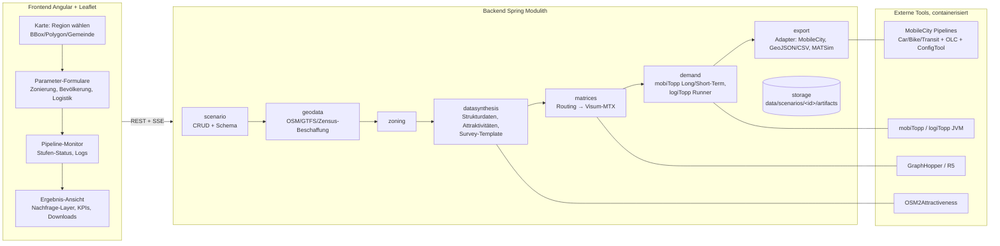
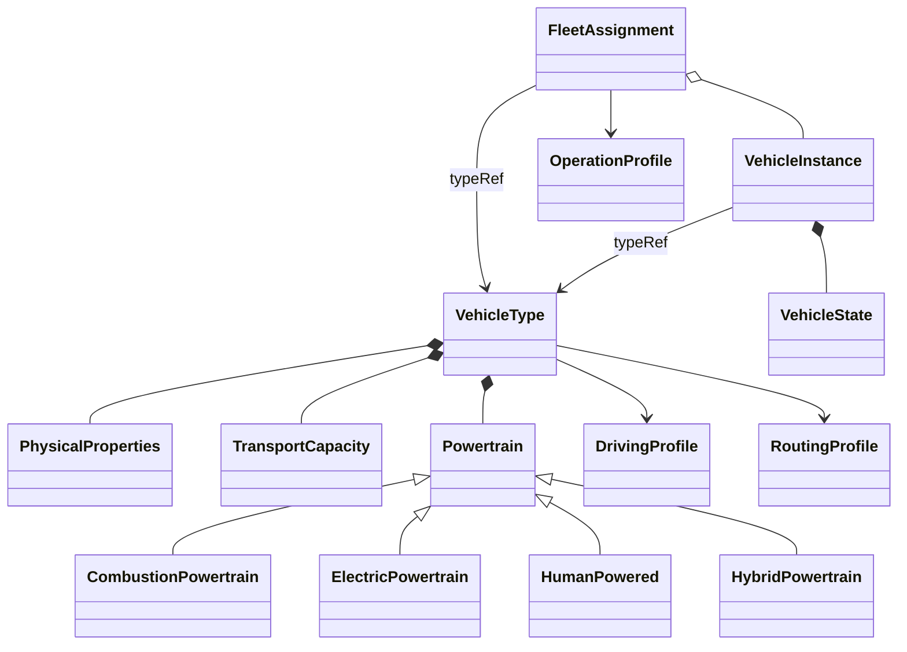

# 03 – Technische Zielarchitektur

Grundidee: simudrive-Muster übernehmen (Angular/Leaflet-Frontend, Spring-Modulith-Backend,
dateibasierter Artefakt-Store, externe Toolchain als Prozesse), aber die Generierung als
**explizite Pipeline aus Stufen mit definierten Artefakten** modellieren – jede Stufe einzeln
ausführbar, cachebar und durch andere Implementierungen ersetzbar.

## Überblick



### Regionale Strukturgewichtung (implementiert, experimentell, 2026-09-21)

Die bestehende Bevölkerungssynthese kann mit `population.useCensusStructure=true`
zusätzlich `CensusStructureSource` und `CensusHouseholdSampler` verwenden. Voraussetzung:
KIT-Haushaltspool. Hashgeprüfte Zensus-2022-Raster liefern Alters- und Haushaltsgrößenanteile
für interne Zonen; der Adapter gewichtet vorhandene Haushalte. Daten- und Fitfehler fallen
mit Diagnose auf die bisherige Ziehung zurück. Die resultierenden Personen sind die
Eingabe für Aktivitäten und MobileCity. Cache unter `data/census-cache/structure/`,
Laufbericht unter `population/census-structure.json`; keine zusätzliche Pipeline-Stufe.
[Schwellen, Bedienung und Grenzen](06-gta-integration-konzept.md#regionale-zensus-struktur).

## Backend-Module (Spring Modulith, analog simudrive)

| Modul | Verantwortung |
|---|---|
| `scenario` | Szenario-Aggregat, REST-API, Validierung, Metadaten-Endpoint für UI-Formulare |
| `geodata` | Rohdaten-Beschaffung mit Cache: OSM-Extrakt (Overpass / Geofabrik-PBF-Clip), GTFS-Feed-Clip, amtliches Zensus-2022-Raster (`CensusPopulationSource`: URL+SHA-256, zentral unter `data/census-cache/`, regionaler 100-m-Filter) |
| `zoning` | Zonen aus OSM-Admin-Grenzen oder H3/Grid; erzeugt `zones.csv`, GeoJSON, MobileCity-District-Artefakte |
| `datasynthesis` | Provider-Slots je Datenebene (echt/öffentlich/synthetisch, siehe 02): Strukturdaten, Attraktivitäten, Survey-Template, Pendler, Depots |
| `matrices` | Zentroid-Bestimmung, Matrix-Berechnung via GraphHopper/R5, Visum-MTX-Export + Matrix-YAMLs |
| `demand` | Generierung der mobiTopp-Projektstruktur (Configs, Wahlmodell-Parameter), Ausführung Long-Term → Short-Term → logiTopp als externe JVM-Prozesse, Normalisierung in `synthesis-travel-demand-v1`, Ergebnis-Ingestion |
| `export` | Export-Adapter-SPI; erste Adapter: GeoJSON/CSV (Visualisierung), MobileCity (siehe unten) |
| `jobs` | Asynchrone Pipeline-Ausführung: Stufengraph, Status, Logs, Abbruch; Fortschritt per SSE/WebSocket ans Frontend |
| `storage` | Dateibasierter Artefakt-Store `data/scenarios/<id>/<stage>/…` mit Manifest (Hash der Eingaben → Cache/Re-Run-Entscheidung) |

**Warum Modulith statt Microservices:** identische Begründung wie simudrive – ein Deployable,
klare Modulgrenzen per Test erzwungen, externe Rechenlast liegt ohnehin in eigenständigen
Prozessen/Containern (GraphHopper, mobiTopp-JVM, Python-Pipelines).

**Polyglott-Strategie:** Alles Geo-/Daten-lastige, das in Python deutlich billiger ist
(OSM-POI-Aggregation, Zensus-Verschnitt, GTFS-Handling), läuft als containerisierte
**Worker-Skripte mit CLI-Kontrakt** (Eingabe-/Ausgabedateien + JSON-Config), orchestriert vom
`jobs`-Modul. Damit lassen sich auch OSM2Attractiveness und später die MobileCity-Python-Pipelines
ohne Umschreiben einhängen.

## Pipeline-Stufen und Artefakte

Jede Stufe: deklarierte Inputs/Outputs, idempotent, Seed-gesteuert reproduzierbar.

| Stufe | Input | Output (Artefakte) |
|---|---|---|
| 1 Region | BBox/Polygon | `region.geojson`, OSM-PBF-Clip, GTFS-Clip, Zensus-Clip |
| 2 Zonierung | Region, Modus, Auflösung | `zones.geojson`, `zones.csv`, `zone-to-community.csv`, `districts.gpkg`+`districts.xlsx` (MC) |
| 3 Strukturdaten | Zonen + Zensus/Synthese | `SynthesisZoneTargets.csv` |
| 4 Attraktivitäten | Zonen + OSM-POIs | `attractivities.csv` |
| 5 Pendler | Zonen + normalisierte Koordinaten-OD oder amtlicher BA-Export `Auspendler Gemeinden` (AGS-Auflösung über BKG VG250); der BA-Export erhält automatisch seinen Wohnort-Randwert aus den versionierten BA-Gemeindedaten 2025. Randwert entscheidet innen/außen, BA verteilt bedingt die Außenziele; ohne veröffentlichten Randwert bleibt die fixierte WORK-Gravitation aktiv. Zusätzlich wird ein noch nicht verhaltenswirksamer OSM-Außenzielkandidat erzeugt und bei vorhandener OD automatisch dagegen bewertet. | `population/commuters.csv`, `uploads/workplace-margins.csv`, `population/external-destination-candidates.json`, Manifest-/Job-Provenienz |
| 6 Matrizen | Zonen + OSM/GTFS-Routing | `*_TTC/COST/DIS.mtx.bz2`, Matrix-YAMLs |
| 7 Long-Term | 3–6 + Survey-Template | `person/household/activity/car/fixedDestination.csv` |
| 8 Short-Term + logiTopp | 7 + Matrizen + Logistik-Parameter | Raw-Wege-/Touren-CSVs, Zustell-, Abhol- und Paketstatus-Events; native Wege/Legs sowie 15-Minuten-Zonen-/OD-Profile unter `demand/` |
| 9 Export | 8 + Adapterwahl | GeoJSON-Layer, KPI-JSON, MobileCity-Paket, … |

## Szenario-Schema (Generik-Achse 2)

Ein Szenario ist ein versioniertes JSON/YAML-Dokument; die UI-Formulare werden aus einem
Metadaten-Endpoint generiert (simudrive-Muster), sodass neue Parameter ohne Frontend-Änderung
auftauchen. Skizze:

```yaml
scenario:
  name: "KA-Südstadt Lastenrad-Depot"
  seed: 42
  region: { type: polygon, geometry: …, source: map-selection }
  zoning: { mode: grid | epsg3035 | inspire, cellSizeMeters: 700, maxZones: 600 }
  population:
    structuralData: { provider: zensus2022 | synthetic | upload }
    surveyTemplate: { provider: synthetic-default | upload }
    samplingFraction: 0.25        # Anteil, den SyntheSis synthetisiert/exportiert;
                                  # Downstream-Modelle verarbeiten diesen Export vollständig
  logistics:
    parcelDemand: { meanPerPersonWeek: 0.75, stdDev: 0.5, max: 10 }
    destinationShares: { home: 0.8, work: 0.1, packstation: 0.1 }
    returns:                       # experimentell; Details und Stufenplan in docs/06, Abschnitt G
      enabled: false              # experimentell und rückwärtskompatibel
      model: exogenous-share      # MVP: unabhängige Rücksende-Nachfrage, kein Paket-Lebenszyklus
      shareOfPrivateOrders: 0.0   # explizite Szenarioannahme; kein unkalibrierter Produktiv-Default
      pickupShares: { home: 1.0, work: 0.0 }
    depots:                        # auf Karte gesetzt oder provider: osm | random
      - { location: [8.4, 49.0], employees: 25, share: 0.6, fleet: cargo-bike }
    services: [{ name: DHL, share: 0.45 }, …]
  simulation: { days: 7, engine: legacy-logitopp | mobitopp-ng }
  exports: [geojson, mobilecity]
```

Die produktive Rasterzonierung bietet drei bewusst getrennte Varianten: `grid` beginnt an der
jeweiligen Regions-Bbox und erlaubt freie 50-m-Schritte; `epsg3035` rastet europaweit stabil auf
ETRS89-LAEA ein und erlaubt flexible 100-m-Schritte (z. B. 700 m); `inspire` verwendet nur die
amtlichen Stufen 100 m, 1 km und 10 km und vergibt INSPIRE-Zellcodes. `maxZones` ist eine
szenariospezifische Rechenobergrenze (Default 600, harte Schutzgrenze 1.200), da die nachfolgenden
OD-Matrizen quadratisch wachsen. Eine geänderte Zonierung erfordert eine neue Generierung aller
zonenabhängigen Artefakte.

Die experimentelle Retourenlogistik erweitert die bestehenden Stufen „Logistik",
„Short-Term + logiTopp" und „Export"; sie benötigt **keine zusätzliche Pipeline-Stufe**.
Kundenretouren werden als logiTopp-Abholaufträge (`IsPickup=true`) modelliert und in Ergebnissen
strikt von nicht zustellbaren Paketen im Status `RETURNING` getrennt. Das vollständige
Fach-, Daten-, KPI- und Validierungskonzept steht in `docs/06-gta-integration-konzept.md`,
Abschnitt G.

Die externe Prozessgrenze ist seit 2026-07-29 durch zwei gekoppelte Verträge abgesichert:
SyntheSis schreibt `synthesis-parcel-demand-v1` in die Paketkonfiguration und fordert in der
Run-Config `synthesis-logitopp-returns-v1` an. `SimulationRunner` startet nur einen Harness mit
passendem Marker; fehlende oder abweichende Versionen schlagen sichtbar fehl. Der reproduzierbare
GPL-Patch-/Build-Vertrag liegt unter `legacy/logitopp-returns-v1/` und publiziert logiTopp unter
einer eindeutigen Maven-Version. Der SUMO-Adapter schließt jede normale logiTopp-Tour vom letzten
Stopp zurück zum ersten Depot, sofern kein explizites Rückkehr-Leg vorhanden ist. Szenario-API
und Frontend spiegeln den Vertrag mit `enabled=false` als rückwärtskompatiblem Default.
`SimulationResultIngestor` schreibt den additiven Vertrag
`synthesis-logistics-kpis-v1`, trennt Zustellung, Zustell-Rückläufer und Kundenretoure und
verifiziert Richtung, Ziehregel sowie Pickup→Depot-Unload vor der Ergebnisfreigabe.

Die Personenverkehrsnachfrage besitzt seit 2026-07-30 ebenfalls eine explizite interne
Prozessgrenze. Nur `LogitoppDemandAdapter` kennt das Legacy-Schema
`demandsimulationResult.csv`; danach arbeiten KPI-Ingestion, Distanzkalibrierung,
LLM-Auswertung und SUMO mit `TravelDemand`. Ein Weg wird über `(personOid, tripId)`
identifiziert, seine Legs nach `legId` geordnet, seine Distanz über alle Legs summiert und
sein Ursprung/Ziel aus erstem/letztem Leg abgeleitet. Ungültige Pflichtfelder, doppelte oder
lückenhafte Legs und nicht-endliche Werte schlagen sichtbar fehl. Unbekannte Moduscodes
bleiben als Code erhalten und werden kontrolliert als `other` ausgewiesen.

Eine wichtige Provenienzgrenze bleibt explizit: mobiTopp 0.3.580 schreibt je Leg dessen
Modus, Quell-/Zielzone, Distanz und Endzeit, die Koordinaten `fromX…toY` und `tripBegin`
stammen aber aus den umschließenden Aktivitäten. `TravelDemand.Leg` behauptet deshalb keine
Leg-Geometrie oder eigene Leg-Abfahrtszeit; diese Felder werden nur am vollständigen
`PersonTrip` geführt.

Der versionierte Artefaktvertrag `synthesis-travel-demand-v1` liegt unter
`artifacts/demand/`: `person-trips.csv`, `legs.csv`, `zone-flows.csv`, `od-flows.csv` und
`metadata.json`. Die Profile verwenden halboffene 15-Minuten-Intervalle auf der absoluten
Wochenzeit; `Zone.id` wird unverändert verwendet, nicht aus Listenindex oder Matrixspalte
abgeleitet. Es handelt sich um **simulierte Stichprobenwege**, nicht um hochgerechnete
Prognosewerte. Der kanonische Hauptmodus stammt aus `mainMode`; die potenziell intermodale
`tripMode`-Sequenz bleibt separat für Audits erhalten. Die Zeitstempel sind geplante
logiTopp-Zeiten, keine beobachteten Ankunftszeiten. Die Dateien werden deterministisch sortiert
und atomar ersetzt.

## Fahrzeugtypen und externe Fahrzeugkonfigurationen — Entwurf (2026-09-17)

**Status: geprüftes Konzept, noch nicht implementiert.** Anlass ist eine externe
`vehicle.json` mit Diesel-Lieferwagen und elektrischem Lastenrad. Ziel ist ein
simulatorunabhängiger Fahrzeugkatalog mit mitgelieferten Standardtypen und importierbaren
Sondertypen, etwa autonomen Leichtfahrzeugen. Ein erfolgreich eingelesener Parameter gilt
erst dann als simulationswirksam, wenn der jeweilige Zielmodell-Adapter ihn nachweislich nutzt.

### Befund zur Beispieldatei und zum aktuellen Code

Die Datei ist syntaktisch gültiges JSON, enthält zwei eindeutige IDs und keine doppelten
Objektschlüssel. Bei beiden Einträgen liegen aktuelle Masse und Volumen der Ladung innerhalb
der angegebenen Ladekapazität. Fachliche Vollständigkeit oder Messwertqualität folgt daraus
nicht. Es fehlen insbesondere Schema-/Typversionen, eindeutige Energieeinheiten und die
Trennung zwischen Typdefinition und Fahrzeugzustand.

| Eingabefeld | Bewertung und vorgesehene Abbildung |
|---|---|
| `id`, `type` | Typ-ID und Fahrzeug-ID unterscheiden. `veh_001` könnte beides meinen. Katalogtypen erhalten stabile `id` + `version`, Instanzen eine eigene `vehicleId` + `typeRef`. `type` wird zur Fahrzeugkategorie. |
| `domain`, `modality` | Einsatzzweck, Fahrzeugkategorie und Verkehrsmodus getrennt halten. Ein Pkw kann Personen oder Güter transportieren; ein autonomes Fahrzeug begründet allein keinen neuen Nachfrage-Modus. |
| `physical_properties.mass_kg` | Leer-/Betriebsmasse, aktuelle Gesamtmasse und maximale Gesamtmasse unterscheiden. Es ist unklar, ob 2.500 kg bzw. 120 kg Fahrer und Ladung bereits enthalten. Keine automatische Übernahme als Leermasse. |
| `max_speed_kmh` | Technische Höchstgeschwindigkeit; Adapter konvertiert bei Bedarf. 130 km/h entsprechen ca. 36,111 m/s, 25 km/h ca. 6,944 m/s. Beim Pedelec eine mögliche Unterstützungsgrenze separat erfassen. |
| `acceleration_mps2` | Technische Fähigkeit oder gewähltes Fahrverhalten klären; Bremsverzögerung, Notbremsverzögerung und Fahrverhaltensprofil ergänzen. |
| `size_m.length/width/height` | Als Abmessungen des Typs übernehmen; positive Werte und Einheiten validieren. |
| `energy_profile.energy_type` | `diesel` ist ein Energieträger, `electric` beschreibt einen Antrieb. Antriebsvariante und Energieträger explizit typisieren. Muskelkraft, elektrische Unterstützung und später Hybrid berücksichtigen. |
| `consumption_per_km` | Ohne Einheit nicht automatisch verwendbar. **Falls** Diesel in l/km und Strom in kWh/km gemeint sind: 0,08 → 8 l/100 km; 0,01 → 10 Wh/km. Mess-/Referenzbedingungen und Bilanzgrenze fehlen. |
| `co2_per_km_g` | Referenzfaktor mit Bilanzgrenze speichern: direkte Emissionen, Energiebereitstellung oder Lebenszyklus; CO₂ von CO₂e unterscheiden. Die 5 g/km beim E-Lastenrad nicht als direkte Abgasemission übernehmen. |
| `noise_db` | Bewertungsverfahren, Gewichtung, Abstand, Geschwindigkeit und Lastzustand fehlen. Zunächst Referenzangabe; kein allgemeingültiger konstanter Simulationsparameter. |
| `logistics.cargo_capacity` | Maximale Nutzlast in kg und nutzbares Ladevolumen in m³ am Typ; später ggf. Paketplätze und Abmessungsgrenzen. |
| `logistics.current_load` | Gehört zum Zustand einer Instanz bzw. ihrer Initialisierung, nicht zum Typ. Ladungswechsel müssen auftrags-/ereignisbezogen bilanziert werden. |
| `delivery_mode`, `loading_time_s`, `unloading_time_s` | Zum Einsatz-/Serviceprofil. Für Zeiten festlegen, ob je Halt, Paket oder kg; die Datei sagt dies nicht. Technik kann Servicezeiten begrenzen, ein Betrieb kann andere Abläufe wählen. |
| `allowed_networks` | Gewünschte Netznutzung als Routingprofil; tatsächliche Kantenfreigaben, Fahrzeugklasse und Abmessungen gemeinsam prüfen. `road`/`bike` reichen als Ausführungsvertrag nicht aus. |
| `parking_behavior` | Betriebs-/Verhaltensprofil mit definierter Semantik; `search` oder `flexible` bewirken ohne entsprechenden Adapter keine Parkplatzsuche. |
| `charging.required`, `charging_speed_kw` | Ladefähigkeit am Antrieb; aktueller Ladebedarf am Fahrzeugzustand bzw. in der Strategie. Maximale Aufnahmeleistung des Fahrzeugs von Stationsleistung unterscheiden; nutzbare Batteriekapazität, Ladeverluste und Anschlüsse ergänzen. |

Der aktuelle Code besitzt noch keinen gemeinsamen konfigurierbaren Fahrzeugtypvertrag:

- `Scenario.Depot.vehicleType` und das Frontend kennen `TRUCK`/`CARGO_BIKE`.
- `PopulationGenerator` zieht gegenwärtig mit Wahrscheinlichkeit 0,08 `bev`, sonst
  `conventional`; Segment, Sitzplatzzahl und Reichweite sind fest vorgegeben.
  `LegacyExportGenerator.convertCars` exportiert anschließend ausdrücklich alle Pkw als
  `conventional`. Eine durchgängig wirksame elektrische Flotte ist damit nicht nachgewiesen.
- Der Depotexport leitet die Fahrzeugzahl aus `employees` ab und schreibt `volume=150.0`
  unabhängig vom Typ. Die Einheit/Semantik dieses Legacy-Feldes muss am Fremdparser bewiesen
  werden, bevor es mit `cargoCapacity.volumeM3` belegt wird.
- `SumoRunner.writeTripsXml` definiert `pkw`, `fahrrad`, `lkw` und `lastenrad` fest;
  Typabmessungen, Batterie und externe Konfigurationen werden dort nicht eingelesen.
- `SumoRunner.Trip` enthält keine dauerhafte Fahrzeug-ID. Jeder Abschnitt bekommt im Export
  eine neue `vN`-ID. Für fahrtenübergreifende Batterie-, Beladungs- und Flottenzustände braucht
  es zuerst eine belastbare Fahrzeug-/Tourzuordnung; die Typklasse allein löst das nicht.
- `SumoRunner.parseEmissions` erkennt Typnamen aktuell nur mit `\w+`; frei gewählte IDs mit
  Bindestrich oder Namensraum würden in dieser Auswertung verloren gehen. Adapter-IDs und
  Rückzuordnung zum Katalog sind Teil des neuen Vertrags.
- Der aktuelle `MobileCityExporter` liefert in `TECCarFleet` den Pkw-Bestand pro Bezirk,
  aber keinen frei konfigurierbaren Antriebsmix.

### Metamodell: Typ, Instanz und Betrieb trennen

Empfohlen wird eine gemeinsame `VehicleType`-Klasse mit komponierten Profilen.
Vererbung bzw. eine geschlossene Variantenfamilie ist beim **Antrieb** sinnvoll; eine
Kreuzhierarchie wie `AutonomousElectricCargoBike` würde unabhängige Eigenschaften koppeln.



| Baustein | Wesentliche Attribute |
|---|---|
| `VehicleType` | `id`, `version`, `name`, `category`, Quellen-/Qualitätsangaben, physische Eigenschaften, Kapazität, Antrieb, Profilreferenzen |
| `PhysicalProperties` | `curbMassKg` mit festgelegter Bezugsdefinition, optional `maxGrossMassKg`, `lengthM`, `widthM`, `heightM`, `maxSpeedKmh`, technische Beschleunigungs-/Bremsgrenzen |
| `TransportCapacity` | `passengerSeats` ohne Bedienperson, `operatorSeats`, `payloadKg`, `cargoVolumeM3`; Personengewicht und Nutzlastgrenze gemeinsam prüfen |
| `CombustionPowertrain` | Kraftstoff, `tankCapacityL`, optionaler Referenzverbrauch `litresPerKm`, Emissionsprofil mit Quellen und Geltungsbereich |
| `ElectricPowertrain` | `usableBatteryCapacityKwh`, `maxChargePowerKw`, Anschlüsse, Lade-/Rekuperationswirkungsgrad, optionaler Referenzverbrauch `kwhPerKm`; `assistanceMode` trennt Vollantrieb von Pedalunterstützung |
| `HumanPowered` / `HybridPowertrain` | Muskelkraft ohne erfundene Batterie; Hybrid als explizite Kombination aus Verbrenner, E-Antrieb und Betriebsstrategie. Hybrid zunächst nur als Ausbaupunkt, nicht als unterstützte Simulation ausweisen. |
| `DrivingProfile` | `controlMode` (menschlich/automatisiert/ferngesteuert), Verhaltensmodell, Zeitabstand, Mindestabstand, gewünschte Beschleunigung/Bremsung; automatisierte Betriebsgrenzen separat beschreiben |
| `RoutingProfile` | Verkehrsklasse, zugelassene Netztypen, zusätzliche Restriktionen; Adapter übersetzt in Modell-/Netzberechtigungen |
| `OperationProfile` | Einsatzart, Lade-/Entladezeitmodell mit Bezugsgröße, Parkstrategie, Lade-/Tankstrategie |
| `FleetAssignment` | Zuordnung zu Depot, Haushalt oder Dienst, referenzierter Typ mit Version, Anzahl bzw. explizite Instanzen; Bestandsanteile für private Pkw als eigene Allokationsregel |
| `VehicleInstance` / `VehicleState` | `vehicleId`, `typeRef`, Betreiber/Standort, aktuelle Ladung, Belegung, Batterieenergie bzw. Tankfüllung, Verfügbarkeit; Anfangszustand getrennt vom späteren Zustand |

Ein Fahrzeugkatalog definiert verfügbare Typen; er erzeugt noch keine Nachfrage oder Flotte.
Szenarien benötigen deshalb zusätzlich Zuordnungen und Mengen/Anteile. Autonome
Leichtfahrzeuge können auf dieser Basis konfiguriert werden; Disposition, Leerfahrten,
Ladeentscheidungen oder ein neues Mobilitätsangebot benötigen jeweils eigene Betriebslogik.
Ein `controlMode=automated` beweist deren Umsetzung nicht.

### Externer Vertrag und Standardkatalog

Vorgeschlagen wird `synthesis-vehicle-configuration-v1`, mit JSON-Schema und fachlicher
Validierung. Die folgende **Strukturskizze** ist noch kein vollständiges Importschema:

```json
{
  "schemaVersion": "synthesis-vehicle-configuration-v1",
  "vehicleTypes": [],
  "catalogRefs": [
    { "id": "standard.pkw.benzin", "version": "1" }
  ],
  "fleetAssignments": [],
  "initialVehicles": []
}
```

`vehicleTypes` enthält vollständige externe Typdefinitionen, `catalogRefs` ausdrücklich
gewählte unveränderliche Standardversionen. Alle `typeRef`-Referenzen aus Zuordnungen und
Instanzen müssen innerhalb dieser aufgelösten Konfiguration existieren. Der kanonische
API-Vertrag verwendet wie `Scenario` camelCase. Ein separater Importadapter kann die
angelieferte snake_case-Datei normalisieren, muss aber fehlende Einheiten, die Massendefinition
und die Typ-/Instanzentscheidung als offene Eingaben melden statt sie still zu erraten.

| Vorgeschlagener Endpunkt | Zweck |
|---|---|
| `GET /api/vehicle-types` | Mitgelieferte Standardtypen mit Version, Quellen, Annahmen und Unterstützung pro Zielmodell auflisten |
| `GET /api/vehicle-configurations/schema` | Versioniertes JSON-Schema für externe Anbieter bereitstellen |
| `POST /api/vehicle-configurations/validate` | Konfiguration ohne Speicherung prüfen; normalisierte Vorschau, Fehlerpfade, Warnungen und Zielmodell-Kompatibilität zurückgeben |
| `GET /api/scenarios/{id}/vehicle-configuration` | Vollständige aktuell gespeicherte Szenario-Konfiguration lesen |
| `PUT /api/scenarios/{id}/vehicle-configuration` | Typen, Referenzen, Zuordnungen und Anfangszustände gemeinsam validieren und atomar als vollständige Konfiguration ersetzen |

Die Studio-Dateiauswahl nutzt denselben JSON-Vertrag wie externe HTTP-Clients. Ungültige
Eingaben verändern keine gespeicherte Konfiguration. Ein vorgeschalteter Validierungsaufruf
ist optional; `PUT` validiert immer selbst. Vorgesehene Antworten: `400` für ungültiges JSON,
`422` für Schema-/Fachfehler, `404` für unbekannte Szenarien und `409` für Versionskonflikte.
Ein ETag mit `If-Match` verhindert verlorene parallele Änderungen. Imports sind zunächst
szenariolokal; sie überschreiben keine globalen Standardtypen.

Mitgelieferte Vorlagen sollten mindestens Pkw Benzin, Pkw Diesel, Pkw elektrisch,
Lieferwagen Diesel/elektrisch, Fahrrad sowie Lastenrad mit/ohne elektrische Unterstützung
abdecken. Autonome Leichtfahrzeuge können als explizit experimentelle Vorlagen ergänzt
werden. Es gibt keinen universell kalibrierten „Standard-Pkw“: jede Vorlage braucht eine
Version und Kennzeichnung ihrer Parameter als gemessen, aus einer Quelle übernommen oder
angenommen. Eine Vorlagenkopie erhält eine neue Typidentität. Unbekannte Werte bleiben
unbekannt; Nullwerte dürfen nicht fehlende Batterie-, Emissions- oder Kapazitätsdaten verdecken.

Zu validieren sind insbesondere eindeutige IDs/Versionen, Referenzen, endliche Zahlen,
positive Abmessungen, nichtnegative Mengen, aktive antriebsspezifische Pflichtfelder,
Ladung ≤ Kapazität, Batterieenergie ≤ nutzbare Kapazität und widerspruchsfreie
Antriebs-/Ladeangaben. Unbekannte Kernfelder werden abgelehnt; Erweiterungen gehören in
einen ausdrücklich definierten Namensraum. Strukturprüfung und physikalische Plausibilität
sind getrennte Prüfungen; widersprüchliche Verbrauchs-/Emissionswerte brauchen Quellenklärung.

Der Start eines Jobs friert die aufgelöste Konfiguration einschließlich Standardversionen
und Inhaltshash ein. Vorgesehene Ablage: Szenarioeingabe unter
`uploads/vehicle-configuration.json`, verwendeter Snapshot und Adapterbericht unter
`artifacts/vehicles/`, Hash/Vertragsversion im Manifest. Ein späterer Katalogwechsel verändert
keinen bereits gestarteten Lauf. Eine deterministische Allokation erhält einen eigenen aus
dem Szenario-Seed abgeleiteten Zufallsstrom, damit sie nicht die Bevölkerungssynthese verändert.

### Wirkung in den Zielmodellen und Umsetzungsschnitt

SUMO kann Typabmessungen, Leermasse, Höchstgeschwindigkeit und Fahrverhaltensparameter
abbilden; Geschwindigkeiten stehen dort in m/s. Breite wirkt beim Standardmodell nur in
der Darstellung und beim Sublane-Modell auch im Fahrverhalten. Technische Maximalbeschleunigung
und gewünschte Beschleunigung sind zu unterscheiden. Diese Grenzen sind im Adapterbericht
auszuweisen. Siehe [SUMO-Fahrzeugtypen](https://sumo.dlr.de/docs/Definition_of_Vehicles,_Vehicle_Types,_and_Routes.html).

Für Batteriestand und Laden benötigt SUMO ein Battery-Device, ein Verbrauchsmodell und
Ladeinfrastruktur; die aktuelle Dokumentation verwendet Wh für Kapazität und W für
Ladeleistung. Der Adapter muss die tatsächlich installierte Version berücksichtigen.
Ein konstantes `kwhPerKm` kann separat eine Referenzbilanz liefern, ersetzt aber kein
fahrzustandsabhängiges Energiemodell. Siehe [SUMO-Elektromodell](https://sumo.dlr.de/docs/Models/Electric.html).
Fahrfolgemodelle wie [ACC](https://sumo.dlr.de/docs/Car-Following-Models/ACC.html) beschreiben
Teilmechanismen; daraus folgt keine vollständige autonome Betriebsführung.

Jeder Adapter meldet pro Parameter und ausgewählter Funktion `applied`, `approximated`,
`metadataOnly` oder `unsupported`, jeweils mit Begründung. Nicht unterstützte angeforderte
Simulationsfunktionen blockieren die Ausführung; reine Katalogmetadaten dürfen gespeichert
bleiben. Eine Näherung erfordert eine explizite Szenarioentscheidung und erscheint im
Ergebnisbericht. Diesel- und Elektrofahrzeuge dürfen insbesondere nicht still gleichgesetzt
werden. Vorhandene Szenarien ohne neue Konfiguration behalten zunächst ihr bisheriges Verhalten.

1. **Katalog und Import:** Typ-/Profilklassen, JSON-Schema, Standardversionen, Validierung,
   API und UI-Vorschau; Frontend-Vertrag parallel spiegeln. Speicherung allein als solche
   kennzeichnen, noch keine simulierte Wirkung behaupten.
2. **Durchgängige Typzuordnung:** Typreferenzen bei Population, Depot-/Flottenerzeugung,
   Legacy-Export, Tourergebnis und SUMO erhalten. Eindeutige dauerhafte Depot-/Fahrzeug-IDs
   ergänzen, wo sie fehlen. Die Legacy-Parser einschließlich Kapazitäts- und BEV-Format
   zuerst am lokalen Fremdcode prüfen; Änderungen am GPL-Tool über den versionierten
   Patch-/Build-Vertrag statt durch unversionierte Eingriffe in `validation/`.
3. **Verkehrsparameter:** Konfigurierbare SUMO-Typen einschließlich ID-Rückzuordnung,
   Routingberechtigungen und Emissionsauswertung. Nachweisen, dass eine gezielte Änderung
   etwa an Länge/Höchstgeschwindigkeit tatsächlich im Routing und Lauf ankommt.
4. **Zustand und Betrieb:** Durchgehende Fahrzeugidentität über Fahrten/Stopps, Batterie,
   Laden, Beladung und autonome Betriebsstrategie als getrennt nachgewiesene Ausbaustufen.
   Zuerst vollständige kleine Prozesskette erproben; neue experimentelle Laufzeitfähigkeit
   bleibt bis zur Abnahme ausgeschaltet.

Abnahme: Import→Persistierung→Export erhält Werte und Einheiten; ungültiger Import lässt
den Vorgänger unverändert; gleiche Konfiguration/Seeds liefern gleiche Typzuordnung;
gemischte Flotten verlieren keine Typidentität; unbekannte Zielmodellfähigkeiten werden
sichtbar zurückgewiesen. Ein Batterietest muss mindestens zwei Abschnitte desselben Fahrzeugs
umfassen, damit ein irrtümlicher Reset am zweiten Abschnitt auffällt. Bestandsregression,
Backend-Suite und Frontend-Tests/AOT-Build ergänzen diese Wirkungsnachweise.

## Frontend (Angular, wie simudrive)

1. **Region wählen:** Leaflet + Zeichenwerkzeuge (BBox/Polygon) + Nominatim-Gemeindesuche;
   Anzeige der abgeleiteten Zonierung als Vorschau-Layer (sofortiges Feedback vor dem teuren Lauf).
2. **Parametrieren:** Formulargruppen Bevölkerung / Verkehr / Logistik; Depots als Karten-Marker
   mit Eigenschaften-Popup; Datenqualitäts-Ampel je Ebene (echt/öffentlich/synthetisch).
3. **Ausführen & beobachten:** Pipeline-Graph mit Stufenstatus, Logs, Laufzeit; Wiederaufnahme
   ab fehlgeschlagener Stufe (Artefakt-Cache).
4. **Ergebnisse:** Choroplethen (Wege je Zone, Paketdichte), Depot-Einzugsgebiete, Touren auf der
   Karte, KPI-Kacheln (Wege/Tag, Modal Split, Zustellpakete, Kundenretouren, fehlgeschlagene
   Zustellungen, Tourlängen, Stopps/Tour), Downloads je Artefakt.

## MobileCity-Integration (Export-Adapter)

**Stand 2026-09-22:** Die Übergabe erfolgt von SyntheSis nach MobileCity als aggregierte
District-Tabellen und Netze. Der vorhandene Export liefert einen Teilbeitrag oder ergänzt
eine vorbereitete TRAMIGO-Vorlage oder erzeugt ein eigenständiges Regionalpaket mit
eigenen Districts und aus OD-Matrizen abgeleiteten Verbindungsnetzen. KBA/BKG liefert
optional private BEV-Anteile, Zensus-Struktur die Populationsgewichtung. Quellen,
Modellannahmen und Hashes werden mit dem Paket gespeichert. `data-inventory.json` hält je
Bereich Status, Auflösungsweg, Abdeckung und wirksamen Wert fest; gebietsbezogene BKG- und
weitere verfügbare Quellantworten werden als Lauf-Snapshots kopiert. Einzelwege und
Logistiktouren haben darin noch keinen bestätigten Zielvertrag. Das Transitnetz wird im
Regionalmodus aus einem Volltages-GTFS erzeugt. Der Java-Adapter
wählt deterministisch einen repräsentativen Mittwoch, mappt die etablierte Route-Type-
Kodierung der mitgelieferten Network Pipeline, bildet Fahrzeiten/Frequenzen und GTFS-Transfers
ab und verbindet jeden District über einen abgeleiteten Fußzugang mit der größten
Servicekomponente. MobileCity arbeitet intern mit ungerichteten Kanten; deshalb wird je Kante
die größere der beiden Richtungsfrequenzen exportiert. Fehlt ein Feed, ist der synthetische
Matrix-Fallback nur bei gesetzter Szenariofreigabe zulässig.

Öffentliche Ladeinfrastruktur wird in einem eigenen Quellenadapter vor dem Schreiben der
Zieltabellen aufgelöst. `MobileCityChargingSource` liest den hashgeprüften BNetzA-Snapshot
vom 01.09.2026, ordnet die Koordinaten mit den tatsächlichen District-Geometrien zu und
aggregiert die veröffentlichte Spalte `Anzahl Ladepunkte`. `REGchargers` enthält damit
Ladepunkte, nicht Standorte oder einzelne Steckertypen. Inbetriebnahmejahre liefern eine
kumulative, als Untergrenze gekennzeichnete Historie der im Snapshot noch geführten Anlagen.
Nach dem letzten beobachteten Jahr bleiben Zellen leer, sodass MobileCity seinen eigenen
Ausbaupfad verwendet. Alternativ kann der Nutzer eine Ladepunktzahl je 1.000 Einwohner als
Annahme oder Fallback angeben. Quellmetadaten und der regionale Ausschnitt liegen in
`charging-provenance.json` und `charging-points.csv`.

Carsharing wird mangels einer kleinräumig vollständigen, allgemein nutzbaren Quelle als
explizite Szenarioannahme modelliert. `carsharingVehiclesPer1000` wird anhand der erzeugten
District-Bevölkerung auf `carsharing.stock.total` verteilt; `carsharingMemberShare` wird als
gebietsweite Zahl in `carsharing.member` geschrieben. Beide Werte bleiben über den
Exporthorizont konstant. Leere Eingaben bedeuten die im Dateninventar ausgewiesene
Nullannahme. So kopiert der Regionalexport weder Karlsruher Bestände noch Servicegebiete.

Umland ist ein eigener, optionaler Szenariovertrag. Manuell aktiviert eine positive
`surroundingPopulation` die Richtungsanker als `districtType=0`. Automatisch erzeugen
`autoSurrounding=true` und `surroundingBufferKm` einen in EPSG:3035 gepufferten Ring um den
Kartenausschnitt, schneiden ihn überlappungsfrei in N/NE/E/SE/S/SW/W/NW und aggregieren
Zensus-2022-Bevölkerung sowie Altersgruppen. Die externen Netzanker liegen im jeweiligen
Sektor; eine manuelle Gesamtsumme skaliert dessen beobachtete Gewichte exakt. Ohne beide
Aktivierungen bleiben die Anker reine Ziele der SyntheSis-Außenbeziehungen. Pkw- und
BEV-Struktur werden weiterhin aus der Binnenbevölkerung extrapoliert und als Annahme
protokolliert. Vier Pflichtanteile für Bildung, Arbeit, Einkauf und Freizeit schreiben den
nativen Vertrag `tripShareToStudyArea`: Wege von Umlandbewohnern in das Untersuchungsgebiet.
Study-Area-Zähler sowie gebietsweite Finanz-, Transit- und Sharing-Größen schließen das
Umland aus. BA-Pendlerdaten dürfen künftig ausschließlich den Arbeitszweck belegen.

**Ausbauziel:** Aus der Kartenauswahl werden regionale Daten automatisch ermittelt und mit
versionierten Modellprofilen sowie gezielten Nutzervorgaben zusammengeführt. Der Export
erhält die aufgelösten Werte einschließlich Quelle, Datenjahr, räumlicher Abdeckung und
Annahmen. Die UI bietet Rücksetzen auf Automatik und kennzeichnet fehlende Werte.
Regions-, Jahres- oder Konfigurationswechsel markieren ein vorhandenes Paket im Studio als
veraltet; laufende Jobs verwenden einen festen Szenariostand. Die optionale Stufe 10
`MobileCity-Validierung` startet nach einem vollständigen Export den echten ConfigTool-Import,
lädt die erzeugten Binärdateien erneut und simuliert den Prüfhorizont. Fehlende lokale
Laufzeit ergibt `SKIPPED`, ein fachlicher oder technischer Prüffehler `FAILED`. Bericht und
Logs liegen getrennt unter `mobilecity-validation/`.

### Offline-Abnahme mit realen Quellen: Rastatt

`scripts/check-mobilecity-rastatt-sources.py --work-dir /private/tmp/mobilecity-rastatt-check`
führt einen reproduzierbaren, opt-in Prüffall für eine kleine Zone in der Rastatter Innenstadt aus.
Benötigt werden die lokal vorbereitete `tramigo-v2`-Profilmappe, das amtliche
Zensus-2022-Bevölkerungsraster und dessen Alters-/Haushaltsarchive, der KVV-GTFS-Feed,
.NET 8 und der MobileCity ConfigTool-Quellstand. Die Pfade lassen sich mit `--help`
anpassen. Das Skript lädt keine Quellen aus dem Netz: Es verwendet KBA- und
BNetzA-Referenzstände aus dem Backend sowie eine festgehaltene BKG-WFS-Antwort
für Rastatt. Damit prüft es die Datenabbildung, aber nicht die heutige Verfügbarkeit
des BKG-Dienstes. Der Ausgabeordner muss neu sein und enthält Eingabe-Hashes,
Quellenstände, Abdeckungen, exportierte Summen, Importpaket, native Logs und
`rastatt-source-report.json`. Fehlende lokale Eingaben beenden den Lauf mit Fehler.
Auch fehlender GTFS-Upload und eine nicht belegbare KBA/BKG-Zuordnung werden
im Java-Prüffall als Fehlerfälle geprüft; es gibt hier keine manuelle BEV-Annahme
und keinen synthetischen ÖV-Fallback.

Referenzlauf vom 25.09.2026: 21 Bevölkerungszellen, 1.639 Einwohner,
21 Alters- und 20 Haushaltszellen mit einer gewichteten Zone, 100 %
BKG-Flächenabdeckung, 6 KVV-Haltestellen im Ausschnitt, 233 geplante
Fahrten am repräsentativen Mittwoch (08.07.2026) und 6 öffentliche
Ladepunkte. Der ConfigTool-Import und die Simulation 2026–2036 bestanden.
Die Quelle für Pkw-Bestände bleibt die synthetische Haushaltsstichprobe;
KBA liefert den BEV-Anteil. Das Modellprofil ist unkalibriert, das Netz
besteht aus aggregierten OD-Verbindungen, und weder Logistik noch eine
Umlandbevölkerung sind in diesem Prüffall modelliert.

Für die gemeindeübergreifende Live-Prüfung:

```bash
python3 scripts/check-mobilecity-rastatt-sources.py --case cross-municipality \
  --work-dir /private/tmp/mobilecity-cross-municipality-neuer-lauf
```

Der Vier-Zonen-Ausschnitt wird über den aktuellen BKG-VG250-WFS abgerufen.
Der Lauf hält dessen unveränderte Antwort samt Zeitstempel und SHA-256 im Paket
und Prüfbericht fest. Je Zone weist der Bericht Zensus-Einwohner und
Strukturauflösung, zugeordnete KBA-Gemeinden und Flächenabdeckung, öffentliche
Ladepunkte, KVV-Haltestellen im Zonenausschnitt und den GTFS-Zugangsknoten aus.
Er fordert volle KBA/BKG-Abdeckung und reale KVV-Halte in jeder Zone. Eine
simulierte Teilantwort nur für Rastatt lässt drei Zonen unbelegt; der Export
bricht dann ohne stillen BEV-Ersatz ab. Der Live-Lauf setzt Netzverfügbarkeit
des BKG-Dienstes voraus und kann bei einer Quellenänderung andere Werte liefern.

Der umgesetzte Stand und die weiteren Arbeitspakete mit Abnahmekriterien stehen im
[MobileCity-Konzept](06-gta-integration-konzept.md#mobilecity-naechste-schritte).
Die GTFS-Netzabbildung, der BNetzA-Ladepunktadapter, die manuelle Carsharing-Modellierung
sowie manuelles und Zensus-basiertes Umland sind umgesetzt. Abnahmen über weitere
Regionstypen, automatische Wegeanteile/Sharing-Quellen und weitere Regionalprofile bleiben
Ausbauziele.

## Deployment

Docker-Compose: `frontend` (nginx), `backend` (Spring Boot), `graphhopper`, optional `r5`,
`worker-python` (Geo-Skripte, OSM2Attractiveness), `worker-mobitopp` (JDK + mobiTopp/logiTopp-Jars),
später `worker-mobilecity` (Python-Pipelines + .NET Config Tool). Artefakte auf gemeinsamem Volume.

## Optionaler Straßenroutenadapter (07.10.2026)

`population.sharedRoadRoutes=false` ergänzt die bestehende SUMO-Stufe, ohne
eine zusätzliche Stufe oder parallele Generierung einzuführen. Der initiale
Matrizenpfad bleibt zonal. Innerhalb der optionalen SUMO-Ausführung berechnet
`RoutingEngine.roadPath` konkrete Wege auf demselben OSM-Snapshot;
`SumoRoadRouteMapper` übersetzt deren OSM-Bezüge auf zulässige gerichtete
SUMO-Kanten. `SharedRoadRoutes` schreibt Herkunft, Zuordnungen, Ersatzrouten
und Zeiten und prüft die Straßenfolge nach dem Router. KIT-Kerne bleiben
unverändert; das Routing innerhalb ihrer Tourplanung wird hiermit nicht ersetzt.
[Artefaktvertrag und Grenzen](20-erweiterungen-routenkonsistenz-und-zeitfeedback.md#experimenteller-adapter-umgesetzt-07102026).
