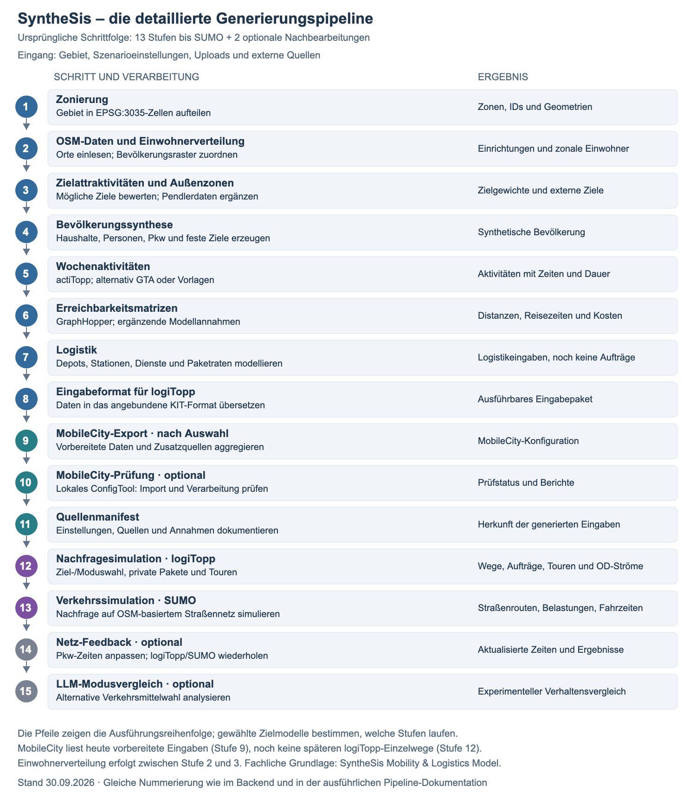
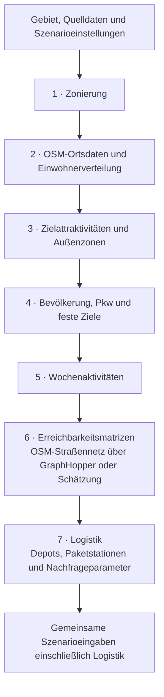
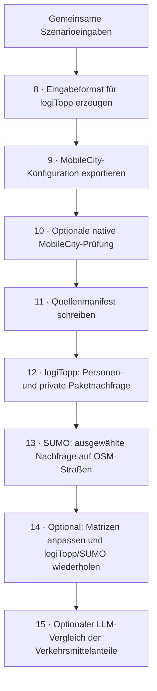

# Die aktuelle Modellierungs- und Generierungspipeline von SyntheSis

**Stand: 29. September 2026, einschließlich der lokalen Änderungen an Zonierung und Bevölkerungszuordnung.** Diese Übersicht beschreibt die implementierte Verarbeitung. Sie unterscheidet Quelldaten, daraus abgeleitete Modellannahmen, erzeugte Eingabedateien und Simulationsergebnisse. Die ältere technische Zielarchitektur beschreibt teilweise weitergehende Möglichkeiten.

## 1. Das Gesamtbild

SyntheSis erzeugt aus einem Kartenausschnitt ein räumliches Bevölkerungs- und Mobilitätsmodell. OSM liefert Orte und Straßen; Bevölkerungsdaten bestimmen, wie viele Menschen dort modelliert werden. Daraus entstehen Haushalte, Personen, Aktivitätenpläne, Erreichbarkeiten und Logistikparameter.

Diese gemeinsame Grundlage bedient drei unterschiedliche Verwendungen:

- **logiTopp:** simuliert Personenverkehr und private Paketlogistik auf Basis individueller Personen und ihrer Aktivitäten. Betriebliche Paketnachfrage ist in unserer aktuellen Anbindung deaktiviert.
- **SUMO:** überträgt ausgewählte Wege und Lieferfahrten auf ein physisches Straßennetz und simuliert den Verkehrsablauf.
- **MobileCity:** erhält ein aggregiertes regionales Modell mit Bevölkerung, Wegehäufigkeiten, Attraktivitäten, Netzen und Technologieparametern. Dieser Export entsteht bereits **vor** dem logiTopp-Lauf.

### Ablaufgrafik für die Präsentation



[Skalierbare SVG-Grafik](figures/synthesis-detailablauf.svg) · [PNG für Folien](figures/synthesis-detailablauf.png) · [Folienvorschläge und Vergleich mit der früheren Grafik](12-praesentationsleitfaden.md)

Die Grafik verwendet wieder die ursprüngliche technische Nummerierung: 13 Schritte bis SUMO und zwei optionale Nachbearbeitungen. [Erläuterung und Wochenplanbeispiel](14-detailablauf-und-wochenplan.md).

### Gemeinsame Generierung in tatsächlicher Reihenfolge



Diese gemeinsame Grundlage heißt **SyntheSis Mobility & Logistics Model** (Namensentscheidung vom 29. September 2026). Heute ist sie auf Konfiguration, Verarbeitungskontext und Artefakte verteilt; ein durchgängig versionierter gemeinsamer Datenvertrag ist noch ein Umsetzungsschritt. Auch alle Logistikannahmen gehören hinein. Simulationsergebnisse ergänzen das Modell später als einem konkreten Lauf zugeordnete Ergebnisse.

### Aktuelle Export- und Ausführungsreihenfolge



Die Pfeile im zweiten Diagramm zeigen die **Reihenfolge**, keine Abhängigkeit von sämtlichen vorherigen Zielmodellen. Nicht gewählte bzw. nicht verfügbare Ausführungsstufen werden gekennzeichnet und gegebenenfalls übersprungen. Insbesondere benötigt logiTopp keinen MobileCity-Export.

**MobileCity: kurzfristiges Ziel und offene Schnittstelle.** Zuerst sollen möglichst gute und nachvollziehbare Eingaben im vorhandenen Zielformat entstehen. Identische Simulationsergebnisse mit SyntheSis sind keine Anforderung. Ein späterer Adapter kann logiTopp-Wege zu MobileCity-Kennzahlen aggregieren. Ob MobileCity auch eine vollständige individuelle oder zeitabhängige Nachfrage übernehmen kann und selbst mobiTopp/logiTopp nutzt, ist mit dessen Entwicklern zu klären. Heute wird keine solche Nachfrageübergabe ausgeführt.

## 2. Was sind die initialen Artefakte?

### Drei verschiedene Bedeutungen von „OSM-Karte“

| Eingang | Verwendung | Warum getrennt? |
|---|---|---|
| Sichtbare OSM-Kartenkacheln im Studio | Orientierung und Auswahl des Untersuchungsgebiets | Die Kartenbilder werden nicht analysiert. Aus ihnen werden weder Straßen noch Gebäude extrahiert. |
| Strukturierte OSM-Ortsdaten: `osm-data.json` | Geschäfte, Schulen, Arbeitsorte, Paketstationen und Siedlungen | Tags wie `shop=supermarket` liefern Anhaltspunkte für mögliche Aktivitäten und Standorte. |
| OSM-Straßennetz: `road-network.osm` | GraphHopper-Routing und später SUMO-Netzaufbau | Für befahrbare Verbindungen werden Knoten, Straßenverläufe und Verkehrsregeln benötigt. Eine POI-Liste reicht dafür nicht. |

Das Untersuchungsgebiet ist derzeit ein **rechteckiger Ausschnitt mit minimalem und maximalem Längen- und Breitengrad**. Verwaltungsgrenzen werden unter anderem für die Zuordnung regionaler Fahrzeugdaten genutzt; sie ersetzen nicht automatisch die Verkehrszellen.

### Weitere Eingänge und ihr fachlicher Zweck

| Eingang | Wann genutzt? | Was er tatsächlich beiträgt |
|---|---|---|
| `scenario.json`: Gebiet, Bezugsjahr, Zellgröße, Zielmodelle, Zufallsstartwert und Modellparameter | Durchgehend | Definiert den konkreten Modelllauf und seine Annahmen. |
| Optional `uploads/population-grid.csv`; sonst Zensus-2022-Bevölkerungsraster | Zwischen Stufe 2 und 3 | Einwohnerzahl und räumliche Verteilung. Eine manuelle Gesamtzahl hat Vorrang; das Raster kann trotzdem die räumlichen Anteile liefern. |
| Mitgelieferter KIT-Haushaltspool | Stufe 4 | Synthetischer Pool aus dem Marne-Beispiel mit Haushaltsgröße, Alter und Geschlecht; nicht deutschlandweit repräsentativ. Weitere Merkmale werden modelliert. |
| Optionale Zensus-Alters- und Haushaltsstrukturen | Stufe 4, wenn aktiviert | Gewichtet die Auswahl ganzer Haushalte regional nach. Liefert keine individuellen Tagesabläufe. |
| Optionale Pendlerdateien: `commuters.csv`, `workplace-margins.csv` | Stufen 3–4 | Verbessert Arbeitszielverteilung und Auspendleranteile. Ohne passende Daten greifen Modellannahmen. |
| actiTopp; alternativ GTA mit lokalem Sprachmodell oder interne Vorlagen | Stufe 5 | Wochenpläne: welche Aktivitäten eine Person wann und wie lange ausübt. |
| GTFS-Fahrplan, hochgeladen oder aus konfiguriertem regionalem Feed | MobileCity und SUMO | Haltestellen, Linienverbindungen und Fahrten. Wird aktuell nicht für die gemeinsame ÖPNV-Reisezeitmatrix verwendet. |
| KBA-Fahrzeugdaten und BKG-Gemeindegrenzen | Regionaler MobileCity-Export, wenn aktiviert | Überträgt regionale BEV-Anteile auf die Modellzonen. Der Pkw-Gesamtbestand kommt weiterhin aus dem Bevölkerungsmodell. |
| BNetzA-Ladepunktdaten | Regionaler MobileCity-Export, wenn aktiviert | Räumliche Zuordnung öffentlich registrierter Ladepunkte. Private Ladepunkte sind damit nicht vollständig erfasst. |
| MobileCity-Parameterprofil bzw. Vorlage | Vollständiger MobileCity-Export | Ergänzt erforderliche technische, ökonomische und weitere Modellparameter, die OSM und Zensus nicht liefern. |
| Nutzerannahmen zu Pkw, Paketen, Sharing, Umland und weiteren Größen | Je nach Modellzweig | Ergänzt fehlende Beobachtungen oder definiert ausdrücklich ein alternatives Szenario. |

Uploads und gespeicherte Quellenstände ermöglichen Wiederholungen ohne erneuten Liveabruf. OSM-Ortsdaten verwenden zuerst einen Upload, danach gegebenenfalls Overpass. Beim Straßennetz gilt: Upload → konfigurierte Serverdatei → Liveabruf. Fehlende Daten können je nach Quelle zu einem dokumentierten Ersatzmodell oder zum Abbruch führen; ein ausdrücklich hochgeladener, ungültiger Datensatz wird nicht einfach still ersetzt.

## 3. Die gemeinsame Generierung: Stufen 1–8

Alle acht Stufen werden derzeit auch dann durchlaufen, wenn nur MobileCity als Ziel gewählt ist. Nicht jedes dabei erzeugte Artefakt wird von jedem Zielmodell verwendet.

| Stufe | Verarbeitung und Begründung | Ergebnis unter `artifacts/` | Zuständige Komponente |
|---|---|---|---|
| **1 · Zonierung** | Zerlegt den Ausschnitt in Verkehrszellen. Einheitliche IDs verbinden Bevölkerung, Ziele und Matrizen. Neue Szenarien nutzen ein europäisch ausgerichtetes EPSG:3035-Raster. Bestehende Raster bleiben erhalten und können ausdrücklich umgestellt werden; INSPIRE ist eine Quelldatenkonvention im Hintergrund. | Zonen zunächst im Speicher; Dateien folgen in Stufe 3. | `GridZoning`, `InspireGridZoning` |
| **2 · OSM-Daten** | Liest Einrichtungen und Siedlungen. Diese liefern räumliche Anhaltspunkte für Aktivitäten, Logistik und gegebenenfalls Bevölkerung. | Bei Liveabruf `osm-data.json`; bei Upload bleibt die Quelle in `uploads/`. | `OverpassClient`, `OsmDataSnapshot` |
| **Zwischen 2 und 3** | Bestimmt Einwohnerzahl und verteilt sie auf Zellen. Das muss vor der Attraktivitätsberechnung passieren, weil etwa private Besuche von der Wohnbevölkerung abhängen. | Einwohnerzahlen an den Zonen; Herkunft später im Manifest. | `preparePopulationDistribution`, `CensusPopulationSource`, `PopulationGenerator` |
| **3 · Attraktivitäten** | Übersetzt OSM-Tags und Bevölkerung in Gewichte für zwölf Aktivitätsarten. Ergänzt gegebenenfalls Außenzonen und ordnet Pendlerbeziehungen zu. | `zone-repository/zones.csv`, `attractivities.csv`, `zones.geojson`; optional `population/commuters.csv`. | `AttractivityCalculator`, Orchestrierung in `GenerationService` |
| **4 · Bevölkerungssynthese** | Erzeugt Haushalte, Personen, Pkw sowie feste Arbeits- und Bildungsziele. Zielwahl nutzt Attraktivität, Entfernung und gegebenenfalls Pendlerdaten. | `population/household.csv`, `person.csv`, `car.csv`, `fixedDestination.csv`, `fixedDestination-logitopp.csv`; optional `census-structure.json`. | `PopulationGenerator`, optional `CensusHouseholdSampler` |
| **5 · Aktivitätenpläne** | Erzeugt eine zeitliche Wochenstruktur je Person. Verkehr entsteht später aus den Ortswechseln zwischen Aktivitäten. | `population/activity.csv`; je nach Quelle zusätzliche actiTopp- oder GTA-Dateien. | actiTopp-Anbindung, GTA-Anbindung oder Vorlagengenerator |
| **6 · Matrizen** | Berechnet Entfernungen, Reisezeiten und Kosten zwischen Zonen. Sie beschreiben, wie aufwendig ein Ziel mit einem Verkehrsmittel erreichbar ist. | `matrix/`: komprimierte Distanz-, Zeit- und Kostenmatrizen sowie Konfigurationsdateien. | `MatrixGenerator`, GraphHopper-Anbindung |
| **7 · Logistik** | Legt Paketdienstanteile, Depots, Paketstationen und Nachfrageparameter fest. Bereitet die spätere Erzeugung und Zustellung von Paketen vor. | `logistics/distribution-centers.csv`, `delivery-services.csv`, `packstations.csv`, `parcel-demand-config.yaml` und Wahlmodellparameter. | `LogisticsGenerator` |
| **8 · Legacy-Export** | Passt Dateiformate, IDs und Matrizen an die verwendete mobiTopp/logiTopp-Laufzeit an. Das ist eine Formatübersetzung. | `legacy/zone-repository/`, `zoneproperties/`, `demand-data/`, `matrices/`, `logistics/`. | `LegacyExportGenerator` |

### Warum sind Verkehrszellen nötig?

Das Modell muss viele Beziehungen zwischen Wohnorten und Zielen berechnen. Zellen bündeln räumliche Detailinformationen zu handhabbaren Einheiten. Die Matrizen wachsen quadratisch: 600 Zellen ergeben 360.000 Zonenpaare je Matrix, 1.200 Zellen bereits 1.440.000. Standardmäßig wird deshalb auf höchstens 600 Zellen gezielt; die harte Obergrenze liegt bei 1.200. Bei Bedarf wird das Raster vergröbert.

Die Kehrseite: Wege innerhalb einer Zelle verlieren räumliche Detailtiefe. Ein sehr grobes Raster eignet sich weniger für kurze Fuß- und Radwege.

### Beobachtete Bevölkerung und modellierte Haushalte

Für die **Gesamtzahl** gilt die Rangfolge:

> Manuelle Vorgabe → nutzbares hochgeladenes Raster → Zensus → OSM-Siedlungsschätzung → Fläche × angenommene Dichte.

Für die **räumliche Verteilung** werden möglichst Rasterdaten genutzt, andernfalls OSM-Siedlungen, POI-Dichte oder eine weitgehend gleichmäßige Verteilung. Rasterbasierte Gewichte erhalten **keinen zusätzlichen gleichmäßigen 3-%-Sockel mehr**. Die bisherige Glättung bleibt bei anderen Gewichtsquellen erhalten. Eine manuell gesetzte Gesamtbevölkerung skaliert auch Rastergewichte auf diese Vorgabe.

### Ein Zonensystem, unterschiedliche Datenquellen

In der Oberfläche wählt der Nutzer **Gebiet und räumliche Auflösung**, nicht mehr drei unterschiedliche Rastertypen. Neue Szenarien verwenden EPSG:3035. Ein vorhandenes Szenario wechselt sein Raster erst über die ausdrückliche Umstellung; danach müssen seine Artefakte neu generiert werden. Das Zonenlimit liegt in einem aufklappbaren Abschnitt.

**EPSG:3035 ist das Koordinatensystem; INSPIRE bezeichnet hier das standardisierte Quellraster mit Zelllage und Kennungen.** INSPIRE-Daten können deshalb direkt in EPSG:3035-Modellzonen eingeordnet werden. Zur Anzeige auf der Karte werden Koordinaten umgerechnet.

| Quelle und Modellauflösung | Umsetzung | Aussage |
|---|---|---|
| 100-m-Quelldaten → 500-m-Modellzonen | Bevölkerung aus 25 vollständig enthaltenen, passend ausgerichteten Quellzellen addieren | Feinere Beobachtungen werden zusammengefasst. |
| 1-km-Quelldaten → 500-m-Modellzonen | Gleichmäßig verteilen: 100 Einwohner → vier Zellen mit je 25 | Modellannahme gleichmäßiger Dichte innerhalb der Quellzelle. |
| 1-km-Quelldaten → 100-m-Modellzonen | 100 Einwohner → 100 Zellen mit je einem Einwohner | Zusätzliche räumliche Auflösung, keine zusätzliche gemessene Genauigkeit. |
| Größere Quellzelle schneidet die Gebietsgrenze | Anteile anhand der innerhalb des Gebiets liegenden 100-m-Teilzellmittelpunkte übernehmen | Randanteile sind in 100-m-Auflösung angenähert. |
| Allgemeine Datei mit Breiten-/Längengrad ohne bekannte Zellgröße | Als Punktdaten der passenden Modellzone zuordnen | Eine Zellfläche wird nicht erfunden. |

Technisch zerlegt der Parser bekannte grobe Quellzellen von 1–10 km in gleich gewichtete 100-m-Zuordnungspunkte. Die Größe stammt aus der Rasterkennung oder aus `x_mp_1km`-Spalten. Bruchteile bleiben bis zur Rundung der Gesamtzahl und der späteren Erzeugung einzelner Personen erhalten: 101 Einwohner ergeben zunächst vier Gewichte von 25,25, nicht viermal 25. Diese Regel betrifft **Bevölkerungszahlen**; sie ist kein allgemeines Verfahren zum blinden Verteilen aller statistischen Kennzahlen.

Altersanteile müssen beispielsweise aus Gruppenzahlen berechnet werden, nicht durch Addieren von Prozenten. Vertrauliche oder fehlende Werte sind keine beobachtete Null; der Parser verwirft nicht nutzbare Werte, ersetzt sie aber nicht durch nachgewiesene Bevölkerungszahlen. Eine vollständige Abdeckungsprüfung bleibt eine Aufgabe der Qualitätskontrolle.

Aus den Zonenzahlen werden Haushalte und Personen gezogen. Der gebündelte KIT-Pool stammt aus einem Marne-Beispiel mit synthetisch rekonstruiertem Ausgangs-Seed; er ist kein repräsentativer deutschlandweiter Mikrodatenbestand. Wohnkoordinaten werden derzeit zufällig innerhalb der Zonenbegrenzung gesetzt, ohne durchgehende Prüfung auf Wohngebäude. Dadurch sind auch ungeeignete Flächen möglich. Beschlossenes Ziel sind plausible Gebäudepunkte mit geeignetem Straßenzugang; echte Adressen oder detaillierte Eingänge sind für die zonale Simulation nicht nötig. Diese Gebäudeverankerung ist noch nicht implementiert. Alter und Haushaltsstruktur können mit aktivierter Zensus-Strukturanpassung regional besser getroffen werden. Diese optionale Anpassung ist standardmäßig ausgeschaltet; Ersatzverfahren und Anpassungsgüte werden protokolliert.

Feste Arbeits- und Bildungsziele entstehen bereits in Stufe 4. Zu diesem Zeitpunkt liegen die späteren gerouteten Reisezeitmatrizen noch nicht vor. Ihre erste Zuweisung beruht daher auf räumlichen Gewichten und Entfernung, nicht auf einer vollständigen Fahrplan- oder Stauauswertung.

### Beispiel: Ein Supermarkt wird zur Zielattraktivität

Ein OSM-Eintrag `shop=supermarket` erhöht in seiner Zone derzeit die Attraktivität für tägliches Einkaufen um **25** und für Arbeit um **8**. Das sind relative Modellgewichte. Sie bedeuten weder 25 reale Kunden noch acht nachgewiesene Arbeitsplätze.

Die zwölf Aktivitätsarten sind die Kategorien der aktuellen SyntheSis-Attraktivitätsberechnung und ihrer KIT-Anbindung, keine naturgegebene Anzahl aller menschlichen Tätigkeiten.

Eine Zone mit vielen passenden Einrichtungen wird dadurch wahrscheinlicher als Einkaufsziel. Ob eine konkrete Person dort einkauft, zu welcher Uhrzeit und mit welchem Verkehrsmittel, entscheiden erst die späteren Verhaltensmodelle.

### Straßennetz, Matrix und Route: drei verschiedene Dinge

| Begriff | Inhalt | Verwendung |
|---|---|---|
| Straßennetz | Knoten, Straßenabschnitte, Richtungen und Zugangsregeln | GraphHopper sucht darin mögliche Verbindungen; SUMO baut daraus sein eigenes Netzformat. |
| Zonenmatrix | Ein Zahlenwert pro Zonenpaar, z. B. 12 Minuten von A nach B | Ziel- und Verkehrsmittelwahl benötigen viele schnelle Erreichbarkeitsabfragen. |
| Konkrete Route | Geordnete Straßenabschnitte zwischen tatsächlichem Start und Ziel | Straßenbelastung, Fahrzeugbewegung und Zustelltouren auf dem Netz. |

GraphHopper arbeitet bereits auf Straßen. Die aktuelle Schnittstelle gibt aber nur **Entfernung und Zeit** zurück; die Straßenfolge wird darin nicht weitergegeben. Außerdem repräsentiert eine Route zwischen Zonenschwerpunkten nicht jede Haustür-zu-Haustür-Verbindung derselben Zonen.

GraphHopper nutzt das gewählte Profil und OSM-Eigenschaften wie Straßentyp, Geschwindigkeitsbegrenzung und Zugangsregeln. Daraus entstehen modellierte Reisezeiten, keine gemessenen aktuellen Stauzeiten. Angebunden sind Pkw-, Fahrrad- und Fußprofile. Lieferfahrzeuge werden im heutigen Modell weitgehend über Pkw-Zeiten behandelt; das ist kein eigenständiges Transporter-/Lkw-Routing mit zuverlässig geprüften Höhen-, Gewichts- und Zufahrtsgrenzen.

**Heutige Ersatzverfahren:** Fehlt die Routingberechnung, scheitert der Netzimport oder ist ein Zonenpaar nicht erreichbar, setzt der Matrixgenerator Näherungen ein. Für Pkw: Entfernung = Luftlinie × 1,35; Zeit = Entfernung / 28 km/h + 3 Minuten. Diese Konstanten haben im Code keinen belastbaren regionalen Kalibrierungsnachweis. Binnen- und Außenzonenwege werden ebenfalls angenähert.

**Beschlossene Änderung, noch offen:** Ein netzbasierter Lauf braucht ein gültiges Netz. Bei fehlenden Verbindungen zuerst Netzabdeckung, Anschluss und erlaubte Alternativen prüfen; tatsächlich unerreichbare Ziele nicht durch erfundene Luftlinienverbindungen erreichbar machen. Eine sinnvolle Alternative kann ein anderer zulässiger Weg oder ein anderes Ziel sein. Diese strengere Behandlung ist noch nicht implementiert.

**ÖPNV heute:** Pkw-Zeit × 1,7 + 8 Minuten, zusätzlich Zugang und Abgang je 6 Minuten. Diese Formel ist eine Annahme. **GTFS-basierte Reisezeiten mit Verkehrstag, Abfahrt, Fußzugängen, Warten und Umsteigen sind als nächste fachliche Erweiterung festgehalten.** Vorhandene GTFS-Nutzung für MobileCity und SUMO ersetzt diese gemeinsame Fahrplanauskunft noch nicht.

**Kosten** sind monetäre Aufwände der Verkehrsmittelwahl, etwa Pkw-Kosten je Kilometer oder ÖPNV-Fahrpreise. Aktuell stehen dafür pauschale Werte im Code, z. B. 0,32 pro Pkw-Kilometer und ein Grundpreis plus 0,15 pro ÖPNV-Kilometer. Sie sind weder nachgewiesene regionale Tarife noch vollständige Betriebskosten einer Zustellflotte. Personenmobilität, ÖPNV-Tarife und Logistikkosten sollen getrennt und mit Herkunft modelliert werden.

Die Matrixdateien speichern Distanzen in Metern und Zeiten in Minuten, etwa `matrix/travel_times/CAR_TTC.mtx.bz2`, `PUT_TTC.mtx.bz2`, `matrix/other/CAR_DIS.mtx.bz2` und `matrix/travelcosts/CAR_COST.mtx.bz2`. Die normalisierte Wege-Datei verwendet Kilometer.

### Wie entstehen Logistikstandorte und Paketmengen?

Explizit gesetzte Depots haben Vorrang. Danach werden geeignete OSM-Standorte verwendet; verbleibender Bedarf wird anhand gewerblich attraktiver und nachfragenaher Zellen synthetisch platziert. Paketstationen stammen möglichst aus OSM, andernfalls aus einer Modellierung in einkaufsattraktiven Zonen.

Die automatische Standortwahl ist eine Prototypannahme. Ein OSM-Logistiktag belegt kein betrieblich geeignetes Paketdepot. Das Zielbild sieht explizit modellierte Depots mit Betreiber, Netzzugang, Bediengebiet und Kapazitäten vor; OSM dient dabei als Vorschlagsquelle. Zur Verifikation eignen sich Betreiberverzeichnisse, Standortseiten und übereinstimmende Adress-/Funktionsangaben. Existenz, Depotfunktion und Kapazität sind getrennte Aussagen. Luftbilder sind dafür ausdrücklich nicht vorgesehen; synthetische Standorte müssen als Szenarioannahmen erkennbar bleiben.

Die Datei `parcel-demand-config.yaml` enthält zunächst **Nachfrageparameter**, beispielsweise die erwarteten Pakete je Person und Woche und die Anteile von Zuhause-, Arbeitsplatz- und Paketstationszustellung. Einzelne Bestellungen und Zustelltouren entstehen erst im logiTopp-Lauf. Retourennachfrage ist eine zusätzliche, optionale Modellierung.

## 4. Die drei Modellzweige und nachgelagerten Stufen

| Stufe | Was wird genutzt und warum? | Wichtigste Ergebnisse |
|---|---|---|
| **9 · MobileCity-Export** | Aggregiert Bevölkerung und Aktivitäten; nutzt Zonen, Attraktivitäten, Matrizen und je nach Modus weitere Quellen. MobileCity benötigt ein regionales Gesamtmodell. | `mobilecity/`: CSV-Konfigurationen, Bezirksgeometrie, Herkunftsnachweise; bei vollständigen Paketen `mobilecity-import.zip`. |
| **10 · MobileCity-Validierung** | Optionaler Lauf des nativen ConfigTools mit Import, erneutem Laden und Modellrechnung. Prüft, ob das erzeugte Vollpaket tatsächlich verarbeitet werden kann. | `mobilecity-validation/status.json`, `validation-report.json` und Protokolle. |
| **11 · Manifest** | Dokumentiert Szenario, Zufallsstartwert, Mengen, Datenqualität und verfügbare Quellenstände/Prüfsummen. | `manifest.json`. Es wird vor den Verkehrssimulationen geschrieben und bescheinigt deshalb nicht deren Erfolg. |
| **12 · Simulation (logiTopp)** | Verarbeitet Bevölkerung, Aktivitäten, Erreichbarkeiten und Logistikparameter im KIT-Modell. Bestimmt Verkehrsmittel, variable Ziele, Wege und Lieferabläufe. | `simulation/results/`, `simulation/kpis.json`, räumliche Auswertungen und normalisierte Nachfrage unter `demand/`. |
| **13 · SUMO (Verkehr)** | Nutzt logiTopp-Nachfrage und OSM-Straßennetz; optional GTFS. Untersucht Verkehr auf konkreten Straßen statt nur Beziehungen zwischen Zellen. | `sumo/`: Netz, Fahrtrouten, Simulationskonfiguration, Fahrtergebnisse, Netzbelastung und Zusammenfassung. |
| **14 · Netz-Feedback** | Optional: überträgt SUMO-Verzögerungen auf Pkw-Reisezeitmatrizen und wiederholt logiTopp/SUMO. Damit kann sich die Nachfrage an die Netzbelastung anpassen. | Aktualisierte Pkw-Zeitmatrizen und erneute Simulationsergebnisse; standardmäßig höchstens drei Iterationen. |
| **15 · LLM-Moduswahl** | Optionaler Vergleich der Verkehrsmittelwahl mit einem lokalen Sprachmodell auf Basis vorhandener Wege. | `simulation/llm-mode-choice.json`. Schreibt die bereits simulierten Wege nicht automatisch um. |

### A. logiTopp: vom Tagesablauf zu Wegen und Lieferungen

`activity.csv` ist eine Liste geplanter Aktivitäten. Erst die Simulation erzeugt daraus die konkrete Verkehrsnachfrage und verbindet diese mit dem Logistikmodell.

Die Rohdatei `simulation/results/demandsimulationResult.csv` wird in einen wiederverwendbaren SyntheSis-Datenvertrag übersetzt:

| Datei unter `demand/` | Inhalt und Verwendungszweck |
|---|---|
| `person-trips.csv` | Ein Personenweg mit Ausgangs-/Zielzone, Koordinaten, Modus, geplanter Abfahrts-/Ankunftszeit und Distanz. |
| `legs.csv` | Teilstrecken eines Wegs, soweit im Nachfrageergebnis vorhanden. |
| `zone-flows.csv` | Abfahrten und Ankünfte je Zone und Verkehrsmittel in 15-Minuten-Intervallen. |
| `od-flows.csv` | Wege zwischen Ausgangs- und Zielzone in 15-Minuten-Intervallen; OD bedeutet Origin–Destination. |
| `metadata.json` | Beschreibung des Datenvertrags und der Herkunft. |

Die Aggregation prüft die Mengenbilanz: Jeder Personenweg zählt einmal als OD-Beziehung, einmal als Abfahrt und einmal als Ankunft. Diese Zeitprofile beschreiben die geplante Nachfrage aus logiTopp; sie enthalten noch nicht die im SUMO-Netz tatsächlich gefahrenen Zeiten.

Die aktuelle Tourheuristik ordnet Stopps anhand geometrischer Distanzen; für Reisezeiten nutzt sie Zonenmatrizen. Die Linien in `tours.geojson` verbinden Stopps und sind keine straßengenauen Routen. Diese entstehen erst bei der SUMO-Aufbereitung.

**Geplante Verbesserung:** Eine wiederverwendbare GraphHopper-Anbindung berechnet auch Verbindungen zwischen Lieferstopps. Eine eigene Tourplanungsstrategie soll die vorhandene logiTopp-Schnittstelle nutzen; fremder KIT-Quellcode wird dafür nicht verändert. Die Übernahme von GraphHopper-Routen nach SUMO braucht eine Zuordnung von OSM-Referenzen bzw. Geometrien zu SUMO-Kanten und Prüfungen auf Richtung, Fahrzeugzulassung und Zusammenhang. Interne Kanten-IDs sind nicht austauschbar. Diese Integration ist noch offen.

Lieferergebnisse umfassen unter anderem `planned-tours.csv`, `parcel-orders-private.csv`, `parcel-states.csv`, `fleet.csv` und `vehicle_events.csv`. Daraus entstehen Karten- und Kennzahlenauswertungen, etwa `tours.geojson` und `parcel-density.geojson`.

### B. SUMO: von Wegen zu Verkehr auf Straßen

SUMO bekommt das OSM-Straßennetz und die aus logiTopp abgeleitete Nachfrage. Der Ablauf lautet:

1. `netconvert` erzeugt ein befahrbares `net.net.xml`.
2. Wege werden auf geeignete Netzkanten übertragen und zu Routen verarbeitet.
3. Gegebenenfalls werden Personenbewegungen und aus GTFS abgeleitete ÖPNV-Fahrzeuge ergänzt.
4. SUMO berechnet den Verkehrsablauf und schreibt unter anderem `tripinfo.xml`, `statistics.xml`, `edgedata.xml`, `summary.json` und `congestion.geojson`.

Die aktuelle Standardeinstellung betrachtet **Tag 0, also Montag**, und übernimmt seit dem 29. September 2026 standardmäßig **alle unterstützten Personenwege ohne Mengenlimit**. Ein positives Mengenlimit kann ausdrücklich für Tests gesetzt werden. Lieferverkehrsabschnitte und GTFS-Fahrzeuge kommen getrennt hinzu. Das ist ein konfigurierbarer Ausschnitt, keine automatische Vollsimulation sämtlicher Wochenwege. Ohne Skalierung kann die Begrenzung die Verkehrsbelastung unterschätzen. Außerdem sind Verkehrsarten unterschiedlich weit angebunden; die GTFS-Anbindung ist besonders auf Busverkehr ausgerichtet, Bahn und Straßenbahn sind nicht vollständig abgedeckt.

Das optionale Netz-Feedback verändert die gemeinsame Pkw-Zeitmatrix und wiederholt logiTopp/SUMO. Der zuvor erzeugte MobileCity-Export wird dabei aktuell **nicht automatisch neu geschrieben**.

### C. MobileCity: ein eigener aggregierter Modellzweig

MobileCity erhält keine Kopie der späteren logiTopp-Einzelwege. Es bekommt unter anderem Bevölkerungszahlen in drei Altersgruppen, durchschnittliche tägliche Wegehäufigkeiten für vier Zwecke, Pkw-Bestände, Attraktivitäten und Netzdaten.

| Exportmodus | Was entsteht? | Wofür geeignet? |
|---|---|---|
| **Teilbeitrag** | Sechs CSV-Dateifamilien: `StudyAreaConfig`, `REGdistricts`, `REGattractivity`, `POPinhabitants`, `POPtrips`, `TECCarFleet`; zusätzlich Geometrie und Berichte. | Beiträge zu einem vorhandenen Modell. Allein kein vollständiges Importpaket. |
| **Vorlagenpaket** | Vollständige vorbereitete TRAMIGO-Vorlage, ergänzt durch SyntheSis-Beiträge. | Verarbeitung in der Struktur und Geometrie der Vorlage. |
| **Regionalpaket** | Vollständiges Paket mit eigenen Bezirken und 25 CSV-Dateifamilien, Governance-Dateien und Bezirks-Shapefile. | Eigenes Untersuchungsgebiet; verwendet weiterhin das Parameterprofil `tramigo-v2` als Ausgangsannahme. |

Beim Regionalpaket sind Pkw- und Radnetze aggregierte Verbindungen zwischen Bezirken. Sie sind kein straßengenaues Abbild des SUMO-Netzes. GTFS ergänzt ein separates ÖPNV-Netz einschließlich Zugängen und Fahrtenhäufigkeiten; hierfür wird ein repräsentativer Mittwoch aus dem Feed gewählt. Ein modellierter ÖPNV-Ersatz ist eine ausdrücklich konfigurierbare Option.

Weitere regionale Anreicherungen:

- **KBA + BKG:** ordnet BEV-Anteile über Gemeindeüberschneidungen flächengewichtet den Bezirken zu. Das verfeinert die Antriebsanteile, ersetzt aber weder eine gebäudescharfe Fahrzeugstatistik noch den synthetisch erzeugten Pkw-Gesamtbestand.
- **BNetzA:** zählt räumlich passende öffentliche Ladepunkte und berücksichtigt bekannte Inbetriebnahmen. Aus heute registrierten Anlagen entsteht keine lückenlose historische Ladeinfrastrukturstatistik.
- **Umland:** kann manuell oder aus einem Zensus-Puffer ergänzt werden. Die Anteile der von dort ins Gebiet führenden Wege je Zweck bleiben Modellparameter. Acht Außenzonen für Zielwahl sind nicht automatisch eine modellierte Umlandbevölkerung.
- **Sharing und Zukunft:** benötigen eigene Annahmen. Fortgeschriebene Eingabewerte sind Szenarioannahmen, keine aus OSM oder Zensus abgeleiteten Prognosen.

Quellen und Lücken stehen unter anderem in `provenance.json`, `data-inventory.json`, `fleet-provenance.json`, `charging-provenance.json` und den gespeicherten Quellen-Snapshots. Nicht jede Zusatzdatei entsteht in jedem Modus.

### Was sind das MobileCity-Profil und die native Prüfung?

`tramigo-v2` ist die lokale Bezeichnung eines aufbereiteten Referenzdatensatzes aus den bereitgestellten TRAMIGO-Beispielkonfigurationen. Es ist kein automatisch regional kalibriertes Profil. Es ergänzt beispielsweise Technologieentwicklung, Verbrauch, Emissionen, ökonomische Koeffizienten, Betriebsgrößen und weitere Pflichtparameter. Einige Größen werden skaliert oder durch regionale Quellen ersetzt; andere bleiben dokumentierte Referenzannahmen. Fehlt eine erforderliche Größe ohne erlaubte Ersatzquelle, kann der vollständige Export blockieren.

Die Abkürzungen stehen für **KBA** (Kraftfahrt-Bundesamt, Fahrzeugbestände), **BKG** (Bundesamt für Kartographie und Geodäsie, räumliche Verwaltungszuordnung) und **BNetzA** (Bundesnetzagentur, öffentliche Ladepunkte). „Umland“ bezeichnet Beziehungen über die Gebietsgrenze hinweg, nicht einen weiteren Datentyp aus OSM.

Das **ConfigTool** stammt aus dem bereitgestellten Ordner „Network Pipeline“. Lokal wird eine vorbereitete, dokumentiert angepasste Arbeitskopie verwendet. Der optionale Test importiert die Dateien, lädt die erzeugten Binärdaten erneut und führt Modelljahre aus. Das prüft technische Verarbeitung und bestimmte Datenbeiträge; es setzt keine MobileCity-Serverinstanz voraus und belegt keine regionale Kalibrierung. Ein übersprungener Test ist kein bestandener Test.

Die Beispieldateien enthalten ausdrücklich Reisezeit-, Entfernungs- und Geschwindigkeitswerte. MobileCity verwendet solche Eingaben und führt eigene Verbindungs- und Nachfrageberechnungen aus. Es ist deshalb sinnvoll, gute Ausgangszeiten bereitzustellen; daraus folgt keine Pflicht, dieselben Ergebnisse wie logiTopp oder SUMO zu erhalten.

**Logistikgrenze:** Depots, Paketnachfrage und Lieferfahrten sind derzeit für logiTopp/SUMO modelliert. Eine entsprechende Logistikabbildung im MobileCity-Zielformat ist noch nicht Bestandteil des Exports.

## 5. Ein durchgängiges Beispiel

Das folgende Personenbeispiel illustriert die Verarbeitung; es ist kein beobachteter Haushalt und kein protokollierter Simulationslauf.

1. **Gebiet:** Der Nutzer wählt einen Ausschnitt um Rastatt und ein Raster. Die Auswahl wird in `scenario.json` gespeichert.
2. **Raum und Bevölkerung:** Zensus liefert Gewichte für die Wohnbevölkerung; OSM enthält in Zone A Wohnumfeld, in B Arbeitsorte und in C einen Supermarkt. Daraus entstehen Zonenzahlen und Attraktivitäten.
3. **Haushalt:** Der Generator erzeugt einen Haushalt in A mit einer 42-jährigen erwerbstätigen Person und einem Pkw. B wird als fester Arbeitsort gewählt.
4. **Wochenplan:** actiTopp erzeugt beispielsweise für Montag „Zuhause → Arbeit → Einkaufen → Zuhause“. Das ist zunächst eine Aktivitätsfolge.
5. **Erreichbarkeit:** Die Matrizen liefern Zeit-, Distanz- und Kostenwerte für die möglichen Ziele und Verkehrsarten.
6. **MobileCity-Abzweig:** Die Person trägt zur Altersgruppe 18–64 bei, der Pkw zum Bezirksbestand und die Aktivitäten zu den mittleren Wegehäufigkeiten. Ihre individuelle Montagsroute wird nicht exportiert.
7. **logiTopp-Abzweig:** Das Modell wählt Verkehrsmittel und die variable Einkaufszielzone, etwa eine Zone mit Supermärkten. Es identifiziert dabei nicht zwingend einen bestimmten OSM-Supermarkt. Die resultierenden Wege erscheinen im Nachfrageergebnis und in `demand/person-trips.csv`.
8. **Logistik:** Aus der Paketnachfrage können Bestellungen entstehen, die einem Dienst, einem Zustellziel und einer Tour zugeordnet werden.
9. **SUMO-Abzweig:** Die ausgewählten Pkw- und Lieferfahrten werden auf Straßen geroutet. Erst hier entstehen straßenbezogene Verzögerungen und Belastungen.

### Stichprobe: dieselbe Grundlage, unterschiedliche Mengenaussage

**Standard ist 100 % der modellierten Bevölkerung (`samplingFraction = 1.0`).** Zehn Prozent sind eine ausdrücklich gewählte Rechenstichprobe, keine Vorgabe für realitätsnahe Quartiersbelastungen.

Angenommen, das Gebiet hat 20.000 modellierte Einwohner und die Generierung verwendet eine 10-%-Stichprobe. Dann werden ungefähr 2.000 synthetische Personen erzeugt; Haushaltsbildung und Rundung können die genaue Zahl beeinflussen.

logiTopp und die normalisierten Nachfrage-Dateien beziehen sich auf diese erzeugte Stichprobe. Eine automatische Hochrechnung auf die volle Bevölkerung findet dort nicht statt. MobileCity rechnet dagegen die Bevölkerungs- und Pkw-Bestände auf die modellierten Zonenzahlen zurück; Wegehäufigkeiten pro Person und Tag bleiben Raten. Rohsummen beider Zweige darf man deshalb nicht direkt vergleichen. Ohne validierte Hochrechnung bzw. Anpassung der Verkehrs- und Logistiksimulation würden 2.000 Personen die Belastung von 20.000 Personen nicht abbilden. Das Übernahmelimit in SUMO war eine zweite, unabhängige Reduktion; es ist als Standard entfernt. Selbst bei 100 % fehlen ohne entsprechende Quellen gegebenenfalls Einpendler, Durchgangsverkehr und weitere externe Nachfrage. Hierfür sollen später passende simudrive-Konzepte geprüft werden.

### Tatsächlich geprüfter regionaler MobileCity-Fall

Am 28. September 2026 bestand ein gezielter Quellen- und Exporttest für vier Zonen im Raum Rastatt mit Überschneidungen zu fünf Gemeinden:

| Prüfgröße | Ergebnis |
|---|---:|
| Exportierte Bevölkerung aus den Test-Zensuszuordnungen | 19.608 |
| Öffentliche Ladepunkte im Gebiet | 46 |
| KVV-Haltestellen im Gebiet | 51 |
| Native Modelljahre | 2026–2036 |
| Native Ergebnis-CSV-Dateien | 276 |
| Erfolgreiche Beitragsprüfungen | 21 von 21 |

Der Test verknüpfte Zensus-, KVV-, KBA- und BNetzA-Daten mit live abgefragten BKG-Gemeindegrenzen. Import, erneutes Laden und native Modellrechnung bestanden. Er prüft gezielt Quellenintegration und MobileCity-Export; er ist kein vollständiger Lauf von der Studio-Kartenauswahl über sämtliche OSM-, logiTopp- und SUMO-Stufen. Der Test setzt die Zensus-Zonensummen direkt. Die frühere zusätzliche Rasterglättung der allgemeinen Pipeline ist seit der Änderung vom 29. September entfernt; der damalige Quellen-/Exporttest wurde damit nicht automatisch zu einem vollständigen Ende-zu-Ende-Test.

## 6. Wo liegen die Artefakte und wo wird gerechnet?

Das Angular-Studio dient zur Eingabe, Fortschrittsanzeige und Ergebnisansicht. Die Java-Komponente `GenerationService` im Backend steuert die Verarbeitung. actiTopp und logiTopp laufen als externe Java-Prozesse, SUMO über seine lokalen Programme. Für die optionale native MobileCity-Prüfung wird das ConfigTool in einer isolierten Arbeitskopie ausgeführt. GTA und der spätere LLM-Modusvergleich benötigen ein erreichbares lokales Sprachmodell.

Die Szenarioablage liegt unter dem konfigurierten Datenverzeichnis, standardmäßig `data` relativ zum Backend-Arbeitsverzeichnis:

```text
data/scenarios/<szenario-id>/
├── scenario.json                 Eingaben und Modellannahmen
├── uploads/                      Explizit bereitgestellte Quelldateien
└── artifacts/
    ├── osm-data.json              OSM-Ortsdaten-Snapshot, falls erzeugt
    ├── road-network.osm           Straßennetz-Snapshot, falls erzeugt
    ├── zone-repository/           Zonen und Attraktivitäten
    ├── population/                Haushalte, Personen, Pkw, Ziele, Aktivitäten
    ├── matrix/                    Entfernungen, Zeiten und Kosten
    ├── logistics/                 Standorte und Paketnachfrageparameter
    ├── legacy/                    Eingabepaket für logiTopp
    ├── mobilecity/                MobileCity-Konfiguration und Quellenberichte
    ├── mobilecity-validation/     Status und Berichte der nativen Prüfung
    ├── manifest.json              Herkunft und Einstellungen der Generierung
    ├── simulation/                logiTopp-Konfiguration, Laufprotokoll, Ergebnisse
    ├── demand/                    Normalisierte Personenwege und Verkehrsströme
    ├── sumo/                      Netz, Routen und Verkehrssimulation
    └── vehicles/                  Fahrzeugkonfiguration und Kompatibilitätsberichte
```

Die Ausgabeordner hängen von Zielmodellen, Einstellungen und erfolgreichen Verarbeitungsschritten ab. Die Oberfläche listet die erzeugten Artefakte zum Anzeigen bzw. Herunterladen auf. Quellen-Caches, etwa für Zensus und GTFS, liegen außerhalb des einzelnen Szenarios im gemeinsamen Datenverzeichnis.

Der aktuelle Ablauf verwendet den Artefaktordner des Szenarios erneut. Er erzeugt nicht automatisch für jeden Start ein unveränderliches, separat versioniertes Ergebnisverzeichnis. Für einen belastbaren Vergleich sollten daher Konfiguration, Quellen-Snapshots und Ergebnisse eines Laufs zusammen gesichert werden.

Fahrzeugkonfigurationen werden bereits zu Beginn gesichert. Ihre explizite Ausführungsanbindung betrifft derzeit insbesondere SUMO; ein geänderter Fahrzeugkatalog verändert nicht automatisch Haushalts-Pkw-Besitz, Paketnachfrage oder Depotflottengröße.

## 7. Wie belastbar sind die Ergebnisse?

Für die Interpretation sind vier Ebenen zu unterscheiden:

| Ebene | Beispiel | Aussage |
|---|---|---|
| **Quelldaten** | Zensus-Raster, OSM-Straße, GTFS-Fahrt | Ein dokumentierter Datenstand mit eigener räumlicher Abdeckung und eigenem Bezugsdatum. |
| **Ableitung/Annahme** | Supermarktgewicht, synthetischer Haushalt, geschätzte ÖPNV-Zeit | Modellregel, die mit Quellen vereinbar sein kann, aber nicht selbst beobachtet wurde. |
| **Generiertes Eingabepaket** | `legacy/`, `mobilecity-import.zip` | Dateien für ein Zielmodell. Ihre Existenz allein belegt noch keine erfolgreiche Simulation. |
| **Geprüftes Simulationsergebnis** | logiTopp-Kennzahlen, SUMO-Fahrtergebnis, MobileCity-Prüfbericht | Ergebnis des konkret ausgeführten Modells und seiner Annahmen. Technische Lauffähigkeit ist noch keine regionale Kalibrierung. |

Für beliebige Gebiete ist die Pipeline technisch angelegt. Ihre Datenqualität hängt aber von regionaler Quellenabdeckung, Netz- und Fahrplanqualität sowie passenden Verhaltensparametern ab. Übernommene KIT-/TRAMIGO-Parameter sind nicht automatisch für jede Region kalibriert. Optionale Kalibrierungen und Netz-Feedback sind standardmäßig ausgeschaltet.

Besonders wichtig beim Lesen eines Laufs: verwendete Quellen und Ersatzverfahren im Manifest prüfen, den Exportmodus beachten und zwischen **erzeugt**, **ausgeführt**, **bestanden** und **übersprungen** unterscheiden. Eine übersprungene native MobileCity-Prüfung ist kein bestandener Importtest.

## 8. Was ist vereinbart und noch umzusetzen?

| Thema | Heute | Nächster konkreter Schritt |
|---|---|---|
| Zonensystem | EPSG:3035 als UI-Standard; INSPIRE-Zuordnung; gleichmäßige Aufteilung bekannter grober Bevölkerungsraster | Abdeckungs- und Quellenauflösung noch deutlicher in Qualitätsberichten darstellen. |
| Wohnorte | Synthetische Punkte innerhalb der Zonenbegrenzung | Geeignete Gebäude mit zulässigem Straßenzugang wählen. |
| Gemeinsames Modell | Konfiguration und Artefakte bilden die fachliche Grundlage | Einheitlichen versionierten Datenvertrag einschließlich Logistik und Qualitätskennzeichen definieren. |
| Routing | Zonenmatrizen aus GraphHopper; eigene geometrische Tourheuristik | Routing wiederverwenden, stoppspezifische Netzzeiten integrieren, Unerreichbarkeit explizit behandeln. |
| ÖPNV | Gemeinsame Zeiten geschätzt; GTFS in anderen Adaptern vorhanden | Fahrplanbasierte gemeinsame Reisezeiten. |
| Logistik | Private Pakete und Touren; teils angenommene Standorte | Verifizierte Depots, dokumentierte Kapazitäten und getrennte Kostenmodelle. |
| MobileCity | Aggregation vorbereiteter Eingaben und Referenzparameter | Eingangsdatenqualität ausbauen; Nachfrageadapter und gemeinsames Modell mit MobileCity abstimmen. |
| Exportprüfung | Export plus optionale native Prüfung | Modell prüfen → Dateien vorläufig erzeugen → Format/native Verarbeitung prüfen → Paket freigeben. |
| Netz-Feedback | Optionale Wiederholung mit SUMO-Zeiten | Veränderung und Stabilität bewerten; keine unbegrenzte Iteration als Qualitätsgarantie. |

Eine erste Rückkopplung kann belastungsabhängige Zeiten realistischer machen, wenn Nachfrage und SUMO-Netz plausibel sind. Weitere zwei bis drei Läufe können die Stabilität prüfen. Wiederholungen verbessern das Modell nicht zwangsläufig: Verzerrte Eingaben, wechselnde Routen oder Schwingungen bleiben möglich. Der aktuelle MobileCity-Export wird durch spätere Feedbackläufe nicht automatisch neu erzeugt.

Der optionale LLM-Modusvergleich fragt anhand vorhandener Wege eine alternative Verkehrsmittelwahl ab und vergleicht Anteile. Er ist ein Experiment zur Verhaltensmodellierung, weder ein empirischer Gütenachweis noch eine automatische Korrektur des Verkehrsgeschehens.

## 9. Verweise auf die Implementierung

Die folgende Auswahl ermöglicht, jede Hauptstufe im Code nachzuvollziehen:

- [GenerationService: Reihenfolge, Quellenwahl und Modellzweige](../backend/src/main/java/de/synthesis/generation/GenerationService.java)
- [Scenario: Szenarioparameter und Standardwerte](../backend/src/main/java/de/synthesis/scenario/Scenario.java), [SynthesisProperties: Laufzeitkonfiguration](../backend/src/main/java/de/synthesis/SynthesisProperties.java)
- [Studio: sichtbare Karte und Szenariokonfiguration](../frontend/src/app/features/studio/studio.component.ts)
- [GridZoning](../backend/src/main/java/de/synthesis/generation/pipeline/GridZoning.java), [InspireGridZoning](../backend/src/main/java/de/synthesis/generation/pipeline/InspireGridZoning.java)
- [AttractivityCalculator](../backend/src/main/java/de/synthesis/generation/pipeline/AttractivityCalculator.java), [CensusPopulationSource](../backend/src/main/java/de/synthesis/generation/pipeline/CensusPopulationSource.java)
- [PopulationGenerator](../backend/src/main/java/de/synthesis/generation/pipeline/PopulationGenerator.java), [CensusHouseholdSampler](../backend/src/main/java/de/synthesis/generation/pipeline/CensusHouseholdSampler.java)
- [MatrixGenerator](../backend/src/main/java/de/synthesis/generation/pipeline/MatrixGenerator.java), [LogisticsGenerator](../backend/src/main/java/de/synthesis/generation/pipeline/LogisticsGenerator.java)
- [LegacyExportGenerator](../backend/src/main/java/de/synthesis/generation/pipeline/LegacyExportGenerator.java), [SimulationRunner](../backend/src/main/java/de/synthesis/generation/pipeline/SimulationRunner.java), [DemandArtifacts](../backend/src/main/java/de/synthesis/generation/demand/DemandArtifacts.java)
- [MobileCityExporter](../backend/src/main/java/de/synthesis/generation/pipeline/MobileCityExporter.java), [MobileCityRegionalExporter](../backend/src/main/java/de/synthesis/generation/pipeline/MobileCityRegionalExporter.java), [MobileCityPopulation](../backend/src/main/java/de/synthesis/generation/pipeline/MobileCityPopulation.java)
- [MobileCityFleetSource](../backend/src/main/java/de/synthesis/generation/pipeline/MobileCityFleetSource.java), [MobileCityChargingSource](../backend/src/main/java/de/synthesis/generation/pipeline/MobileCityChargingSource.java), [MobileCitySurroundingSource](../backend/src/main/java/de/synthesis/generation/pipeline/MobileCitySurroundingSource.java)
- [GtfsSource](../backend/src/main/java/de/synthesis/generation/pipeline/GtfsSource.java), [MobileCityGtfsAdapter](../backend/src/main/java/de/synthesis/generation/pipeline/MobileCityGtfsAdapter.java), [SumoRunner](../backend/src/main/java/de/synthesis/generation/pipeline/SumoRunner.java)
- [MobileCityValidationRunner](../backend/src/main/java/de/synthesis/generation/pipeline/MobileCityValidationRunner.java), [natives Validierungsskript](../scripts/validate-mobilecity.py)
- [ScenarioRepository: Dateistruktur](../backend/src/main/java/de/synthesis/scenario/ScenarioRepository.java), [ArtifactService: Bereitstellung der Ergebnisse](../backend/src/main/java/de/synthesis/storage/ArtifactService.java), [VehicleArtifacts](../backend/src/main/java/de/synthesis/vehicle/VehicleArtifacts.java)

Vertiefung: [technisches Handoff der Verkehrsbedarfsmodellierung](09-verkehrsbedarfsmodellierung-handoff.md) und [reproduzierbare Laufumgebung](08-reproduzierbare-laufumgebung.md).


### Aktualisierung: vollständiger actiTopp-Haushaltskontext

Die Aktivitätenplanung verwendet jetzt einen separaten SyntheSis-Adapter, der die unveränderten KIT-Originalquellen kompiliert. Haushaltsmitglieder, Kinderzahlen und tatsächliche Pkw-Anzahl werden gemeinsam übergeben; der Siedlungstyp ist als Szenarioannahme in der UI wählbar. Die angelegten Kontexte werden in `population/actitopp/actitopp-households.csv` dokumentiert. [Details und Grenzen](../adapters/actitopp/README.md).
