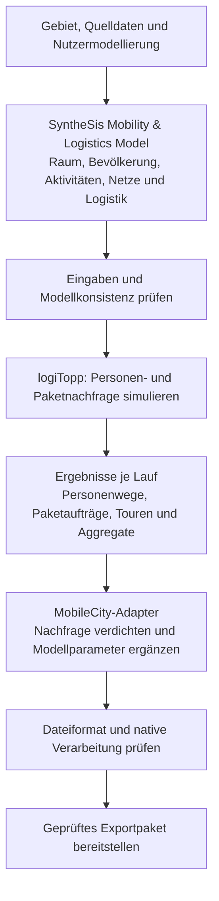

# Modellierungsfragen und Zielbild des SyntheSis Mobility & Logistics Model

**Stand: 29. September 2026.** Ergänzung und Präzisierung zur [Pipeline-Übersicht](10-modellierungs-generierungspipeline.md). Grundlage sind der aktuelle Java-Code, die lokal angebundenen KIT-Modelle, das native MobileCity-ConfigTool und die bereitgestellte TRAMIGO-Beispielkonfiguration.

**Status:** Die unten bezeichneten Ist-Befunde sind geprüft. Das gemeinsame Szenariomodell, der nachgelagerte Nachfrageexport und die strengere Behandlung fehlender Daten beschreiben das Zielbild; diese Architekturänderungen sind noch nicht implementiert.

## Aktueller Beschlussstand

Die zusammenhängende, aktualisierte Erklärung steht in der [Pipeline-Übersicht](10-modellierungs-generierungspipeline.md). Dieses Dokument bewahrt zusätzlich die fachlichen Fragen und Antworten; frühere Diskussionsstände weiter unten sind entsprechend gekennzeichnet.

**Neu umgesetzt:** EPSG:3035 als Standard neuer Szenarien, vereinfachte Rasteroberfläche, ausdrückliche Umstellung vorhandener Raster und gleichmäßige Verteilung bekannter 1–10-km-Bevölkerungszellen auf 100-m-Zuordnungspunkte. Rastergewichte erhalten keinen zusätzlichen 3-%-Sockel mehr. Beispiel: 100 Einwohner einer 1-km-Zelle → vier 500-m-Zellen mit je 25. Die Verteilung ist eine Modellannahme, keine feinere Messung.

**Name beschlossen:** SyntheSis Mobility & Logistics Model. **Mengen:** Bevölkerung standardmäßig 100 %; SUMO ohne standardmäßiges Mengenlimit für die unterstützten Wege des gewählten Tages. **Weiter offen:** Gebäudeverankerung, gemeinsame Routingnutzung für Zustelltouren, GTFS-Reisezeitmatrix, durchgängiger Datenvertrag und MobileCity-Nachfrageschnittstelle.

## Ergänzung: Gebäudepunkte, Routenübertragung und vereinfachte Rasterwahl

### Gebäude und Netzzugang

Für die grobe zonale Modellierung sind plausible Gebäudepunkte mit geeignetem Straßenzugang ausreichend. Zuerst ein geeignetes Gebäude wählen, danach den Straßenanschluss zuordnen; reine Straßennähe eines beliebigen Zufallspunktes schließt Gewässer oder unpassende Flächen nicht aus. Keine adressgenaue Rekonstruktion oder Luftbildprüfung vorsehen.

### Routing als nächster Umsetzungsschritt

GraphHopper aus einem versionierten OSM-Ausschnitt aufbauen und für Zonenmatrizen sowie später tatsächliche Lieferstopps wiederverwenden. Eigene Tourplanungsstrategie über vorhandene logiTopp-Schnittstellen anbinden, ohne fremden Quellcode zu ändern.

GraphHopper-Routen können grundsätzlich auf SUMO übertragen werden, benötigen aber eine Übersetzung auf SUMO-Kanten. Dazu Routenlinien und möglichst OSM-Wegreferenzen erhalten, beim SUMO-Netzimport Originalreferenzen bewahren und Geometrie, Richtung, Fahrzeugzulassung und zusammenhängende Kantenfolge abgleichen. GraphHopper-interne Kanten-IDs sind keine SUMO-Kanten-IDs. Abweichungen oder unzulässige Verbindungen sichtbar ausweisen; keine unbemerkte Neuberechnung als identische Routenübernahme ausgeben. Die Straßenfolge einer repräsentativen Zonenroute ersetzt außerdem nicht automatisch eine Route zwischen tatsächlichen Stopps.

Quellen: [SUMO-OSM-Import und Originalreferenzen](https://sumo.dlr.de/docs/Networks/Import/OpenStreetMap.html), [SUMO-Routenzuordnung](https://sumo.dlr.de/docs/Tools/Routes.html).

### Vereinfachte Oberfläche und Rasterkonzept

**Ziel:** Fokus Deutschland/Europa. In der Oberfläche Gebiet und räumliche Auflösung anbieten, etwa 100 m, 500 m oder 1 km sowie eine automatische Empfehlung. Keine gleichrangige Auswahl zwischen „EPSG“ und „INSPIRE“. Neue Modelle verwenden ein fest ausgerichtetes EPSG:3035-Raster. Bestehende Szenarien nicht still auf ein anderes Raster umstellen. Die vereinfachte Auswahl und ausdrückliche Migration sind umgesetzt; eine neue automatische Empfehlung ist damit nicht zusätzlich implementiert.

EPSG:3035 bezeichnet das Koordinatensystem. INSPIRE beschreibt hier ein standardisiertes Datenraster samt Zelllage und Kennung, das ebenfalls in diesem Koordinatensystem liegt. Es ist daher keine Wahl zwischen zwei konkurrierenden Koordinatensystemen.

Ablauf: Eingabedatei erkennen → Quellzellen aus Koordinaten oder INSPIRE-ID bestimmen → in EPSG:3035 verorten → Modellzellen räumlich zuordnen → Kennzahlen fachlich richtig aggregieren → Herkunft und Abdeckung speichern. Zur Kartenanzeige nach WGS84 umrechnen; die Rechengeometrie bleibt EPSG:3035.

Beispiel: Eine vollständig abgedeckte, passend ausgerichtete 500-m-Modellzelle umfasst 25 Zensuszellen von je 100 m. Einwohner- und Haushaltszahlen summieren; Altersanteile aus den summierten Altersgruppenzahlen neu berechnen. Prozente nicht addieren. Die eigene 500-m-Modellzelle muss keine amtliche INSPIRE-Zellkennung erhalten; Quellkennungen werden als Herkunft gespeichert.

Bei gröberen Quelldaten als Modellzellen ist keine zusätzliche gemessene Detailtiefe vorhanden. Die Nutzerentscheidung lautet: 1-km-Daten gleichmäßig auf kleinere Zellen verteilen. Für vier vollständig enthaltene 500-m-Zellen ergibt das je ein Viertel. Für Randzellen und fehlende Werte ist eine feste Zuordnungsregel nötig; fehlend darf nicht als beobachtete Null gelten.

Aktuell verwendet der Parser bei feinen bzw. punktförmigen Quellen Zellmittelpunkte und ordnet sie den Modellzonen zu; bekannte grobe Bevölkerungsraster werden zuvor gleichmäßig auf 100-m-Zuordnungspunkte aufgeteilt. Damit funktionieren INSPIRE-Daten bereits bei EPSG:3035-Modellzonen. Für passend ausgerichtete, vollständig enthaltene 100-m-Zellen ist die Zuordnung eindeutig. Die frühere 3-%-Glättung ist für Rastergewichte entfernt; andere Schätzgewichte können weiterhin geglättet werden.

## Beschlüsse und Umsetzung vom 29. September 2026

Diese Festlegungen aktualisieren die darunter dokumentierten früheren Diskussionsstände.

- **Name:** SyntheSis Mobility & Logistics Model. Die früheren Bezeichnungen SSM/Scenario Model sind verworfene Arbeitstitel.
- **Räumliche Detailtiefe:** Für die zonale Simulation genügen plausible Gebäude-/Standortpunkte mit geeignetem Straßenzugang. Keine Rekonstruktion realer Haushaltsadressen oder detaillierter Eingänge erforderlich. Beliebige Punkte außerhalb geeigneter Gebäude sind davon zu unterscheiden.
- **Routing:** gemeinsame OSM-Netzgrundlage und wiederverwendbare GraphHopper-Berechnung für Matrizen und perspektivisch Tourplanung. Keine Änderungen an fremdem KIT-Quellcode. Vorhandene Strategie-Schnittstellen zuerst für eine eigene Integration prüfen. SUMO benötigt weiterhin sein eigenes Netzformat aus derselben Quelle.
- **Raster:** Quelldatenraster und Modellzonen sind unabhängig. EPSG:3035-Modellzonen können INSPIRE-Zensusdaten aufnehmen. Keine Notwendigkeit, allein wegen einer Quelle das Modellraster zu wechseln.
- **Erreichbarkeit:** Fehlendes Netz blockiert einen netzbasierten Lauf. Bei fehlender Verbindung zunächst geeigneten Anschluss, größeren Netzausschnitt bzw. erlaubte Alternativwege prüfen. Echte Unerreichbarkeit nicht durch eine erfundene Verbindung ersetzen.
- **Kosten:** Personenmobilität, ÖPNV-Tarife und betriebliche Logistikkosten getrennt modellieren.
- **Depotprüfung:** OSM und Betreiber-/Standortnachweise verwenden; keine Luftbildauswertung vorsehen. Existenz, Depotfunktion und Betriebsparameter getrennt kennzeichnen.
- **MobileCity kurzfristig:** möglichst gute, nachvollziehbare Eingabedaten bereitstellen. Identische Ergebnisse oder Ergebnisvergleichbarkeit mit SyntheSis sind keine Anforderung. Technische Konsistenz und Übernahme exportierter Eingaben bleiben zu prüfen.
- **MobileCity langfristig offen:** mit der MobileCity-Seite gemeinsame Nachfragegrundlage und mögliche Nutzung von mobiTopp/logiTopp klären. Eine solche Nutzung ist derzeit nicht nachgewiesen. Den bestehenden Rechenkern nicht ohne Abstimmung ersetzen.
- **SUMO umgesetzt:** Standard `max-trips = -1` übernimmt sämtliche unterstützten Personenwege des gewählten Tages ohne Mengenlimit. Positive Werte bleiben als ausdrückliche Testoption, 0 behält seine bisherige Bedeutung. Tagwahl, technische Laufzeitbegrenzung und nicht unterstützte Verkehrsarten bleiben separate Themen.
- **Später:** Pendler-/Außenverkehrskonzepte aus simudrive prüfen und übernehmen, soweit passend. Diese Übernahme ist noch nicht implementiert.

## Präzisierungen und festgehaltene Anforderungen vom 29. September 2026

**Historischer Diskussionsstand:** Die folgende Namensdiskussion ist durch die Entscheidung für **SyntheSis Mobility & Logistics Model** abgeschlossen. Die Antworten bleiben zur fachlichen Nachvollziehbarkeit erhalten.

### Vom Nutzer vorgegeben bzw. bestätigt

- **ÖPNV:** GTFS-basierte Reisezeiten einschließlich Verkehrstag, Abfahrtszeit, Fußzugängen, Warte- und Umsteigezeiten als fachliches Ziel. Die bisherige Pkw-basierte Formel ist eine zu ersetzende Näherung.
- **Einkaufen und Paketlogistik:** eigene Nachfragearten und Ergebnisobjekte. Einkaufswege von Personen sind keine Paketlieferfahrten. Abhängigkeiten, etwa Abholwege zur Paketstation, benötigen eine explizite Verknüpfung und dürfen nicht doppelt gezählt werden.
- **Exportfreigabe:** Modell prüfen → Dateien vorläufig erzeugen → Format und native Verarbeitung prüfen → Paket bereitstellen. Ohne durchgeführte native Prüfung kein entsprechender Erfolgsstatus.
- **Depots:** reale OSM-Standorte übernehmen, wenn Existenz und Funktion als Depot hinreichend belegt sind. OSM-Kandidaten nicht allein durch das Tag als verifiziert behandeln. Synthetische Depots separat als Szenarioannahmen kennzeichnen.

### Weitere geprüfte Klarstellungen

- Haushaltskoordinaten werden derzeit zufällig innerhalb der Zonenbegrenzung gezogen, ohne durchgängige Prüfung auf Wohngebäude oder Eingang. Damit sind Punkte auf ungeeigneten Flächen möglich. Feste Ziele nutzen zum Teil Zonenschwerpunkte. Eine spätere Netzanbindung erzeugt keine echte Wohnadresse.
- GraphHopper routet auf OSM-Straßen. `RoutingEngine` gibt an den Matrixgenerator nur Entfernung und Zeit zurück. Die Straßenkantengeometrie wird in dieser Schnittstelle nicht erhalten. Die aktuelle Lieferstopp-Heuristik verwendet separat geometrische Entfernungen. Das erklärt die Unterschiede zwischen Straßenrouting, Zonenmatrix, Stoppfolge und gezeichneter Tour.
- Das lokale ConfigTool stammt aus dem bereitgestellten Ordner „Network Pipeline“ und liegt vorbereitet unter `validation/mobilecity/ConfigTool`. Es ist ein Werkzeug mit Import- und Berechnungsmodulen, keine bereitgestellte MobileCity-Benutzeroberfläche oder angebundene Serverinstanz. Testkopien enthalten dokumentierte Anpassungen.
- `tramigo-v2` ist unsere lokale Bezeichnung für einen aus den mitgelieferten TRAMIGO-Konfigurationen aufbereiteten Referenzdatensatz. Das Manifest hält Quellenprüfsummen und Anpassungen fest. Übernommene Koeffizienten und technische Größen sind Annahmen für ein neues Gebiet, keine eigens dafür gemessenen Daten.
- Der KIT-Pool liefert bei aktiviertem `useKitPopulation` Haushaltszusammensetzung, Alter und Geschlecht. Einkommen, Erwerbsstatus, Fahrzeuge, Wohnort, Ziele und Aktivitäten stammen aus weiteren Modellschritten. Standardmäßig ist der Pool aktiviert; regionale Zensus-Strukturanpassung ist optional. Im normalen Lauf wird kein neuer vollständiger KIT-IPU-Lauf je Gebiet ausgeführt.
- Die Pkw-Ersatzformel und pauschalen monetären Kostensätze stehen als Konstanten im Code. Eine belastbare regionale Quellen- oder Kalibrierungsbegründung ist dort nicht dokumentiert.
- **10 % waren ein Rechenbeispiel.** Der Standardwert der Bevölkerungssynthese ist `samplingFraction = 1.0`, also 100 %. Davon getrennt begrenzte der SUMO-Adapter früher ausgewählte Personenwege auf 4.000 je Verkehrsart und gewähltem Tag. Dieses Standardlimit wurde entfernt (`max-trips = -1`); ausdrückliche Testlimits bleiben möglich. Es fehlt eine validierte Skalierungsstrategie für Verkehrsbelastung und Logistik bei reduzierter Nachfrage.

### Vorschläge für die Umsetzung, noch nicht implementiert

**Depotprüfung:** OSM-ID, Tagging, Betreiber, Adresse und Geometrie erfassen; aufgegebene Standorte ausschließen; mit einer aktuellen Betreiberquelle bzw. Betriebsbestätigung abgleichen; Netzzugang prüfen. Existenz, Depotfunktion und betriebliche Kapazität getrennt bewerten. Prüfnachweis, Datum und Status speichern. Luftbild, Änderungsdatum oder ein Graphanschluss allein belegen keinen aktiven Depotbetrieb.

**Netz-Feedback:** zunächst vollständige bzw. methodisch validiert skalierte Nachfrage simulieren und eine belastungsabhängige Matrix erzeugen. Danach einen Vergleichslauf; weitere Iterationen nur bei relevanten Änderungen oder Instabilität. Ein zusätzlicher Zufallsstart prüft statistische Streuung, während eine Feedbackiteration die Modellannahmen verändert. Beides ist zu unterscheiden. Schon ein erster Lauf kann helfen, ist aber nicht automatisch realistischer ohne passende Nachfrage, Netzparameter und Vergleichsdaten.

**Quartiersbetrieb:** 100 % der modellierten Bevölkerung als fachliche Basis und kein stilles Abschneiden für den produktiven SUMO-Lauf. Reduzierte Läufe als Testmodus kennzeichnen. Zusätzlich Einpendler, Besucher, Durchgangsverkehr und von außen kommende Lieferfahrten berücksichtigen; 100 % der Bewohner allein bedeuten noch nicht 100 % des Verkehrs im Quartier.

**MobileCity:** Variante A liefert aus logiTopp verdichtete Eingaben für MobileCity, das Ziel- und Verkehrsmittelwahl selbst berechnet. Variante B übergibt verbindliche OD-Nachfrage und benötigt eine Erweiterung des nativen Vertrags samt definierter Abschaltung/Anpassung der entsprechenden eigenen Nachfrageberechnung.

Methodische Quellen: [MATSim-Handbuch zu Stichproben und Kapazitätsanpassung](https://www.matsim.org/files/book/partOne-latest.pdf), [mobiTopp: Personenagenten und Wochenmodell](https://mobitopp.ifv.kit.edu/), [OSM: Datum einer Vor-Ort-Prüfung](https://wiki.openstreetmap.org/wiki/Key:survey:date). Die MATSim-Skalierung ist kein Nachweis, dass eine entsprechende Skalierung in unserer SUMO-/Logistikkette bereits funktioniert.

## 1. Können wir komplette logiTopp-Modelle erzeugen? In welcher Granularität?

Für einen Kartenausschnitt können wir ein **ausführbares Szenario für Personenmobilität und private Paketnachfrage** erzeugen und mit der angebundenen logiTopp-Laufzeit simulieren. „Komplett“ im Sinn eines regional kalibrierten Gesamtverkehrs- und Wirtschaftsverkehrsmodells wäre zu weitgehend.

| Ebene | Heute abgebildet | Grenze |
|---|---|---|
| Bevölkerung | Einzelne Haushalte, Personen und Pkw | Synthetische Merkmale; keine Rekonstruktion tatsächlicher Haushalte. |
| Raum | Verkehrszellen und punktförmige Wohn-/Zielorte | Wohnpunkte innerhalb von Zellen werden synthetisch gesetzt; keine durchgängige Gebäudeadressierung. |
| Zeit | Eine Woche mit Aktivitäten und einzelnen Wegen, Zeitangaben in Minuten | Das Routingangebot ist zunächst zeitlich statisch. |
| Mobilität | Einzelne Personenwege, Verkehrsmittel, Ausgangs- und Zielorte | Straßengenaue Fahrzeugbewegung erfolgt erst in SUMO. |
| Pakete | Einzelne private Aufträge, Empfänger, Dienst, Zustellziel und Ereignisse | Betriebliche Paketnachfrage ist in unserer Laufzeitanbindung deaktiviert; kein vollständiges Güterverkehrsmodell. |
| Zustellung | Touren und geordnete Stopps, Fahrzeugzuordnung | Geometrische Tourheuristik und vereinfachte Bedienzeiten. |
| Auswertung | Einzelwege und aggregierte Verkehrsströme | `demand/` aggregiert Personenwege zusätzlich in 15-Minuten-Intervalle. |

Die Standard-Stichprobenquote ist 100 %. Bei kleineren Quoten simulieren logiTopp und SUMO die erzeugte Stichprobe ohne automatische Hochrechnung auf den Vollbestand. Räumlich sind beispielsweise 100-m-, 500-m- oder 1-km-Zellen möglich, abhängig vom Rastermodus und der Zonenzahl. Die praktische Auflösung hängt vom Gebiet ab: Standardlimit 600, harte Obergrenze 1.200 Zonen. Eine kleine Zellgröße allein macht synthetische Wohnpunkte nicht zu realen Adressen.

**Nachweis:** `GenerationService`, `SimulationRunner` (`days: 7`), `TravelDemand`, `SimulatorBuilder.buildDelivery`. Letzterer verwendet ausdrücklich `nullBusinessParcelOrderModel` für betriebliche Nachfrage.

## 2. Warum entsteht MobileCity heute vor logiTopp?

Die aktuelle Implementierung ist ein direkter **Konfigurationsexport aus den generierten Eingaben**. Sie liest Haushalte, Personen, Pkw, Aktivitäten, Zonen und Matrizen. Die Wegehäufigkeiten werden aus Übergängen zwischen Aktivitäten gezählt. Der Export kann deshalb ohne abgeschlossene logiTopp-Simulation laufen.

Das erklärt die bestehende Abhängigkeit, ist aber kein fachliches Argument dafür, simulierte Nachfrage dauerhaft zu umgehen. Für einen auf logiTopp aufbauenden Nachfrageexport sollte der Ablauf lauten: **Szenario aufbauen → logiTopp ausführen → simulierte Nachfrage normalisieren → nach MobileCity übersetzen → prüfen → Paket bereitstellen.**

Nur die Stufe nach hinten zu verschieben genügt nicht: Der Exporter würde weiterhin `activity.csv` lesen. Er braucht eine neue Nachfrageanbindung. Zudem muss geklärt werden, welche Ergebnisse MobileCity übernehmen kann und welche es selbst neu berechnet; siehe Frage 24.

## 3. Gehört Logistik in die gemeinsame Modellgrundlage? Wie nennen wir sie?

Ja. Der am 28. September vorgeschlagene Arbeitstitel war **SyntheSis Scenario Model (SSM)**; er wurde am 29. September nicht übernommen. Beschlossen ist inzwischen **SyntheSis Mobility & Logistics Model**. Es umfasst alle Szenarioeigenschaften, einschließlich Depots, Paketstationen und Paketnachfrage. Die bisherige Grafik hat diesen Zusammenhang unzureichend dargestellt.

| Teil des gemeinsamen Modells | Inhalt |
|---|---|
| Raum und Angebot | Gebiet, Zonen, Einrichtungen, Straßen, ÖPNV und Erreichbarkeiten |
| Bevölkerung und Aktivitäten | Haushalte, Personen, Mobilitätswerkzeuge, feste Ziele, Wochenpläne |
| Logistik | Anbieter, Depots, Paketstationen, Bediengebiete, Flotten und Nachfrageparameter |
| Szenarioannahmen | Technologie, Kosten, Sharing, Zukunftsannahmen, Maßnahmen |
| Quellen und Qualität | Herkunft, Bezugsdatum, Einheiten, Unsicherheit, Ersatzverfahren |
| Ergebnisse je Lauf | Simulierte Personenwege, Pakete, Touren, Verkehrsströme und Prüfberichte |

Eingaben und Ergebnisse bleiben darin unterscheidbar: Vor einem Lauf existieren Paketnachfrageparameter; nach dem Lauf zusätzlich konkrete Paketaufträge. Heute sind diese Inhalte auf `Scenario`, den Verarbeitungskontext und Dateien verteilt. Ein vollständig versionierter, simulatorunabhängiger Datenvertrag des gemeinsamen Modells fehlt noch. `TravelDemand` ist bereits ein Baustein für Personenverkehr, enthält aber noch kein entsprechendes gemeinsames Logistikergebnis.

## 4. Warum war die Grafik unübersichtlich?

Sie mischte fachliche Abhängigkeiten mit zeitlicher Ausführung. Dadurch erschien Stufe 6 weit hinten, und 8 → 12 übersprang sichtbare Zwischenschritte. Die Übersicht verwendet jetzt zwei lineare Diagramme für den **Ist-Ablauf**. Das folgende Diagramm zeigt separat eine **mögliche spätere Nachfrageanbindung**, deren Zielvertrag mit MobileCity abzustimmen ist. Kurzfristig hat die Verbesserung des vorhandenen Konfigurationsexports Vorrang:

SUMO kann die gemeinsame Nachfrage zusätzlich auf dem Straßennetz simulieren. Falls Netz-Feedback aktiviert ist, muss vor dem MobileCity-Export feststehen, welche Iteration die gültige Nachfrage liefert. Der optionale LLM-Vergleich gehört in die Analysewerkzeuge, nicht in den notwendigen Exportpfad.

## 5. Wo wird das Straßennetz für Wege und Liefertouren benötigt?

Das Netz wirkt heute **indirekt über die Matrizen** auf logiTopp: OSM → GraphHopper → Zonenzeiten/-distanzen → Ziel- und Verkehrsmittelwahl. logiTopp muss dazu nicht dieselbe OSM-Datei erneut lesen.

Für Liefertouren ist die aktuelle Vereinfachung stärker: `TspBasedDeliveryTourStrategy` bestimmt die Stoppfolge mit einer geometrischen Distanz und einer Näherung für das Rundreiseproblem. Reise- und Rückkehrzeiten werden aus den Zonenmatrizen abgefragt. Zustellfahrzeuge vom Typ `TRUCK` verwenden dabei die Pkw-Zeitmatrix.

`tours.geojson` verbindet Depot und Stopps geradlinig. Diese Darstellung ist keine gespeicherte Straßenroute. Die eigentliche Folge befahrener Straßenkanten entsteht bei der SUMO-Aufbereitung. Für realistisch optimierte Lieferabläufe sollten bereits Stoppfolge und Tourplanung fahrzeugspezifische Netzzeiten nutzen.

## 6. Was macht der LLM-Vergleich der Verkehrsmittelwahl?

Er liest die logiTopp-Wege und sortiert sie in sechs Distanzgruppen: unter 1, 1–2, 2–5, 5–10, 10–20 und ab 20 km. Für jede Gruppe werden einfache Reisezeitannahmen erzeugt, beispielsweise Pkw mit 25 km/h plus vier Minuten. Ein lokales Sprachmodell schätzt dazu Anteile von Fuß, Rad, Pkw, Mitfahrt und ÖPNV.

Diese Anteile werden nach der Zahl der Wege gewichtet und mit logiTopp sowie einem MiD-Referenzwert verglichen. Es ist **ein experimenteller Plausibilitätsvergleich**: keine individuelle Neuentscheidung mit allen Personenmerkmalen, keine Verarbeitung der echten ÖPNV-Fahrpläne und keine empirische Validierung. Die ursprünglichen Wege werden nicht verändert. Das Verfahren ist unabhängig von GTA, das bereits bei der Erstellung von Aktivitätenplänen ansetzt.

## 7. Was bedeuten KBA, BKG, BNetzA, Umland und Modellprofil?

| Begriff | Bedeutung und Verwendung |
|---|---|
| KBA | Kraftfahrt-Bundesamt: regionale Fahrzeugdaten; hier vor allem Anteil batterieelektrischer privater Pkw. |
| BKG | Bundesamt für Kartographie und Geodäsie: Gemeindegrenzen zur räumlichen Zuordnung dieser Statistik. |
| BNetzA | Bundesnetzagentur: registrierte öffentliche Ladepunkte und ihre Standorte. |
| Umland | Bevölkerung außerhalb des Ausschnitts, deren Wege das Untersuchungsgebiet erreichen können. |
| Modellprofil | Vorbereiteter Satz von MobileCity-Parametern, derzeit `tramigo-v2`; enthält zusätzliche technische, finanzielle und Verhaltensannahmen. |

„Optional“ heißt: Die jeweilige Quellenanreicherung muss aktiviert bzw. konfiguriert sein. Es heißt nicht, dass eine fachlich erforderliche Größe beliebig fehlen darf.

## 8. Was passiert bei der nativen MobileCity-Prüfung?

Das Prüfskript erzeugt eine isolierte Kopie des ConfigTools, baut diese, importiert die erzeugten Konfigurationen, lädt die daraus erzeugten Binärdateien erneut und führt mehrere Modelljahre aus. Es untersucht Fehler, nicht endliche Zahlen und die tatsächliche Übernahme bestimmter Beiträge, etwa Bevölkerung, Pkw, Ladepunkte, Sharing und Umlandnachfrage.

Die Arbeitskopie enthält dokumentierte Anpassungen für Erstimport, bekannte Sonderfälle und Diagnoseausgaben. Ein bestandener Lauf belegt deshalb die Verarbeitung durch diese geprüfte Werkzeugversion. Er bescheinigt weder regionale Kalibrierung noch automatisch die Kompatibilität mit jeder ausgelieferten MobileCity-App. Die Prüfung ist heute optional und wird bei fehlender Laufzeit als übersprungen ausgewiesen.

## 9. Ist der KIT-Haushaltspool allgemein für Deutschland gültig?

**Nein.** Das gebündelte Sample entstand aus dem **Marne-Beispiel** der KIT-Bevölkerungssynthese. Es umfasst 6.512 Haushalte und 13.168 Personen. Für diesen lokalen Vorlauf wurde der ursprüngliche, nicht mitgelieferte Personen-Seed synthetisch rekonstruiert. Die Datei ist damit kein repräsentativer deutschlandweiter Mikrodatenbestand und auch keine Sammlung tatsächlicher Marner Haushalte.

Die optionale Anpassung an regionale Zensus-Alters- und Haushaltsgrößenanteile verbessert die Randverteilungen. Sie kann fehlende Haushaltstypen, regionale Verhaltensunterschiede oder eine ungeeignete gemeinsame Merkmalsverteilung nicht vollständig beheben. Für belastbare Regionalmodelle brauchen wir einen besser geeigneten Ausgangspool, regionale Gewichtung und ausgewiesene Anpassungsgüte.

Nachweis: [Entstehung des Samples](05-validierung.md), Abschnitt zum KIT-IPU-Vorlauf; lokaler Runner `validation/populationsynthesis/exampleCensus/src/main/kotlin/SynthesisSample.kt`.

## 10. Welche MobileCity-Parameter fehlen als regionale Beobachtung, und wie werden sie ergänzt?

„Fehlen“ bedeutet oft: Das Format verlangt einen Wert, aber wir haben dafür noch keine regionale Datenquelle. Heute liefern Profil und Modellregeln solche Werte.

| Bereich | Heutige Ergänzung | Was regional noch fehlt |
|---|---|---|
| Ziel-/Verkehrsmittelwahl | Übernommene Koeffizienten aus `MODparameters` | Kalibrierung an regionalen Wegehäufigkeiten, Zielbeziehungen und Modal Split |
| Technologieentwicklung | Profilwerte für Antriebsentwicklung, Verbrauch und Emissionen | Regionale Zukunftsannahmen bzw. geeignete technische Referenzen |
| Pkw-Neuzulassungen | Annahme Bestand / 8 pro Jahr; BEV-Anteil wie im Bestand | Tatsächliche regionale Zulassungen und deren Antriebsmix |
| ÖPNV-Betrieb | GTFS ergänzt Angebot; weitere Profilwerte, z. B. Kapazitäten und Jahresfahrleistungen | Regionaler Fahrzeugpark und Betriebskennzahlen; pauschaler Zeitkartenanteil derzeit 25 % |
| Finanzen | Bestimmte Budgets, Betriebs- und Netzausgangsgrößen werden aus dem Profil pro Einwohner skaliert | Regionale Haushalte, Kosten und echte Netzgrößen |
| Zugänge, Parken, Tarife | Profilwerte bzw. einfache Modellansätze | Regionale Zugangszeiten, Parkbedingungen und Tarifsysteme |
| Sharing | Nutzerangaben oder ausdrücklich modellierter Nullbestand | Beobachtetes Angebot und Mitgliedschaften |
| Umland | Zensus-Puffer oder Vorgabe; Einfahranteile nach Zweck manuell | Belastbare grenzüberschreitende Nachfragebeziehungen |
| Maßnahmen | Im Regionalexport leerer Maßnahmenkalender | Für das neue Gebiet modellierte Eingriffe |

Eine fehlende Pflichtgröße ohne erlaubte Ersatzquelle kann den Export blockieren. Andere Größen erlauben heute explizite Annahmen oder einen gekennzeichneten Ersatz. Die künftige Regel des gemeinsamen Modells sollte lauten: **Quelle → belastbare Ableitung → sichtbare Nutzerannahme → fehlend**. Ein Profilwert darf nicht als gemessener Regionalwert erscheinen.

## 11. Funktioniert Zensus mit allen Rasterarten?

Ja. Die Zensus-Zellmittelpunkte werden aus ihrem Koordinatensystem umgerechnet und den jeweils gewählten Modellzonen zugeordnet. Das funktioniert für das normale Raster, das ausgerichtete EPSG:3035-Raster und INSPIRE.

INSPIRE passt geometrisch besonders gut zum amtlichen Raster. Bei anders geschnittenen Zellen entstehen Randzuordnungen über Zellmittelpunkte; das ist keine exakte anteilige Zerlegung jeder Zensuszelle. Außerdem bleiben Quellauflösung, Datenschutzlücken und die derzeitige Bevölkerungsglättung bestehen. EPSG:3035 gilt räumlich für Europa; der automatisch eingebundene deutsche Zensus deckt Deutschland ab. Rasterkompatibilität erweitert diese Datenabdeckung nicht.

## 12. Warum zwölf Aktivitätsarten?

Die zwölf Kategorien entsprechen den Attraktivitätsspalten des angebundenen mobiTopp-Beispiels: Arbeit, drei Bildungsarten, zwei Einkaufsarten, zwei Freizeitarten, Geschäftsaktivität, private Erledigung, privater Besuch und Service. Es sind **zwölf außerhäusliche Zielattraktivitäten**; Zuhause braucht keine konkurrierenden Zielgewichte. Die Zahl ist keine allgemeingültige Eigenschaft von Mobilität. MobileCity verdichtet Zwecke auf Bildung, Arbeit, Einkauf und Freizeit.

## 13. Wie ermittelt GraphHopper Zeiten, und was ist mit Transportern?

GraphHopper erstellt aus OSM ein Netz. Straßenklasse, Geschwindigkeits- und Zugangstags, Einbahnregelungen sowie das gewählte Fahrzeugprofil bestimmen nutzbare Kanten und angenommene Geschwindigkeiten. Aus Kantenlänge und Geschwindigkeit entsteht eine Reisezeit, die entlang des Weges aufsummiert wird. Ohne eigene Verkehrslagedaten ist dies keine beobachtete aktuelle Stauzeit.

Unsere Anbindung verwendet GraphHopper 8 mit den Profilen `car`, `bike` und `foot`. „Straßenfahrzeuge“ wäre ein sinnvoller Oberbegriff, aber „alle Fahrzeuge korrekt geroutet“ wäre derzeit falsch: Für Transporter und Lkw fehlen getrennte Profile mit passenden Gewichts-, Höhen-, Breiten- und Zufahrtsregeln. Lieferfahrzeuge nutzen aktuell die Pkw-Matrix als Näherung.

GraphHopper unterstützt grundsätzlich angepasste Profile; diese müssen wir gezielt anbinden. [Primärquelle: GraphHopper zu Fahrzeugprofilen](https://www.graphhopper.com/blog/2021/12/15/new-and-customizable-routing-profiles/).

## 14. Was bedeutet fehlendes Routing oder eine unerreichbare Zone?

Routing ist die Suche nach einem erlaubten Weg durch das Netz. Es kann insgesamt fehlen, weil es deaktiviert wurde, der OSM-Abruf scheitert oder der Netzimport fehlschlägt. Ein einzelnes Paar kann wegen unpassender Anbindung des Zonenschwerpunkts, abgeschnittener Umfahrungen, Datenlücken oder tatsächlicher Zugangsbeschränkungen scheitern.

Der Code unterscheidet diese Ursachen heute nicht ausreichend. Er ersetzt sie durch Näherungen, zum Beispiel für Pkw:

> Entfernung = Luftlinie × 1,35; Zeit = Entfernung / 28 km/h + 3 Minuten.

Für Rad gilt Luftlinie × 1,25 bei 14 km/h plus zwei Minuten; für Fuß Luftlinie × 1,2 bei 4,7 km/h. Für Wege innerhalb einer Zelle gibt es eine eigene, von der Zellgröße abhängige Schätzung.

**Fachliche Konsequenz:** Eine tatsächlich unerreichbare Verbindung darf nicht durch eine erfundene fahrbare Verbindung ersetzt werden. Künftig brauchen wir getrennte Zustände für routbar, Daten fehlen, ungeeigneter Zonenanschluss und tatsächlich unerreichbar. Zunächst Netzabdeckung/Anschlüsse korrigieren; echte Unerreichbarkeit muss die Verkehrsmittel- bzw. Zielwahl einschränken. Schätzwerte bleiben eine bewusst gewählte Annahme für geeignete Fälle.

## 15. Woher kommen ÖPNV-Faktor 1,7 und acht Minuten? Warum kein GTFS?

Sie stehen als feste Konstanten in `MatrixGenerator`. Im aktuellen Code gibt es dafür keinen Nachweis einer regionalen Schätzung oder Kalibrierung. Das ist eine einfache Ersatzannahme.

Eine GTFS-basierte Lösung ist fachlich sinnvoller. Dafür genügt das Lesen einer Fahrplantabelle nicht: Nötig sind Wege zur Haltestelle, gültiger Verkehrstag, Abfahrtszeit, Wartezeit, Fahrzeit, Umstieg und Fußweg zum Ziel. Daraus entsteht eine zeitabhängige ÖPNV-Verbindungssuche. Vorhandene GTFS-Aufbereitung können wir wiederverwenden; für die gemeinsame Matrix fehlt noch diese Berechnung einschließlich einer Regel, welche Tageszeiten zusammengefasst werden. Die heutigen Matrixkonfigurationen gelten einheitlich für den ganzen Tag.

## 16. Was sind „Kosten“?

Gemeint sind monetäre Wegekosten als Einflussgröße der Verkehrsmittelwahl. Heute werden beispielsweise 0,32 je Pkw-Kilometer sowie 1,80 Grundpreis plus 0,15 je Luftlinienkilometer für ÖPNV angesetzt, fachlich als Eurobeträge. Für Fuß und privates Fahrrad wird null angesetzt. Das sind weder belegte lokale Tarife noch Depotbetriebskosten oder die Kosten der Softwareausführung.

Für eine belastbare Modellierung müssen Preisstand, Energie-/Fahrzeugkosten, Parken, Zeitkarten und gegebenenfalls der Unterschied zwischen wahrgenommenen und tatsächlichen Kosten explizit werden.

## 17. Werden Depots beliebig gesetzt?

Heute haben vom Nutzer modellierte Depots Vorrang. Ohne solche Vorgaben gelten OSM-Einträge mit `amenity=post_depot`, `office=courier` oder `office=logistics` als Kandidaten. Fehlende Standorte werden nach Arbeitsattraktivität und Nachfragenähe synthetisch an Zonenschwerpunkten ergänzt.

Ein OSM-Tag belegt aber nicht Kapazität, Flotte, Betreiber oder Eignung als Paketverteilzentrum. Die Standortheuristik ist eine Prototypannahme. **Das Zielbild übernimmt die Anforderung, Depots explizit zu modellieren:** Standort und Netzzugang, Betreiber, Bediengebiet, Betriebszeiten, Umschlag-/Fahrzeugkapazitäten, Flotte und gegebenenfalls Ladeinfrastruktur. OSM liefert Vorschläge. Künstliche Standorte müssen als bewusst gewählte Szenarioannahmen erkennbar sein. Das betrifft auch Depots außerhalb des Kartenausschnitts, die das Gebiet bedienen.

## 18. Warum Export und Validierung getrennt?

Es gibt unterschiedliche Prüfungen: Eingabe- und Fachprüfungen benötigen das Szenariomodell; eine Dateiformatprüfung benötigt bereits erzeugte Dateien; ein echter Importtest benötigt das Zielprogramm. Deshalb bleiben es technisch getrennte Schritte.

Für den Nutzer sollte die Reihenfolge jedoch lauten: **Modell prüfen → Dateien vorläufig erzeugen → Format und native Verarbeitung prüfen → geprüftes Paket freigeben.** Heute wird das ZIP bereits vor der optionalen nativen Prüfung erzeugt. Diese Bereitstellung ist noch kein verbindlicher Qualitätsfilter. Ohne native Prüfung muss der Status ausdrücklich „nicht nativ geprüft“ bleiben.

## 19. Benötigt MobileCity Reisezeiten oder berechnet es sie selbst?

**Beides.** Die Originalbeispiele verlangen Ausgangsgrößen. Im Blatt `INFcarLinks` beschreibt B9:D12 `time` als freie Fahrzeit einschließlich Kreuzungen/Ampeln, `distance` als Kilometer und `avSpeed` als durchschnittliche Geschwindigkeit einschließlich Stau. `INFpedestrian` B9:E10 fordert Zeit- und Distanzmatrizen; `INFdistricts` ergänzt Binnen- und Zugangsgrößen.

Auf diesen Eingaben berechnet MobileCity eigene Verbindungen bzw. Bezirksmatrizen, berücksichtigt Netzänderungen und bestimmt daraus Nachfrage und Modal Split. Das bestätigen `CAL3010_INFTravelTimeAndDistance` und `CAL4010_MODTrips` im bereitgestellten ConfigTool. Die Datensätze allein belegen die Eingabefelder; die Berechnungsfolge wurde zusätzlich im Code geprüft. MobileCity ist an dieser Stelle keine SUMO-artige straßenbezogene Mikrosimulation.

Beispielquelle: `2026.01.07_MC_CityConfig_TRAMIGO.xlsx` im bereitgestellten Ordner „22 TRAMIGO Mittlerer Oberrhein“. Blatt `POPtrips`, A3, beschreibt die mittleren Raten nach Alter, Zweck und Jahr ausdrücklich als für alle Bezirke gültig.

## 20. Wie entsteht `activity.csv`?

Standardmäßig über **actiTopp**, ein gesondertes KIT-Modell für Wochenaktivitäten. Unsere Anbindung übergibt Personenmerkmale und übersetzt dessen Ausgabe in das benötigte Format. Es verwendet statistische Verhaltensmodelle und stochastische Entscheidungen; es ist keine beliebige Gleichverteilung von Aktivitäten.

Alternativ kann GTA Pläne mit einem lokalen Sprachmodell erzeugen. Wenn eine gewählte Quelle ausfällt, kann die aktuelle Pipeline auf actiTopp bzw. auf einfache interne Wochenvorlagen mit Zufallsvariation zurückfallen. Die verwendete Quelle wird protokolliert. mobiTopp/logiTopp verarbeitet die so vorbereiteten Pläne anschließend im Verkehrsnachfragelauf.

[Primärquelle: KIT-Methodik zu Aktivitätenplänen und Nachfragesimulation](https://mobitopp.ifv.kit.edu/152.php).

## 21. Woher kommen die Dateien in `demand/`?

Sie werden **aus dem mobiTopp/logiTopp-Simulationsergebnis** erzeugt. `LogitoppDemandAdapter` liest `demandsimulationResult.csv`, normalisiert Wege und Teilstrecken zu `TravelDemand`, und `DemandArtifacts` schreibt Einzelwege, Teilstrecken sowie Zonen- und OD-Verkehrsströme. Es ist eine Formatübersetzung und Aggregation vorhandener Ergebnisse.

Für den geplanten MobileCity-Adapter reicht der bisherige Vertrag noch nicht aus: Er enthält insbesondere keinen expliziten Wegezweck, keine Altersgruppe und keinen Hochrechnungsfaktor am Weg. Diese Informationen müssen nachvollziehbar aus der Simulation und der Bevölkerung ergänzt werden, einschließlich Regeln für Heimwege und Personen ohne Wege. Logistikergebnisse benötigen einen entsprechenden eigenen Vertrag.

## 22. Warum begrenzt SUMO auf 4.000?

Das frühere Standardlimit von **4.000 ausgewählten Personenwegen je Verkehrsart** diente handhabbaren lokalen Läufen und war keine Modellanforderung. Es ist entfernt: Standard ist jetzt `max-trips = -1`, also kein Mengenlimit. Ein positives Testlimit bleibt ausdrücklich wählbar; bei begrenzter Auswahl wird die Tagesverteilung näherungsweise erhalten. Lieferverkehrsabschnitte und GTFS-Fahrzeuge kommen getrennt hinzu.

Die unterstützte Nachfrage des gewählten Tages wird standardmäßig vollständig übernommen, sofern Netz und Rechner es schaffen. Rechenaufwand hängt auch von Netzgröße, Dauer und Stau ab. Der jetzige Adapter betrachtet weiterhin einen ausgewählten Tag. `0` bedeutet im aktuellen Code keine ausgewählten Personenwege, nicht „unbegrenzt“.

Ein begrenzter Lauf unterschätzt ohne geeignete Skalierungsstrategie unter Umständen die Verkehrsdichte. Seine Stauwerte sollten deshalb nicht ungeprüft als Grundlage einer Vollbevölkerungs-Kalibrierung dienen.

## 23. Wird die Matrix durch immer mehr Wiederholungen immer besser?

Sie kann **konsistenter mit der modellierten Nachfrage** werden: höhere Belastung erzeugt längere Zeiten, darauf reagiert die Nachfrage, dann wird die Belastung erneut berechnet. Ohne Dämpfung kann dieser Prozess pendeln. Unsere Schleife mittelt Änderungen mit abnehmendem Gewicht und stoppt bei kleiner Änderung oder Iterationslimit.

Standardmäßig sind drei Iterationen, höchstens 150 Zonen für das Feedback und eine Änderungsschwelle von 0,01 vorgesehen; Staufaktoren werden auf 1 bis 3 begrenzt. Ein kleiner Änderungswert bedeutet aber weder mathematisch bewiesenes Gleichgewicht noch empirische Richtigkeit. Fehlerhafte Ausgangsnachfrage, zu starke Stichprobenbegrenzung oder ungeeignete Parameter bleiben auch nach vielen Wiederholungen problematisch. Zusätzliche Iterationen liefern schließlich wenig Nutzen und können weiter schwanken.

## 24. Warum bekommt MobileCity keine Einzelwege? Wie setzen wir auf logiTopp auf?

Der geprüfte MobileCity-Eingabevertrag kennt aggregierte Bevölkerungs- und Wegehäufigkeiten sowie Attraktivitäten und Netze. Er enthält keinen bestätigten Import für eine vollständige Liste individueller Wege. MobileCity erzeugt seine eigene OD-Verteilung und Verkehrsmittelwahl.

Es gibt daher zwei fachlich unterschiedliche Ziele:

1. **Kompatibler Export aus logiTopp:** Die simulierten Wege liefern gewichtete Wegehäufigkeiten, Distanzverteilungen und Vergleichswerte. SyntheSis überträgt die im bestehenden Format darstellbaren Größen und prüft die korrekte Übernahme dieser Eingaben. Eine Übereinstimmung der späteren MobileCity-Nachfrage mit SyntheSis ist keine Anforderung. Wegen der Verdichtung auf wenige Altersgruppen/Zwecke und gebietsweite Raten ist keine identische OD-Matrix zu erwarten.
2. **Unveränderte Übernahme der Nachfrage:** Soll MobileCity dieselben OD-Ströme nach Zeit, Zweck und Modus verwenden, braucht es einen zusätzlichen Eingabevertrag und einen Modus zur Übernahme exogener Nachfrage. Dabei muss verhindert werden, dass MobileCity anschließend dieselbe Nachfrage noch einmal erzeugt oder verteilt.

Ein Teil der logiTopp-Ergebnisse wird beim ersten Weg bewusst aggregiert. Der zweite Weg erfordert Änderungen am Zielmodell. Für Paketlogistik gilt das zusätzlich: Der vorhandene MobileCity-Vertrag hat dafür noch keine bestätigte Abbildung.

## 25. Was bedeutet „variables Einkaufsziel“?

Tatsächlich die Fahrt zum Einkaufen, etwa zum Supermarkt. „Variabel“ bedeutet: Anders als der vorab zugeordnete Arbeits- oder Bildungsort wird das Einkaufsziel im Nachfragelauf gewählt. Eine Person hat einen Einkaufsanlass im Aktivitätenplan; das Zielwahlmodell vergleicht passende Zielzonen anhand von Einkaufsmöglichkeiten, Entfernung/Erreichbarkeit und Modellparametern.

Die Wahl betrifft in unserer aktuellen Abbildung primär eine **Zielzone** und einen modellierten Ort darin. Sie identifiziert nicht zwingend einen bestimmten Supermarkt aus OSM. OSM-Supermärkte beeinflussen die Attraktivität dieser Zone. Der Einkauf des Haushalts und die Zustellung eines online bestellten Pakets sind außerdem unterschiedliche Vorgänge.

## 26. Werden bei 10 % wirklich nur 2.000 statt 20.000 Menschen simuliert?

Ja. Bei 20.000 modellierten Einwohnern erzeugt die 10-%-Einstellung ungefähr 2.000 Personenagenten. Sie bestimmt nicht nur, wie viele Ergebniszeilen gespeichert werden: Der Mobilitäts- und Paketnachfragelauf verarbeitet tatsächlich diese verkleinerte Bevölkerung. Daher entstehen auch weniger Wege und private Paketaufträge.

Die derzeitige logiTopp-/SUMO-Kette ergänzt die übrigen 18.000 Menschen nicht automatisch und weist den simulierten Fahrzeugen keine zehnfache Belastungswirkung zu. Für die Nachfrage-Vollsimulation ist `samplingFraction = 1.0` vorgesehen; bei SUMO ist das separate Mengenlimit standardmäßig deaktiviert. Gebiet, Tag und unterstützte Verkehrsarten begrenzen weiterhin den Umfang.

Einzelne Mengen oder Mittelwerte einer geeigneten Stichprobe lassen sich hochrechnen, aber nicht automatisch sämtliche Simulationseffekte: Stau, Flottenbedarf, Depotkapazität, Paketbündelung und Tourenlängen reagieren nicht linear. Der aktuelle MobileCity-Export rechnet Bevölkerungs- und Pkw-Bestände hoch und nutzt Wegehäufigkeiten pro Person. Er übernimmt damit keine bereits für 20.000 Personen simulierte Netzbelastung.

## Aktualisierte nächste Schritte

1. **Routing wiederverwenden:** gemeinsame OSM-Grundlage, stoppspezifische Netzzeiten und explizite Unerreichbarkeit; eigene Strategie über KIT-Schnittstellen statt Änderungen an fremdem Code.
2. **Fachliche Eingaben verbessern:** GTFS-Reisezeiten, Gebäudepunkte, verifizierte Depots, getrennte Kostenmodelle und regionale Bevölkerungsstruktur.
3. **Gemeinsamen Datenvertrag festigen:** Logistik, Quellen, Einheiten und Qualitätsstatus einschließlich Ergebnisse je Lauf konsistent abbilden.
4. **Exportfreigabe vervollständigen:** Modellprüfung, vorläufige Dateien, Format-/native Prüfung und eindeutiger Bereitstellungsstatus.
5. **MobileCity-Schnittstelle abstimmen:** zunächst hochwertige Eingaben im bestehenden Format; langfristig gemeinsame Nachfragegrundlage und möglichen Einsatz von mobiTopp/logiTopp klären. Danach einen passenden Nachfrageadapter entwickeln.

Zonensystem, gleichmäßige Verteilung grober Bevölkerungsraster und Entfernung des SUMO-Standardlimits sind bereits umgesetzt. Eine Architektur mit identischen Simulationsergebnissen ist nicht vorgegeben.

## Implementierungsverweise

- [GenerationService](../backend/src/main/java/de/synthesis/generation/GenerationService.java): tatsächliche Stufenreihenfolge und Quellenwahl.
- [MatrixGenerator](../backend/src/main/java/de/synthesis/generation/pipeline/MatrixGenerator.java), [RoutingEngine](../backend/src/main/java/de/synthesis/generation/pipeline/RoutingEngine.java): heutige Zeit-, Kosten- und Routingannahmen.
- [LogisticsGenerator](../backend/src/main/java/de/synthesis/generation/pipeline/LogisticsGenerator.java): Depot- und Paketstationsgenerierung.
- [ActitoppRunner](../backend/src/main/java/de/synthesis/generation/pipeline/ActitoppRunner.java), [LlmModeChoiceRunner](../backend/src/main/java/de/synthesis/generation/pipeline/LlmModeChoiceRunner.java): zwei verschiedene Verhaltensanbindungen.
- [TravelDemand](../backend/src/main/java/de/synthesis/generation/demand/TravelDemand.java), [DemandArtifacts](../backend/src/main/java/de/synthesis/generation/demand/DemandArtifacts.java): gemeinsame Sicht auf Personenverkehr.
- [MobileCityPopulation](../backend/src/main/java/de/synthesis/generation/pipeline/MobileCityPopulation.java), [MobileCityRegionalExporter](../backend/src/main/java/de/synthesis/generation/pipeline/MobileCityRegionalExporter.java): aktuelle Aggregation und Profilübernahmen.
- [SumoRunner](../backend/src/main/java/de/synthesis/generation/pipeline/SumoRunner.java): Auswahl und Übertragung auf das Straßennetz.
- [Natives MobileCity-Prüfskript](../scripts/validate-mobilecity.py): Import, Laden, Simulation und Beitragsprüfungen.
- [PopulationGridParser](../backend/src/main/java/de/synthesis/generation/pipeline/PopulationGridParser.java): rasterunabhängige Zensus-Verarbeitung.
