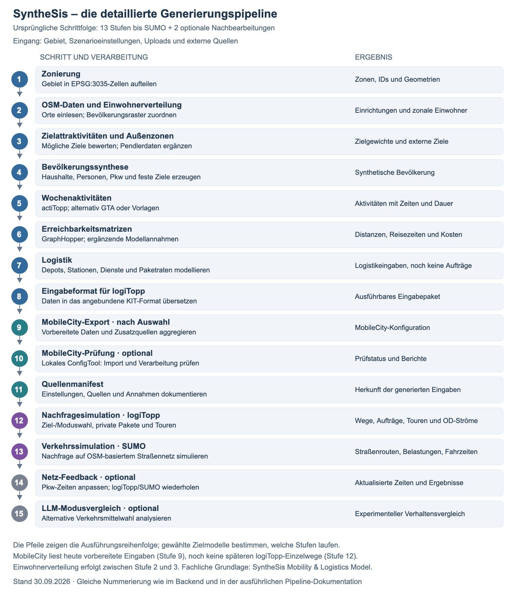

# Detaillierter Ablauf und Beispiel eines Wochenplans

**Stand: 30. September 2026.** Auf Wunsch wieder die ursprüngliche Schrittfolge statt der verdichteten Acht-Phasen-Darstellung. Die aktuelle Implementierung umfasst **13 Stufen bis einschließlich SUMO und zwei optionale Nachbearbeitungen**, also 15 Stufen insgesamt.

## Ablaufgrafik als Grundlage



[SVG für die Präsentation](figures/synthesis-detailablauf.svg) · [PNG](figures/synthesis-detailablauf.png)

1. **Zonierung:** Gebiet in Verkehrszellen mit gemeinsamen IDs aufteilen.
2. **OSM-Daten:** Einrichtungen und Siedlungen einlesen; anschließend Einwohnerzahlen räumlich verteilen.
3. **Attraktivitäten:** Zielgewichte, Außenzonen und optionale Pendlerbezüge aufbauen.
4. **Bevölkerung:** Haushalte, Personen, Pkw und feste Arbeits-/Bildungsziele erzeugen.
5. **Aktivitäten:** Wochenpläne mit Aktivitätsarten, Zeiten und Dauer erzeugen.
6. **Matrizen:** Distanzen, Reisezeiten und Kosten zwischen Zonen bestimmen.
7. **Logistik:** Depots, Paketstationen, Dienste und Paketnachfrageparameter vorbereiten.
8. **logiTopp-Eingabeformat:** Erzeugte Daten für die angebundene KIT-Laufzeit übersetzen.
9. **MobileCity-Export:** Vorbereitete Eingaben aggregieren und um zielmodellspezifische Quellen/Parameter ergänzen.
10. **MobileCity-Prüfung:** Optional das lokale ConfigTool ausführen und die Verarbeitung prüfen.
11. **Manifest:** Quellen, Einstellungen und Annahmen der Generierung dokumentieren.
12. **logiTopp:** Personenwege, private Paketaufträge und Zustelltouren simulieren.
13. **SUMO:** Nachfrage auf einem OSM-basierten Netz als Verkehrsablauf simulieren.
14. **Optionales Netz-Feedback:** Pkw-Zeiten aktualisieren und logiTopp/SUMO wiederholen.
15. **Optionaler LLM-Modusvergleich:** Alternative Verkehrsmittelwahl experimentell analysieren.

Die Nummern entsprechen der technischen Pipeline. Die Pfeile beschreiben deren Reihenfolge; ein logiTopp-Lauf benötigt keinen erfolgreichen MobileCity-Lauf als fachliche Eingabe. Zielmodellabhängige bzw. optionale Stufen werden nur entsprechend der Auswahl ausgeführt. Der MobileCity-Export verwendet heute noch keine Ergebnisse der späteren Stufe 12.

**Für die Folien:** Diese Schritte als feste Gliederung verwenden. Je Schritt Eingänge → Verarbeitung → Ergebnis erklären. Die detaillierten Inhalte stehen in der [Pipeline-Erklärung](10-modellierungs-generierungspipeline.md). Die [Datenübersicht](13-dateninventar-modell.md) verwendet die acht fachlichen Phasen der [aktuellen Vertiefungsfolien](12-praesentationsleitfaden.md); sie sind nicht mit diesen 15 technischen Schrittnummern gleichzusetzen.

## Beispiel: ein Wochenplan einer synthetischen Person

**Illustratives Beispiel, kein ausgelesenes actiTopp-Ergebnis.** Person: 38 Jahre, erwerbstätig, fester Arbeitsort. Die Zeiten unten bezeichnen den Aufenthalt bei einer Aktivität, nicht Abfahrts- oder Ankunftsprognosen aus einer Verkehrssimulation. Zwischen den Aktivitäten liegen Zeitfenster für Ortswechsel. Nicht aufgeführte übrige Zeiten verbringt die Person zu Hause.

| Tag | Geplante Aktivitäten außerhalb des Zuhauses |
|---|---|
| Montag | 08:30–16:30 Arbeit; 17:00–17:30 täglicher Einkauf |
| Dienstag | 08:30–16:30 Arbeit; 18:00–19:00 Sport/Freizeit |
| Mittwoch | 08:30–16:30 Arbeit; anschließend zu Hause |
| Donnerstag | 08:30–16:30 Arbeit; 17:00–17:30 private Erledigung |
| Freitag | 08:30–15:00 Arbeit; 18:00–20:00 privater Besuch |
| Samstag | 10:00–11:00 Einkauf; 14:00–16:00 Freizeit |
| Sonntag | 11:00–13:00 privater Besuch; übrige Zeit zu Hause |

Es sind mehrere Aktivitäten derselben Art an unterschiedlichen Tagen möglich. Andere Personen können ganz andere Pläne haben: Schule statt Arbeit, keine außerhäuslichen Aktivitäten an einzelnen Tagen, Schichtarbeit oder andere Freizeitfolgen. Dieses konkrete Beispiel ist keine Aussage, dass jede solche Besonderheit im aktuellen Modell gleich gut abgebildet wird.

### Montag genauer: vom Plan zur Nachfrage

```text
Zuhause → Arbeit (08:30–16:30) → Einkauf (17:00–17:30) → Zuhause
```

| Ebene | Was ist bekannt bzw. wird bestimmt? |
|---|---|
| **Stufe 4: Bevölkerung** | Person und Haushalt, Wohnort sowie fester Arbeitsort sind zugeordnet. |
| **Stufe 5: Aktivitätenplan** | Aktivitätsfolge, Beginn und Dauer; Einkauf ist ein Anlass, noch keine straßengenaue Fahrt. |
| **Stufe 6: Matrizen** | Erreichbarkeiten möglicher Zielzonen nach Verkehrsart stehen bereit. |
| **Stufe 12: logiTopp** | Variable Einkaufszielzone, Verkehrsmittel und resultierende Personenwege werden bestimmt. Der Montag enthält in diesem Beispiel drei Ortswechsel. |
| **Stufe 13: SUMO** | Unterstützte Bewegungen werden auf Straßen übertragen; daraus entstehen konkrete Routen und belastungsabhängige Fahrzeiten. |

Der Plan behauptet nicht, dass jede spätere Fahrt genau in das beispielhafte Zeitfenster passt. Reisezeiten und simulierte Abläufe sind gesonderte Modellergebnisse.

### Wo gehört eine Paketbestellung hin?

Eine Paketbestellung ist **keine zusätzliche Einkaufsaktivität in dieser Tabelle**. Die Logistikparameter aus Stufe 7 erzeugen in Stufe 12 separate Paketaufträge und Lieferfahrten. Aktivitäten und Aufenthaltsorte können für die Zustellung relevant sein. Ein tatsächlicher Abholweg zur Paketstation müsste ausdrücklich mit der Personenmobilität verbunden werden und darf nicht doppelt gezählt werden.
