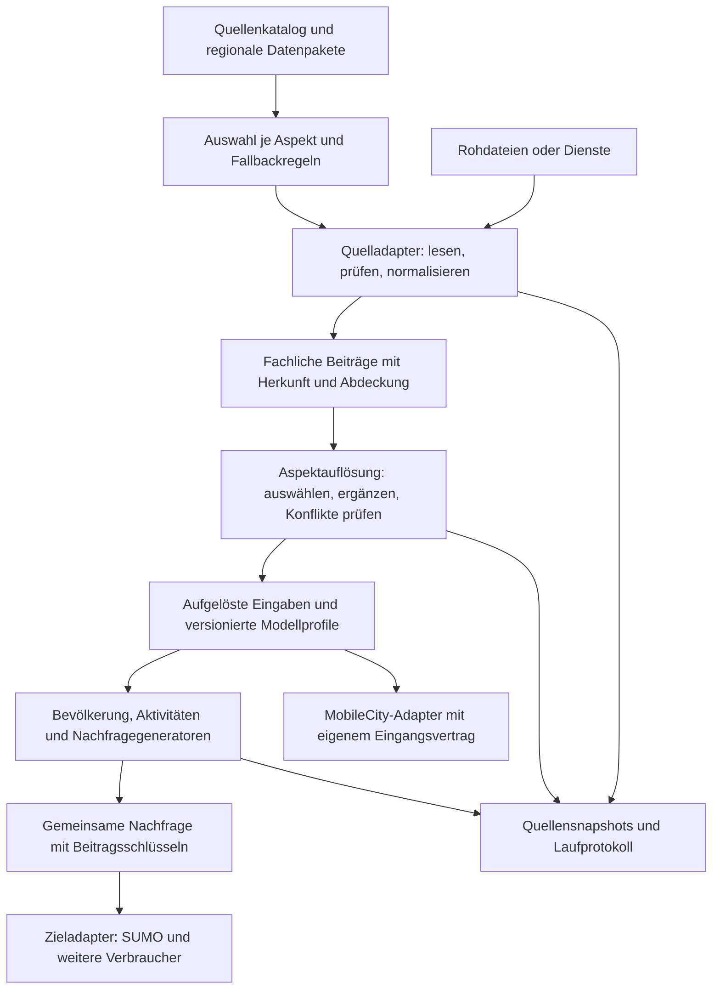

# Datenquellen, fachliche Beiträge und austauschbare Adapter

**Stand: 04.11.2026, einschließlich Quellenlaufbericht im Studio. Verbindliches Zielkonzept mit begrenztem Mindestumfang.**

Die bisherigen Empfehlungen waren zunächst in §18 festgehalten. Sie sind jetzt in
den Fachabschnitten als Anforderungen eingearbeitet. Das ist eine Überarbeitung des
Konzepts, keine Behauptung ihrer vollständigen Implementierung. Der vorhandene Code
ist ein standardmäßig ausgeschalteter experimenteller Schnitt; §13 trennt Nachweise
und offene Gates, §19 verlinkt seinen tatsächlichen Stand.

| Dokument | Zuständigkeit |
|---|---|
| Dieses Konzept | Entscheidungen, Mindestumfang, Fachverträge und Freigabegates |
| [Bestandsaufnahme](22-datenquellen-bestandsaufnahme.md) | Quelleninventar, heutige Ketten und Codebelege Q1–Q20 |
| [Import und UI](22-datenquellen-import-und-ui.md) | Ausführlicher technischer Entwurf und Extraktionsplan des Tourenimports |
| [Konzeptreview](22-datenquellen-konzeptreview.md) | Vergleich mit simudrive, Rückmeldungen und begründete Entscheidungen |
| [Befundregister](05-validierung.md#datenquellenimport-und-quellenplan-2026-10-28--technischer-schnitt-bestanden) / [Umsetzungschronik](06-gta-integration-konzept.md#datenquellen-import-umsetzungsstand) | Ausgeführte Prüfungen bzw. implementierter Umfang |

Die Nummern 1–19 und ihre Überschriften bleiben als Linkziele erhalten; ausgelagerte
Details sind an der bisherigen Stelle verlinkt. Alte Formulierungen „noch Entwurf“
in den Detailunterlagen beziehen sich auf die jeweilige Zielkapazität, nicht auf
eine Abwesenheit des ersten Importpfads.

## 1. Entscheidungsvorschlag

SyntheSis sollte eine **konfigurierbare Quellenauflösung pro fachlichem Aspekt** erhalten.
Der Nutzer wählt beispielsweise eine Quelle für die Bevölkerungsverteilung, eine andere
für Arbeitsbeziehungen und eine dritte für schwere Güterverkehrsmengen. Die Generatoren
arbeiten anschließend mit einheitlichen fachlichen Eingaben. Sie kennen weder einen
konkreten Datenanbieter noch dessen ursprüngliche Spaltennamen.

Das Konzept besteht aus fünf getrennten Bausteinen:

1. **Quelladapter** lesen Daten und erhalten deren Bedeutung, Abdeckung und Herkunft.
2. **Fachliche Datenverträge** beschreiben, was die Daten tatsächlich aussagen.
3. **Auswahlregeln je Aspekt** bestimmen Vorrang, Ergänzung und erlaubte Fallbacks.
4. **Modellbausteine** erzeugen daraus Bevölkerung, Aktivitäten und Nachfrage.
5. **Zieladapter** übersetzen die Ergebnisse für logiTopp, SUMO oder MobileCity.

Ein Quellenwechsel innerhalb eines vorhandenen Vertrags soll durch Konfiguration oder
Importmapping möglich werden. Eine neue fachliche Methode kann weiterhin neuen
Adaptercode benötigen; sie soll dafür keine Änderungen an `GenerationService`, den
bestehenden Generatoren oder anderen Quellen verlangen.

**Wichtigstes fachliches Prinzip:** Ein Fallback ersetzt fehlende Information durch eine
ausgewiesene Modellannahme. Er macht daraus keine Beobachtung. Fehlende Daten,
bewusste Abwahl eines Nachfrageaspekts und ein belegter Wert null sind drei verschiedene
Zustände.

### 1.1 Verbindlicher Mindestumfang

**M0 ist ein begrenzter Import-/Auswahlschnitt, keine Migration aller Quellen.**
Sein Nutzen ist nachgewiesene Wiederverwendung des Tourenimportkerns für andere
Fachverträge und ein expliziter Bezug auf unveränderliche Eingaben.

| Bereich | M0 muss leisten | Bewusst außerhalb von M0 |
|---|---|---|
| Aspekte | Nur `population.distribution`, `opportunities.work`, `freight.vehicleOd` | Haushaltspools, sämtliche Zielkategorien, GTFS, Netz, Flotte und alle übrigen Katalogeinträge |
| Import | CSV/TSV/XLSX und tabellarisch extrahierbare JSON/XML/DOCX für die drei Kleindatenverträge; Rohdatei, Mapping und unveränderliche Revision | Beliebige Hierarchien, nationale Großraster, freie Transformationen, neue Dienstprotokolle |
| Auswahl | Explizite Revision oder Bestandspfad; Arbeitsplätze nur mit klarer Lückenregel; Schwerlast zusätzlich explizit ausschließbar | Allgemeine Kombinationssprache mit sechs frei kombinierbaren Operationen |
| Herkunft | Quellrevision, Rohhash, Einheit, Bezugszeit, deklarierter Raum, Lizenz/Attribution und tatsächliche Anwendungsbilanz | Vollständig aufgeschlüsselte alte Providerketten ohne deren Migration |
| UI | Import und Aktivierung getrennt, serverseitige Planprüfung, verständliche Blocker und Annahmen | Alle internen Zustände als auswählbare Nutzeroptionen |
| Freigabe | Vertragstests und die jeweils betroffenen Fälle aus §13 vor einer allgemeinen Freigabe | Empirische Güterkalibrierung oder globale Quellenabdeckung durch bestandene Unit-Tests |

Die drei Verträge sind umgesetzt, aber die M0-Abnahme ist **noch nicht vollständig**.
Der bestehende Lkw-Mengenpfad ist ausschließlich eine technische Demonstration
(§9.5), kein Bestandteil einer fachlich freigegebenen Fallbacklösung. Ein neuer
Aspekt oder Kompositionsmodus wird erst ergänzt, wenn ein konkreter Verbraucher,
sein Vertrag und ein Prüffall vorhanden sind. Der große Katalog in §6 ist dafür
Orientierung, kein gleichzeitig zu implementierender Umfang.

## 2. Warum die heutige Integration starr wirkt

Quellenwahl, Interpretation und Modellierung sind im Bestand teilweise gekoppelt.
Die [Analyse der Aufrufpfade](22-datenquellen-bestandsaufnahme.md#2-warum-die-heutige-integration-starr-wirkt)
begründet den Umbau; sie beschreibt keine bereits abgeschlossene Bestandsmigration.

## 3. Was bedeutet „generisch“ oder „regionsspezifisch“?

Technische Austauschbarkeit und fachliche Übertragbarkeit sind getrennte Achsen.
Ein generischer CSV-Reader kann ausschließlich regional gültige Daten lesen; ein
weltweit ausführbares Modell kann regional ungeprüfte Parameter verwenden.
[Einordnung und Beispiele](22-datenquellen-bestandsaufnahme.md#3-was-bedeutet-generisch-oder-regionsspezifisch).

## 4. Quelleninventar: heutiger Beitrag zur Nachfrage

Das [vollständige Inventar](22-datenquellen-bestandsaufnahme.md#4-quelleninventar-heutiger-beitrag-zur-nachfrage)
ordnet Bevölkerung/Ziele, Verhalten/Erreichbarkeit, Paket-/Güterverkehr und
Zielmodellerweiterungen den tatsächlichen Bestandspfaden zu. Es unterscheidet
aktive Quellen, Referenzwerte, Offlinevorbereitung und reine Diagnose.

## 5. Heutige Fallbacks als überprüfbare Ketten

Die [Bestandsketten](22-datenquellen-bestandsaufnahme.md#5-heutige-fallbacks-als-überprüfbare-ketten)
sind die Ausgangsbasis für Kompatibilitätstests. Sie sind keine allgemeine
Fachfreigabe ihrer Annahmen; jede Migration muss den betroffenen Zweig nachweisen.

## 6. Fachliche Aspekte als stabile Erweiterungspunkte

Ein Aspekt bezeichnet eine klar begrenzte Information oder Modellleistung. Er ist
kleiner als „OSM“, „Zensus“ oder „Güterverkehr“.

| Gruppe | Vorgeschlagene Aspekte | Warum getrennt? |
|---|---|---|
| Bevölkerung | `population.total`, `population.distribution`, `households.seed`, `households.margins`, `privateCars.ownership` | Andere Gesamtzahl darf Verteilungsraster erhalten; Haushaltspool und Zielrandsummen ergänzen sich |
| Orte / Ziele | `opportunities.work`, `.education`, `.shopping`, `.leisure`, `work.commuterOd`, `work.externalShare`, `locations.addresses` | Ein Arbeitsplatzregister ersetzt nicht Freizeit-POIs; OD und Randwert sind unterschiedliche Informationen |
| Verhalten | `activity.patterns`, `choice.parameters`, `calibration.targets` | Erhebung, übertragene Parameter und Kalibrierziel dürfen nicht ineinander verschwimmen |
| Angebot | `network.roads`, `network.freightRestrictions`, `impedance.car`, `.bike`, `.walk`, `.transit`, `transit.schedule` | Straßen, Restriktionen, Fahrplan und Reisezeitmatrix haben verschiedene Verträge |
| Paketlogistik | `parcel.intensity`, `parcel.depots`, `parcel.lockers`, `parcel.returns` | Mengen und Standorte benötigen unterschiedliche Evidenz |
| Schwerlastverkehr | `freight.vehicleOd`, `freight.productionAttraction`, `freight.departureProfile`, `freight.vehicleMix`, `freight.counts` | OD, Strukturgewichte, Zeitprofil, Flottenmix und Zählreferenz sind nicht gegenseitig austauschbar |
| Unternehmen | `company.tours`, `company.locations` | Reale Auftrags-/Tourenmengen und angenäherte Ortszuordnung getrennt erhalten |
| Flotte / Energie | `fleet.drivetrainShares`, `energy.publicStations`, `sharing.supply` | Infrastruktur und Fahrzeugausstattung erzeugen nicht automatisch Verkehrsaufträge |
| Zielmodellspezifisch | `mobilecity.modelProfile`, `.surroundingPopulation`, `.inboundPurposeShares` | Diese Beiträge nicht fälschlich als gemeinsame Nachfrage ausweisen |

Das ist ein fachlicher Katalog, keine Forderung nach je einer neuen Pipeline-Stufe.
Ein Adapter darf mehrere Aspekte anbieten; ein Szenario darf nur bestimmte seiner
Angebote verwenden. Beispiel: OSM-Straßen bleiben aktiv, OSM-Arbeitsplatzgewichte
werden durch ein kommunales Register ersetzt.

## 7. Zielarchitektur



### 7.1 Vier Begriffe, die im System getrennt bleiben

| Baustein | Beispiel | Verantwortlichkeit |
|---|---|---|
| Datenquelle | Zensus-Datei, kommunales Register, GTFS-ZIP | Rohinformation mit räumlichem/zeitlichem Geltungsbereich |
| Quelladapter | `CensusPopulationAdapter`, konfigurierter Tabellenimport | Liefert typisierte Beobachtungen/Annahmen und prüft deren Bedeutung |
| Modellbaustein | Bevölkerungssynthese, Gravitation, synthetischer Schwerlastgenerator | Leitet neue Information und Nachfrage ab; dokumentiert Parameter |
| Zieladapter | SUMO-/MobileCity-/Legacy-Übersetzung | Übersetzt bekannte Information in Zielverträge und meldet unterstützte Wirkung |

Ein `SourceAdapter` erzeugt beispielsweise `VehicleOdObservation`, nicht direkt
SUMO-XML. Ein neuer synthetischer Gütergenerator ist ein `DemandModule`, keine
vorgebliche Güterverkehrserhebung. GraphHopper ist ein Impedanzberechner, keine zweite
Beobachtungsquelle neben seinem OSM-Netz.

### 7.2 Quellenkatalog und Beitragspakete

Der Katalog enthält Adaptertyp, Version, unterstützte Verträge, Konfigurationsschema
und tatsächlich unterstützte Wirkungen. Ein regionales Datenpaket konfiguriert
konkrete Dateien/URLs, Geometrien, Gültigkeit und Mappings. So kann derselbe
GTFS-Adapter einen anderen Verbund und derselbe Tabellenadapter ein anderes
kommunales Arbeitsplatzregister verarbeiten.

Ein Datensatz deklariert mindestens:

- stabile Quellen- und Datensatz-ID, Adapterversion und Inhaltshash;
- Fachvertrag, Einheit und Grundgesamtheit, etwa Personen, Pendlerbestand,
  Fahrzeugfahrten oder Tonnen; beobachtet, abgeleitet oder angenommen;
- Abdeckungsgeometrie, räumliche Bezugsebene, Koordinatensystem und Schlüsselstand;
- Beobachtungszeitraum, Veröffentlichung/Abruf, Tagestyp und gegebenenfalls Zeitzone;
- fachliche Teilmenge, beispielsweise mautpflichtige Fahrzeuge, private Pkw oder
  ausgewählte Betriebspläne;
- Qualitätsmarker, fehlende/geheim gehaltene Werte und bekannte Einschränkungen;
- Herkunft, Nutzungsbedingungen und Attribution als Metadaten;
- unterstützte Verwendung: Grunddaten, zusätzliche Nachfrage, Randbedingung,
  Kalibrierziel oder unabhängige Prüfung.

`referenceYear=2026` allein genügt nicht, um einen Zensusstand von 2022, ein
Maut-Monatsmittel und einen konkreten Unternehmensdienstag zusammenzuführen.

**Verbindliche Trennung der Konfigurationsobjekte:**

- Ein **Mappingprofil** versioniert Umwandlungsregeln für einen bekannten Fachvertrag.
- Eine **Datenrevision** enthält konkrete normalisierte Daten und deren Rohbelege.
- Ein **Datenpaket** liefert Revisionen oder vorbereitete Tabellen mit Manifest:
  Paket-ID/Version, Fachformat, lokale Datenreferenzen samt Hashes, Gültigkeit,
  Raum-/Zeitbezug, Lizenz, Attribution und Einschränkungen. `unknown` bleibt sichtbar.
- Ein **Quellenprofil** nennt je Aspekt eine explizit geordnete Liste von Provider-IDs,
  Ausschlüsse, Lücken-/Fehlerregeln und zulässige Ersatzmodelle. Ein Szenario bindet
  eine konkrete Profilversion und seine expliziten Überschreibungen.

Eine Paketinstallation ergänzt nur das Angebot. Sie verändert weder die Auswahl
noch die Priorität bestehender Szenarien. Reihenfolgen entstehen nicht aus
Bean-Reihenfolge, Paketinstallation oder automatisch berechneter Gebietsfeinheit.
Pakete führen keinen Code aus; Dienstabrufe erfolgen über konfigurierte Connectoren,
nicht allein durch beliebige Download-URLs in einem Paketmanifest. Lokale Pakete
und geordnete Quellenprofile sind als erster M1-Schnitt für die drei vorhandenen
Fachverträge umgesetzt. Die Übernahme bleibt szenariolokal; eine installationsweite
Paketbibliothek ergänzt die Wiederverwendung gemäß §10.10. Gemeinsame Quellenprofile sind gemäß §10.11 verfügbar; entfernte Kataloge und
weitere Providerfamilien bleiben Erweiterungen. Ein allgemeiner Abhängigkeitsgraph
ist damit noch nicht implementiert.

### 7.3 Technischer Adaptervertrag

Folgendes ist **schematischer Zielcode**, keine heute verfügbare API:

```java
interface SourceAdapter<T extends AspectData> {
    AdapterDescriptor descriptor();
    ProbeResult probe(SourceBinding binding, ResolutionContext context);
    SourceResult<T> load(SourceBinding binding, ResolutionContext context);
}

interface AspectResolver<T extends AspectData> {
    Resolution<T> resolve(AspectPolicy policy, List<SourceResult<T>> inputs);
}

interface DemandModule {
    ModuleDescriptor descriptor();
    DemandContribution generate(ResolvedInputs inputs, ModelProfile profile);
}
```

Adapter-/Moduldeskriptoren deklarieren die benötigten Fachverträge (`needs`),
Versionen und unterstützten räumlich-zeitlichen Bezüge. Sobald austauschbare
Bausteine voneinander abhängen, prüft der Planer fehlende Anforderungen und Zyklen
vor dem Lauf; die Ausführung folgt den Abhängigkeiten innerhalb der seriellen
Pipeline. M0 braucht dafür noch keinen allgemeinen Workflow- oder Plugin-Graphen.

`probe` prüft möglichst leichtgewichtig Eignung und Anforderungen. Es behauptet keine
vollständige fachliche Validierung vor dem Einlesen. `load` liefert typisierte Daten
mit Prüfbericht, Provenienz und Abdeckung. `AspectResolver` enthält die Auswahl- und
Kompositionsregeln; jeder Adapter erfindet nicht seine eigene Vorranglogik.

Fachverträge sollten unter anderem `PopulationGrid`, `HouseholdSeed`,
`HouseholdMargins`, `OpportunityWeights`, `CommuterOd`, `ExternalWorkShare`,
`RoadNetwork`, `TransitSchedule`, `ImpedanceMatrix`, `VehicleOd`, `TrafficCounts`
und `CompanyTours` unterscheiden. Vertragstyp und Konfiguration werden beim
Registrieren/Planen geprüft; reine Stringnamen ohne Typprüfung genügen nicht.

Für Mengen sind Einheit, Population, Zeitraum und räumlicher Bezug Teil des Typs bzw.
verpflichtender Metadaten. Ein Tonnen-OD darf nicht ungeprüft einen Fahrzeug-OD-Slot
bedienen. Die notwendige Umrechnung ist ein gesonderter Modellschritt mit Beladungs-,
Fahrzeug- und Leerfahrtenannahmen.

### 7.4 Praktischer Erweiterungsumfang

| Änderung | Gewünschter Weg |
|---|---|
| Anderer GTFS-Verbund, gleiches Schema | Neue Dateninstanz/Feedkonfiguration, keine Kerncodeänderung |
| Kommunale CSV mit anderen Spalten und bekanntem Inhalt | Gespeichertes Importmapping, Einheiten-/Schlüsselkonfiguration |
| Andere Länderstatistik für vorhandenen Fachvertrag | Datenpaket, falls generischer Parser reicht; sonst separater Adapter |
| Neuer Dienst mit eigenem Protokoll / neues Binärformat | Neuer registrierter Quelladapter, Kern bleibt gleich |
| Neuer fachlicher Zusammenhang, etwa Tonnen → Fahrzeugtouren | Neuer Modellbaustein mit eigenen Annahmen und Nachweisen |
| Neues Zielmodell | Eigener Zieladapter mit expliziter Liste unterstützter Aspekte |

Für den Anfang reichen registrierte Spring-Komponenten und dateibasierte
Adapterkonfigurationen. Kein Pluginmarktplatz und kein dynamischer JAR-Lader sind für
das Ziel erforderlich. Ein neuer Codeadapter darf zunächst einen Build/Neustart
benötigen. Externe Spezialadapter können später dem vorhandenen Prozessmuster mit
versionierten Datei-/JSON-Verträgen, Timeout, Exitprüfung und getrennten Logs folgen.

Tabellenmappings erlauben Spaltenzuordnung, feste Einheitenumrechnung, Schlüsseljoins
und kontrollierte Kategorienzuordnung. Freie Skripte sind kein Ersatz für geklärte
Semantik. Der vorhandene bestätigte Tourenimport liefert ein Vorbild für wiederverwendbare
Mappings; LLM-Vorschläge bleiben Vorschläge und werden nicht zur Datenautorität.

## 8. Auswahl, Kombination und Fallback

### 8.1 Drei unabhängige Nutzerentscheidungen

1. **Aspekt modellieren?** Beispielsweise Schwerlastverkehr einbeziehen oder bewusst
   aus dem Untersuchungsumfang ausschließen.
2. **Welche Quellen dürfen dafür beitragen?** Eine Quelle aktivieren, priorisieren
   oder für einen bestimmten Aspekt ausschließen.
3. **Welche Ersatzannahmen sind zulässig?** Beispielsweise ein übertragbares
   Güterprofil mit dokumentierter Mengenvorgabe erlauben.

„Mautdaten abwählen“ bedeutet damit: Diese Daten werden nicht verwendet, auch nicht
heimlich als Fallback. „Schwerlastverkehr abwählen“ bedeutet: Kein Gütermodul und kein
synthetischer Ersatz dafür. „Quelle fehlt“ bedeutet: Der nächste erlaubte Beitrag
wird geprüft. Das Deaktivieren eines Adapters verhindert auch neue Downloads für
seine abgewählten Beiträge, sofern kein anderer aktiver Aspekt dieselben Rohdaten braucht.

### 8.2 Keine universelle Gewinnerliste

| Kompositionsregel | Geeigneter Fall | Regel |
|---|---|---|
| `choose` | Einwohnergesamtzahl, alternatives Verhaltensmodell | Eine passende Quelle gewinnt im jeweiligen Geltungsbereich |
| `fill-gaps` | Lokales Arbeitsplatzregister plus OSM außerhalb seiner Abdeckung | Primärquelle bleibt; ausschließlich ausgewiesene Lücken ergänzen |
| `constrain` | Randwerte, Verkehrszählungen, Kalibrierziele | Begrenzt/prüft Modelloutput; erzeugt nicht zusätzlich dieselbe Menge |
| `add-disjoint` | Nachweislich getrennte Nachfragepopulationen | Beiträge nur bei geklärter Disjunktheit direkt addieren |
| `add-explicit` | Bewusst additive Unternehmens-/Hintergrundszenarien | Überlappungsrisiko bleibt ausgewiesen; keine Behauptung einer bereinigten Vollnachfrage |
| `compare-only` | Alternative Standortinventare, unabhängige Prüfzähler | Verändert aktive Nachfrage nicht |

Diese sechs Regeln sind ein **Zielkatalog**, kein generisches M0-Regelwerk.
M0 verwendet nur Auswahl und die begrenzte räumliche Ergänzung von Arbeitsgewichten.
Die additive Semantik bestehender Unternehmenspläne bleibt im Bestandspfad;
sie wird hier nicht als neue frei konfigurierbare Operation eingeführt.

Einwohner aus Zensus und einem alternativen Raster werden nicht addiert. POI-Anzahlen
und gemessene Arbeitsplätze benötigen zunächst einen gemeinsamen Bedeutungsmaßstab;
erst dann dürfen sie Gewichte ergänzen. Eine Zählstelle ist keine zusätzliche OD.

Die Auflösung erfolgt je nach Vertrag pro Zone, Zweck, räumlicher Teilmenge,
Zeitfenster oder OD-Relation. Ein lokaler Upload für zwei Gemeinden darf einen
brauchbaren nationalen Datensatz außerhalb dieser Gemeinden nicht verdrängen.

### 8.3 Abdeckung statt bloßer Dateiexistenz

Ein leerer Bereich kann „beobachtet null“ oder „nicht erhoben“ bedeuten. Deshalb
braucht `fill-gaps` eine Abdeckungsmaske mit expliziten Nullwerten, keine Regel
„Wert fehlt/ist null → synthetisch auffüllen“. Ein vollständiges Schulregister mit
keiner Schule in Zone A darf dort nicht durch eine erfundene Schule ergänzt werden.

Qualität ist mehrdimensional: fachliche Passung, Mess-/Modellstatus, Jahr,
Gebietsabdeckung, Einheit, Geheimhaltung und Zuordnungsqualität. Ein einzelner
Score „amtlich besser als OSM“ wäre unzureichend. Die Auswahl erfolgt zuerst nach
Kompatibilität und Ausschlüssen, dann nach expliziter Priorität.

Eine Abdeckungsquote nennt immer ihren Nenner: Anteil der Zonen, Bevölkerung,
Arbeitsplätze, OD-Menge oder vergleichbaren Zählstellen. „80 % Datenabdeckung“
ohne diese Angabe wäre fachlich mehrdeutig. Eine Netz-/Mengenbilanz weist zudem
zugeordnete, verworfene, angenäherte und nicht dargestellte Eingaben getrennt aus.

**Verbindlicher Raumvertrag:** Eine Bbox ist eine Such-/Zuschnittshilfe, kein
allgemeiner Nachweis fachlicher Abdeckung. Jeder Vertrag unterscheidet Datenform,
Erhebungsumfang und tatsächliche Zuordnung:

| Datenform | Maßgeblicher Bezug | Zulässige Ableitung |
|---|---|---|
| Georeferenzierte Betriebsstandorte | Original-ID/Punkt, deklarierte Erhebungsmaske und Vollständigkeitsangabe | Punkt einer Zone zuordnen; Null in nicht belegten Zonen nur bei bestätigtem vollständigem Register für genau diesen Umfang |
| Kommunale Arbeitsplatzsumme | Gemeindeschlüssel als String, Schlüsselraum, Gebietsstand und Beschäftigten-/Arbeitsplatzdefinition | Zunächst Gemeindeaggregat erhalten; räumliche Disaggregation als gesonderten, versionierten Modellschritt ausweisen |
| Raster | Zell-ID, CRS, Auflösung und NoData-/Nullmaske | Intersektion und gegebenenfalls dokumentierte unterzellige Verteilung |
| OD | Schlüsselraum und Gebietsstand beider Enden sowie Zeitraum/Grundgesamtheit | Schlüsselzuordnung und gegebenenfalls Disaggregation beider Enden protokollieren |

Für kommunale Daten muss etwa `codeSystem: de:AGS` zusammen mit dem Gebietsstand
und einer versionierten Geometrie-/Schlüsselreferenz erhalten bleiben. Nicht
aufgelöste Schlüssel, Gebietsänderungen und Gemeinden am Szenariorand sind eigene
Diagnosen. Eine Zuordnung über Namen oder einen Gemeindemittelpunkt ersetzt weder
einen Schlüsseljoin noch die Verteilung einer Gemeindesumme. Ein Gemeindemittelpunkt
macht die gesamte Gemeinde nicht zu einem beobachteten Betriebsstandort.

Eine zum Teil geschnittene Gemeinde braucht eine dokumentierte Allokationsregel
und Mengenbilanz; ohne diese bleibt der übertragbare Anteil unbekannt. Flächenanteile
sind ohne Begründung keine Arbeitsplatzanteile. Die UI fragt ausdrücklich, ob
Betriebspunkte oder Gebietsaggregate vorliegen und welchen Umfang das Register erhebt.

**Implementierter M0-Vertrag:** `workplaces-v1` liest Punkte mit Wert und
deklarierter Box. Für Vorschau, Veröffentlichung und Auswahl ist nun zusätzlich
`coverageDeclaration` erforderlich: `kind=point-register`, `completeness=complete`
und eine Beschreibung des Erhebungsumfangs (10–1.000 Zeichen). Nur so deklarierte
Bestände dürfen vollständig in der Box liegende Modellzonen ersetzen und fehlende
Punkte dort als null behandeln. Ungeklärte/lückenhafte Bestände und Gemeindeaggregate
werden abgewiesen. Die Angabe ist eine Erklärung zur Quelle, keine unabhängige
Verifikation. Für Gemeindeaggregate gibt es inzwischen den getrennten
`municipal-workplaces-v1`-Vertrag mit `de:AGS`, Gebietsstand und unveränderlicher
Referenz auf `municipality-allocation-v1`. Letzterer enthält explizite Punktgewichte
je AGS. Der Join verlangt identische Schlüsselräume, Gebietsstände und Modellversionen.
Er bestätigt keine amtliche Gültigkeit der Schlüssel oder kommunalen Grenzgeometrien.

Alte Revisionen ohne diese Angabe bleiben unter ihrem unveränderten Hash lesbar,
werden aber für Arbeitsgewichte vor dem Queueing abgelehnt. Der Nutzer muss die
Metadaten am Import ergänzen und eine neue Revision veröffentlichen. Eine fehlende
Vollständigkeit wird nicht durch Migration angenommen. Teilzonen bleiben beim
Bestandspfad oder lösen je nach Lückenregel einen Fehler aus. Die vollständige
Komposition wird geprüft, bevor Arbeitsgewichte überschrieben werden. G6 bleibt
wegen amtlicher Schlüssel-/Gebietsverifikation und weiterer Referenzfälle teilweise
offen. Die Punktgewichtsvariante der Gemeindezuordnung verändert ausschließlich explizit mit
Gewichtspunkten belegte Modellzonen; ihre Bbox erzeugt keine Nullabdeckung. Gewichte
werden über alle bereitgestellten Punkte je AGS normalisiert, einschließlich der
außerhalb des Szenarios liegenden Punkte. Der Bericht trennt Originalsumme,
angewendete und außerhalb liegende Menge. Die Verteilung ist eine Modellannahme.
Zusätzlich ist `uniform-area-v1` mit versionierten GeoJSON-Polygonen verfügbar:
Flächenverschneidung in EPSG:3035 mit tatsächlichen Zonenecken, Erhalt von Löchern
und MultiPolygon-Teilen, Abweisung überlappender Gemeinden. Der Nenner ist die
vollständige Gemeindegeometrie. Vollständig abgedeckte Zonen erhalten das Modellgewicht;
Teilzonen folgen der Lückenregel und ihre nicht angewendete Menge bleibt separat.
Die Flächenverteilung ist eine Annahme. Amtliche Geometrieverifikation und automatische
Gebietsstandsüberleitung bleiben offen.

### 8.4 Zustände und Fehlerbehandlung

| Quellenzustand | Bedeutung | Vorgesehene Reaktion |
|---|---|---|
| `excluded` | Vom Nutzer für diesen Beitrag abgewählt | Nicht verwenden; kein Rückgriff über Fallback |
| `not-applicable` | Falsches Land, Zeitraum, Vertrag oder Grundgesamtheit | Nächsten erlaubten Kandidaten prüfen |
| `unavailable` | Geeignete optionale Quelle momentan nicht erreichbar | Erlaubten Fallback verwenden und Ursache erhalten |
| `invalid` | Ausgewählte Datei defekt, widersprüchlich oder mit falscher Einheit | Im Standard abbrechen; kein stilles Übergehen |
| `available-partial` | Verwertbare Teilabdeckung bekannt | Nur erlaubte Lücken ergänzen; Rest offen ausweisen |
| `available` | Für den deklarierten Umfang verwendbar | Fachliche Komposition ausführen |

Der **Aspektstatus** ist separat: `resolved`, `resolved-with-fallback`, `partial`,
`disabled` oder `insufficient-input`. Das sind Diagnosen, keine Nutzeroptionen.
M0 bildet im Code noch nicht diese ganze Taxonomie ab: Es meldet u. a. `legacy`
oder gibt eine fehlerhafte Vorprüfung mit konkreter Meldung zurück. Das darf im
Bericht nicht als bereits vollständiger neuer Statusvertrag ausgegeben werden.

Die heutigen Stage-Statuswerte bleiben bestehen. Bewusste Abwahl bleibt `SKIPPED`,
ein tatsächlicher nicht aufgefangener Fehler `FAILED`. Degradierte Datenqualität
steht im Aspektbericht und darf weder einen Fehler unsichtbar machen noch
fälschlich als zusätzliche neue Stage-Semantik eingeführt werden.

Zwei frei wählbare Nutzungspolicies sind sinnvoll: **Exploration** erlaubt die
ausdrücklich konfigurierten Ersatzprofile; **belastbare Auswertung** verlangt vorab
definierte Mindestabdeckung und Evidenz für ausgewählte Aspekte. Auch Exploration
überspringt eine defekte explizite Datei nicht automatisch.

### 8.5 Teileherkunft statt Evidenzwert `mixed`

**`mixed` ist kein eigenständiger Evidenzwert.** Die UI darf „mehrere Beiträge“
anzeigen; darunter müssen die tatsächlichen Teile und Verarbeitungsschritte
auflösbar bleiben. Mindestvertrag für jeden verwendeten Teil bzw. jede Ableitung:

- ID, Quellrevision oder versionierter Modellschritt und Eingabereferenzen;
- Geltungsbereich: Zonen/Geometrie/Schlüssel, Zweck, Zeit und gegebenenfalls OD/Klasse;
- Evidenzart `observed`, `derived`, `assumed` oder `unknown`; Nutzeruploads ohne
  geprüfte Quellenangabe gelten nicht allein durch das Hochladen als beobachtet;
- separat Herkunftsgebiet/-zeit, Übertragung und Auswahlrolle wie Primär/Fallback;
- Operation und bei tatsächlichen Gewichtungen die Parameter und deren Herkunft;
- Mengenbilanz nur für vergleichbare Größen mit gleichem Nenner.

Beispiel: Ein vollständiges Punktregister innerhalb seiner Maske und OSM-basierte
Arbeitsgewichte außerhalb ergeben zwei räumlich disjunkte Teilbeiträge mit eigenen
Quellenständen. Die Erhebungswerte behalten ihre Herkunft; die Übersetzung von
OSM-Merkmalen in Arbeitsgewichte bleibt eine Modellableitung mit Parametern.
Daraus folgt weder eine gemessene Gesamtarbeitsplatzsumme noch eine erfundene Quote
„60 % beobachtet“. Ein Kompositionsknoten verweist auf beide Teile; er ersetzt sie
nicht durch das Wort `mixed`. Auch eine Ableitung aus Beobachtungen und Annahmen
bewahrt beide Eingaben. Ohne auflösbare Teile ist der Zielvertrag nicht erfüllt.

Für Arbeitsplatzgewichte ist `synthesis-source-provenance-v1` jetzt implementiert:
Quellrevision → Punktzuordnung → Auswahl/räumliche Ergänzung, einschließlich
Originalzeilen/-IDs und zonenweiser Geltung. Externe Zonen-ID und nullbasierter
Modellindex sind getrennte Felder. Der Bestandspfad erhält einen eigenen Teil mit
`evidence=unknown`; seine internen Provider werden dadurch noch nicht aufgelöst.
Nutzerangaben gelten ebenfalls nicht automatisch als beobachtete Evidenz. Der
Bericht summiert Arbeitsplatzmengen nicht mit unvergleichbaren alten Modellgewichten.

Der Vertrag liegt im tatsächlichen Anwendungsbericht, während die Vorprüfung die
Zonenzuordnung als ausstehend meldet. Vollständige Teileherkunft aller übrigen
Aspekte bleibt offen. Ein erfolgreicher Pipeline-Schritt belegt keine empirische
Qualität seines Fallbacks.


## 9. Schwerlastverkehr: konkreter Fallbackentwurf

Ein universeller Faktor „x Prozent der Einwohnerwege sind LKW“ ist ungeeignet.
Schwere Transporte hängen unter anderem von Branchen, Warenströmen, Umschlag und
Fernverkehr ab. Auf einer Autobahn können Quelle und Ziel außerhalb der Region liegen.
Ein fachlich freigegebener Ersatz muss deshalb vier Teilprobleme behandeln:
**Menge, OD-Verteilung, Abfahrtsprofil und Fahrzeugmix**. §§9.1–9.4 sind dessen
Zielanforderungen. Die vorhandene technische Mengendemonstration (§9.5) erfüllt
sie nicht und darf nicht als Umsetzung dieser Leiter geführt werden.

### 9.1 Vorgeschlagene Leiter

| Stufe | Verfügbare Grundlage | Modellreaktion | Ergebnisqualität |
|---|---|---|---|
| 1 | Passende regionale Fahrzeug-OD bzw. reale Touren für klaren Teilumfang | Übernehmen, normalisieren, regionale Projektion getrennt durchführen | Beobachteter/geplanter Teilumfang mit modellierter räumlicher Ausführung |
| 2 | Gröbere Fahrzeug-OD, etwa regionale Mautbeziehungen | Räumlich disaggregieren, Netzrandzugänge zuordnen; Zeit- und Klassenannahmen ergänzen | Gemischte Beobachtung und Modellierung |
| 3 | Verwertbare Branchen-/Beschäftigten-/Flächenwerte und freigegebenes Erzeugungsprofil | Lokale Produktions-/Attraktionsmengen erzeugen; Binnen-/Quell-/Zielanteile verteilen | Synthetische Nachfrage mit belegter Strukturgrundlage |
| 4 | Keine solchen Strukturwerte, aber explizite Tagesmenge oder freigegebenes übertragbares Profil mit Mengenansatz | Menge als Annahme setzen, über verfügbare Standorte/Flächen verteilen | Ausgewiesenes Annahmenszenario; Sensitivitätsband erforderlich |
| 5 | Weder Mengenanker noch freigegebenes Erzeugungsprofil | `insufficient-input`; im vorgesehenen Vollumfang nicht generierbar, im Teilumfang sichtbar fehlend | Keine behauptete Vollnachfrage und kein vermeintlich beobachteter Nullverkehr |

Die Stufen 3/4 sind **neu zu entwickeln und fachlich zu prüfen**. Die vorhandenen
Offlinevorbereiter und `FreightDemandGenerator` implementieren sie nicht bereits.
Das Fallbackprofil kann gebietsübergreifend konfigurierbar sein; seine Koeffizienten
bleiben empirisch zu begründen oder ausdrücklich als Annahmen zu kennzeichnen.

Ein gespeichertes Standardprofil kann die häufige manuelle Codeanpassung ersetzen.
Es braucht aber einen dokumentierten Geltungsbereich, eine Version und offen sichtbare
Parameter. Es gibt keinen in dieser Analyse belegten universellen Defaultwert.

### 9.2 Einfacher, nachvollziehbarer Strukturansatz

Für Zone `i` können zunächst beispielsweise Branchenbeschäftigte `E[i,b]` und
Erzeugungsraten `r[b]` verwendet werden:

```text
P[i] = Summe über Branchen b: E[i,b] * r_erzeugung[b]
A[i] = Summe über Branchen b: E[i,b] * r_anziehung[b]
```

`r` hat hier etwa die Einheit Fahrzeugabfahrten bzw. -ankünfte je Beschäftigtem und
Tagestyp. Eine Fläche oder POI-Anzahl benötigt einen **anderen** Parametersatz.
Die Eingangsgrößen dürfen nicht gleichzeitig als unabhängige Mengenerzeuger addiert
werden, wenn sie dieselben Betriebe beschreiben.

Nach Trennung von Binnen-, Quell- und Zielverkehr werden interne OD-Gewichte über
Attraktion und Netzimpedanz gebildet. Unterschiedliche Produktions-/Attraktionssummen
werden über ausgewiesene Außenbeziehungen oder eine dokumentierte Bilanzierung
behandelt, nicht heimlich passend skaliert. Ein reines Fahrzeug-OD-Modell ist dabei
noch kein Modell physischer Güterketten oder konsistenter Fahrzeugrückläufe.

Für **Durchgangsverkehr** braucht es einen eigenen äußeren Mengen-/OD-Anker oder
ausdrücklich angenommene Gate-to-Gate-Beziehungen. Lokale Arbeitsplätze können
Durchgangsmengen nicht identifizieren. Zählstellen können gemeinsam mit einem
Nachfragemodell und dessen Routen Mengen einschränken; aus einigen Zählwerten folgt
keine eindeutige vollständige OD-Matrix.

### 9.3 Regeln, die auch im Ersatzpfad gelten

- Fahrzeugfahrten, Sendungen, Tonnen und Tonnenkilometer bleiben getrennte Größen.
- Bereits als Fahrzeugfahrten gezählte Maut-OD erhalten keinen pauschalen Zuschlag
  für Leerfahrten. Ein gütermengenbasierter neuer Ansatz benötigt dagegen eine
  explizite Leerfahrten-/Beladungsmodellierung mit passendem Nenner.
- Monatssumme durch Kalendertage ist ein Kalender-Tagesmittel. Ein Werktagsprofil
  oder ein konkreter Dienstag erfordert eine weitere begründete Umrechnung.
- SV einschließlich Busse, SGV und mautpflichtige Fahrzeugklassen sind nicht automatisch
  vergleichbar. Klassenmapping und nicht vergleichbare Teilmengen bleiben sichtbar.
- Unternehmenspläne werden im heutigen Modus zusätzlich eingespeist. Das neue
  System muss diese `add-explicit`-Semantik zunächst erhalten. Späterer Abzug aus
  Hintergrundmengen ist eine eigene, nachweispflichtige Modelloption; identische
  Aggregate erlauben keine verlässliche automatische Einzelfahrtdeduplizierung.
- Paketlieferverkehr und schwere Güterströme sind nicht einfach nach Fahrzeugnamen
  disjunkt. Für eine als vollständig bezeichnete Gesamtbilanz müssen die
  Grundgesamtheiten und mögliche Überschneidungen erklärt werden.
- Personensampling, vollständige Unternehmenspläne und absolute LKW-Zählwerte dürfen
  nicht unbemerkt gemischt skaliert werden. Die heutige 100-%-Bedingung für schweren
  Güterverkehr bleibt bis zu einem geprüften Gewichtungskonzept erhalten.

### 9.4 Beispiel ohne neue Codeänderung je Region

**Region A:** Maut-OD liefert Hintergrundmenge und grobe räumliche Struktur;
kommunale Betriebsdaten verbessern Zielgewichte; Zählungen prüfen den Ausgang;
ein Unternehmensplan wird bewusst additiv aufgenommen.

**Region B:** Keine Mautdaten. Ein Branchenregister und ein ausgewähltes
Erzeugungsprofil erzeugen lokale schwere Nachfrage. Eine eigene Gate-to-Gate-Annahme
oder grobe externe OD ergänzt Transit. Ausgabe: synthetisch, parameterabhängig.

**Region C:** Nur OSM-Netz und eine vom Nutzer gesetzte schwere Tagesmenge. Ein
freigegebenes Ersatzprofil verteilt diese Menge auf Standorte/Randbeziehungen.
Die räumliche und zeitliche Verteilung bleibt Annahme. Ohne Menge oder verwendbares
Erzeugungsprofil ist der Aspekt unzureichend versorgt.

Die Wahl zwischen A/B/C gehört in Datenpaket und Szenariopolicy, nicht in eine
`if (region == ...)`-Verzweigung des Generators.

### 9.5 Vorhandene Mengendemonstration und fehlende Fachfreigabe

`SourceResolver.assumedFreight` nimmt vier vom Nutzer gesetzte Tagesmengen,
platziert zwei Innen- und zwei Punkte nahe dem Boxrand und verteilt Abfahrten
über 0–24 Uhr. Eine ausgewählte Klasse gilt für alle Relationen. Mengen sind
Nutzereingaben, die Punktbruchteile und das Tagesfenster stehen im Code. Ein
`inbound`-Label oder randnaher Punkt belegt keinen realen externen Zugang.

| Teilproblem | Demonstration leistet | Für einen freigegebenen Fallback fehlt |
|---|---|---|
| Menge | Explizite positive Vorgabe, keine Ableitung aus Personenwegen | Begründeter Tagestyp, Population, Parameterversion und Niedrig-/Basis-/Hochannahmen |
| OD | Vier synthetische Relationsmuster | Plausible Standorte und echte Außenbeziehungen, Zugangseignung, Zuordnungs-/Mengenbilanz |
| Zeit | Gleichmäßige Abfahrten im festen Tagesfenster | Auswählbares, versioniertes Tagestyp-/Stundenprofil mit begründeten oder explizit angenommenen Werten |
| Klasse | Eine vom Nutzer gewählte Klasse | Transparenter Klassenmix bzw. explizit akzeptierter Ein-Klassen-Umfang |

Die bisherige Bezeichnung „experimenteller Schnitt“ ist **keine fachliche Abnahme
von §9**. Der Browsernachweis mit drei Fahrten zeigt die technische Verdrahtung.
Für regionale Analysen, Kalibrierung und Aussagen über Vollnachfrage ist dieser
Pfad nach diesem Konzept nicht freigegeben. Der Backendblocker verlangt jetzt
`qualityMode=exploration`, `demonstrationAccepted=true` und eine Annahmenbeschreibung
von 10–1.000 Zeichen. `qualityMode=analysis` lehnt diese Quelle vor dem Queueing ab.
Alte gespeicherte Demonstrationen werden nicht automatisch freigegeben.

Ein positives `ready` bedeutet weiterhin technisch erfüllte Eingaben. Die Wahl
„Fachliche Auswertung“ allein zertifiziert weder sämtliche Quellen noch ein Modell.
Der gesamte Quellenplan bleibt standardmäßig ausgeschaltet.

Vor einer allgemeinen Bereitstellung als Fallback muss der Demonstrationspfad
entweder als solcher separat eingegrenzt oder durch eine explizite Profilkonfiguration
für alle vier Teilprobleme ersetzt werden. Gleichverteilung darf weiterhin eine
bewusst gewählte Explorationsannahme sein, aber kein unbemerkter Default.
Ohne fachlich freigegebenes Profil bleibt §9 offen; Beobachtungsdaten werden dadurch
weder ersetzt noch empirisch bestätigt.

## 10. Konfiguration und Bedienung

### 10.1 Beispielkonfiguration

Folgendes ist ein **Entwurf für eine zusätzliche Konfigurationsstruktur**. Die
Felder sind heute nicht über die Szenario-API ausführbar. Referenzen werden gegen
einen Katalog aufgelöst; Versions- und Inhaltshashes werden beim Lauf eingefroren.

```yaml
dataPlan:
  version: 1
  mode: explore
  sources:
    - id: local-population
      adapter: population-grid
      input: upload:population-grid.csv
    - id: local-workplaces
      adapter: opportunity-table
      input: upload:workplaces.csv
      mappingProfile: municipality-workplaces-v1
    - id: osm
      adapter: osm-snapshot
      input: upload:osm-data.json
    - id: freight-structure
      adapter: employment-by-industry
      input: upload:employment.csv

  aspects:
    population.distribution:
      enabled: true
      strategy: choose
      candidates: [local-population]
      fallback: model:population-density-v1
    opportunities.work:
      enabled: true
      strategy: fill-gaps
      candidates: [local-workplaces, osm]
      fallback: model:synthetic-work-opportunities-v1
    freight.vehicleOd:
      enabled: true
      strategy: choose
      candidates: []
      fallback:
        module: freight-structural-v1
        inputs:
          productionAttraction: freight-structure
        profile: assumed-freight-weekday-v1
        allowAssumptions: true
    company.tours:
      enabled: false
```

`assumed-freight-weekday-v1` muss die im vorigen Abschnitt beschriebenen
Mengen-/Außenverkehrsparameter tatsächlich enthalten; die ID allein liefert keine
fachlich vollständige Konfiguration. Der Resolver prüft auch transitive Anforderungen
an Netz, Geometrien und Impedanzen. Ein nicht existierendes Profil ist ein Fehler.

### 10.2 Bedienoberfläche nach fachlichen Fragen

Das Studio sollte zuerst Aspekte zeigen: „Wie viele Menschen?“, „Wo liegen
Arbeitsplätze?“, „Welcher Schwerlastverkehr?“. Darunter erscheinen passende
Quellen und deren Wirkungen, statt einer langen Liste technischer Klassen.

Pro Aspekt zeigt die Vorschau Auswahl, Abdeckung, Quellenjahr, übertragene Annahmen,
Fallback und unterstützte Zielmodelle. Eine Änderung aktualisiert die sichtbaren
Abhängigkeiten: beispielsweise „kommunales Register für Arbeitsplätze; OSM weiterhin
für Schulen, Einkauf und Straßen“. Eine Quellenkarte kann diese Beziehungen zusätzlich
aus Anbietersicht anzeigen.

Ein Ergebnisbericht könnte so aussehen — **illustrative Werte, keine Messung**:

| Aspekt | Verwendet | Verbleibende Annahme | Status |
|---|---|---|---|
| Wohnbevölkerung | hochgeladenes Raster | Verteilung innerhalb grober Quellzellen | `resolved/derived` |
| Arbeitsplätze | Registerteile mit eindeutiger Maske/Schlüsseln | OSM-Ableitung außerhalb; getrennte Teilebelege | `resolved-with-fallback`; Teileherkunft nach §8.5 |
| Schwerlastverkehr | Branchenregister als Strukturinput | Erzeugungsraten, Transit und Zeitprofil als getrennte Annahmenknoten | `resolved-with-fallback`; keine reine Beobachtung |
| Unternehmenstouren | bewusst abgewählt | keine | `disabled` |
| ÖV-Erreichbarkeit | heutige Pkw-Zeitformel | gesamter Reisezeitansatz | `resolved/assumed` |

Vor dem Start bekannte Blocker gehören in den Preflight; erst nach dem Einlesen
erkennbare Datenprobleme bleiben Laufdiagnosen. Ein Quellenbericht muss pro geprüftem Kandidaten ID/Version, Rang, Ergebnis und
konkreten Grund erhalten: abgewählt, außerhalb des Geltungsbereichs, nicht verfügbar,
ungültig, fehlender Input oder durch einen vorrangigen Beitrag ersetzt. Nicht
geprüfte Kandidaten werden nicht nachträglich als geprüft ausgegeben. Der Bericht
unterscheidet geplante Auswahl und tatsächlich angewendete Teilbeiträge.

### 10.3 Tatsächlich verfügbarer lokaler Paket-/Profilvertrag

Unter `/api/scenarios/{id}/data` sind `GET/POST packs` (POST mit ZIP-Multipartdatei)
und `GET/POST source-profiles` verfügbar. Mappingprofile bleiben unter `profiles`.
Eine Profildefinition hat Vertrag `synthesis-source-profile-v1`, einen Namen und
je konfiguriertem Aspekt eine geordnete Liste `candidates` plus `fallback`.
Kandidaten referenzieren `pack:<ZIP-SHA256>:<Quellen-ID>` oder
`revision:<Revisions-SHA256>`; `excluded` und `onUnavailable: fail|next` sind explizit.
`fallback: none|legacy` bestimmt den Rückweg, wenn kein Kandidat passt.

Ein Szenario wählt je Aspekt `source: profile` und den konkreten Profilhash im Feld
`profile`. Neue Profilversionen und Paketinstallationen ändern diese Bindung nicht.
Abgewählte Kandidaten werden nicht gelesen, spätere Kandidaten nach einer Auswahl
als nicht geprüft protokolliert. Unpassende Region, unvollständige Bevölkerungsbox,
unpassender Fachvertrag und Daten aus einem späteren Szenariojahr werden als nicht
passend protokolliert. Fehlende Dateien erlauben nur bei `next` den nächsten Versuch;
Hash-/Format-/Einheitenfehler brechen ab und bleiben in der Vorprüfung sichtbar.

Der Eingabelock erhält Profildefinition, Kandidatendiagnosen und die tatsächlich
aufgelösten Revisionen. Weiterhin erst im Lauf bekannte Zonenzuordnungsprobleme
sind Fehler, kein nachträglicher stiller Quellenwechsel. Die Einzelprovider des
alten Datenpfads werden noch nicht vollständig als neue Kette ausgewiesen.

[Ausführbare Beispielpakete und Manifestvertrag](examples/data-packs/README.md).
Das ZIP enthält nur ein Manifest und die referenzierten lokalen strukturierten
Dateien. Die gesamte Materialisierung wird vor der ersten Veröffentlichung
fachlich geprüft; der installierte Paketkatalog wird erst abschließend sichtbar.
Ein späterer I/O-Fehler kann unzugewiesene Importrevisionen hinterlassen, aktiviert
aber weder ein unvollständiges Paket noch eine Szenarioquelle.

### 10.4 Gemeindeaggregate, Referenzdaten und Laufzweck

Gemeindegewichte werden zuerst über denselben Importeditor als unterstützende
Datenrevision veröffentlicht. Der Gemeindeimport referenziert danach deren konkreten
Hash in `metadata.geography.allocationRevision`. Die Schlüsselverträge verlangen
`codeSystem: de:AGS` und denselben Gebietsstand. Als Modell sind
`explicit-point-weights-v1` mit `municipality-allocation-v1` oder
`uniform-area-v1` mit `municipality-areas-v1` auswählbar. Quell-AGS bleiben achtstelliger Text,
einschließlich führender Nullen. Vor Veröffentlichung werden Zeilen-/Schlüsselregeln,
vor Verwendung zusätzlich alle benötigten Referenzen und der Join geprüft.

Die Importadapter deklarieren Referenzabhängigkeiten mit Rolle und erwarteter
Schema-ID. Der Resolver prüft fehlende/falsche, zyklische und übermäßig tiefe
Abhängigkeiten und friert verwendete Referenzrevisionen in `sources/lock.json` ein.
Das ist ein begrenzter Revisionsgraph, kein allgemeiner Workflow-/Providerplaner.

Der neue `dataPlan.qualityMode` ist standardmäßig `exploration`. Die technische
Lkw-Demonstration verlangt zusätzlich ihre ausdrücklich gespeicherte Freigabe und
Annahmenbeschreibung. Der Modus `analysis` blockiert diesen Pfad. Für andere Quellen
bleiben empirische Qualitätsanforderungen separat; der Modusschalter ist kein
wissenschaftliches Gütesiegel.

[Importbeispiele und Bilanzierungsregel](examples/municipal-workplaces/README.md).

### 10.5 Erste native Providerfamilie: Bevölkerung

`source: builtins` am Aspekt `population.distribution` wählt eine explizite Liste
`providers` mit IDs `upload-grid`, `census-2022`, `osm-places`, `poi-density`,
`uniform`. Jeder Eintrag hat `excluded` und `onUnavailable: fail|next`. Nur diese
fünf Bestandsprovider sind in diesem Schnitt konfigurierbar; die separate Auswahl
von Datenrevisionen und Quellenprofilen bleibt bestehen. Es gibt keinen stillen
Rückweg aus einer erschöpften Liste. OSM für Straßen/Arbeitsplätze bleibt unabhängig.

Der Quellenplan bindet den vorhandenen Uploadhash bzw. sein Fehlen vor dem Queueing.
Die tatsächliche räumliche Auflösung folgt nach Zonierung und OSM. Deshalb meldet
Preflight `pending-resolution`; das ist keine bestätigte Verfügbarkeit. Der Lauf
bewahrt Kandidatenstatus, Gesamtzahl- und Verteilungsherkunft sowie den verwendeten
Upload. Integritätsfehler und unterdrückte/ungültige Rasterwerte sind im expliziten
Pfad fatal. Der neue typisierte Zellvertrag aus §10.9 unterstützt explizite Masken;
eine automatische Maskenübernahme aus beliebigen nativen Rastern bleibt offen. Die Mischung nativer und importierter
Kandidaten ist inzwischen gemäß §10.7 verfügbar.
[Bedienung und Vertrag](examples/population-sources/README.md).

### 10.6 Gemeinsamer Auswahlkern und native Arbeitsgewichte

`ProviderChain<T>` kapselt jetzt die gemeinsame verzögerte Auswahl für Bevölkerung
und Work. `source: builtins` am Aspekt `opportunities.work` erlaubt `osm-pois` und
`synthetic` mit denselben Vorrang-/Abwahl-/Ausfallregeln. Die Werte sind Modellgewichte,
keine beobachteten Arbeitsplatzmengen. Eine eigene Seedableitung isoliert den
synthetischen Work-Ersatz von der Zufallsfolge der bestehenden Pipeline.
Andere Zielzwecke und OSM-Verbraucher bleiben unabhängig.

Die Kombination dieser nativen Kandidaten mit importierten Registerteilen und
konfigurierbaren nativen Lückenfüllern ist inzwischen im Schnitt §10.7 umgesetzt. Auch der gemeinsame OSM-
Transportpfad ist noch nicht vollständig auf einzelne Provideradapter migriert.
[Bedienung, Herkunftsvertrag und Grenzen](examples/workplace-sources/README.md).

### 10.7 Gemischte Profile und explizite Registerlücken

Profile für Bevölkerung und Work können native `builtin:`-Kandidaten mit Revisionen
und Paketquellen kombinieren. Potenziell benötigte Revisionen werden vor Queueing
geprüft und im Lock gebunden; die tatsächliche Auswahl folgt im Lauf. Native Profile
haben keinen impliziten Legacy-Rückweg. Für Register sind explizite native Lückenfüller
konfigurierbar; vollständige Registerzonen einschließlich Null bleiben unverändert,
Teilzonen folgen einer ganzen Ersatzzuordnung mit separater Mengen-/Teileherkunft.
Die Komposition wird vor ihrer Anwendung vollständig geprüft. Mehrere regionale
Register lassen sich inzwischen mit der expliziten Strategie aus §10.8 ergänzen.
[Verbindlicher Vertrag, Beispielpaket und Bedienung](examples/mixed-sources/README.md).

### 10.8 Mehrere Register regional ergänzen

Work-Profile können mit `strategy: fill-gaps` mehrere importierte Register räumlich
nach Vorrang ergänzen. Ganze vollständig abgedeckte Zonen, einschließlich Nullwerten,
bleiben beim ersten geeigneten Register. Nachrangige überlappende Mengen werden
getrennt ausgewiesen, statt sie zu addieren. Nur Restlücken verwenden explizite native
Ersatzquellen. Alte Profile behalten ihren bisherigen Hash und die Auswahlstrategie.
[Vertrag, Mengenbilanz und Beispiel](examples/regional-registers/README.md).

### 10.9 Rasterzellen mit Wertstatus und expliziter Restmengenverteilung

Die neuen Importverträge `population-cells-v1` und `workplace-cells-v1` verwenden
EPSG:3035-Quellzellen mit vollständiger Ausdehnung und getrennten Zuständen `value`,
`missing`, `not-collected`, `suppressed`. Echte Null bleibt ein belegter Wert;
NoData-Marker bleiben als Beleg erhalten und werden nicht zu Zahlen umgedeutet.
Reader/Mappingeditor, Revisionen, Pakete und Quellenprofile werden wiederverwendet.

Nur vollständig bekannte Modellzonen übernehmen flächenproportionale Quellmengen.
Teilzonen werden als ganze Lücke behandelt; bekannte dabei nicht angewendete Mengen
stehen separat in der Bilanz. Work nutzt nachrangige Register oder ausdrücklich
gewählte native Lückenmodelle. Bevölkerung benötigt bei Lücken eine manuelle
Gesamtzahl: Nur die Differenz zu den bekannten übernommenen Mengen wird auf offene
Zonen verteilt. Widersprüchliche Gesamtzahlen schlagen fehl. Datenherkunft,
Flächenannahme, Mengenanker und Ersatzmodell bleiben als einzelne Graphteile erhalten.

Das ist ein begrenzter Zellvertrag, keine allgemeine Rastermigration. Native alte
Zensus-/Uploadpfade bleiben strikt; beliebige CRS/GeoTIFFs, unterzonale Ergänzung und
empirische Fachabnahme bleiben offen.
[Vertrag, UI, Bilanz und ausführbares Beispiel](examples/masked-cells/README.md).

### 10.10 Datenpakete szenarioübergreifend wiederverwenden

Eine installationsweite Bibliothek kann portable `synthesis-data-pack-v1`-ZIPs
entgegennehmen oder eine bestehende Szenariopaketversion übernehmen. Der Paket-SHA-256
ist die unveränderliche Identität. Alle Referenzrevisionen müssen im Paket vorhanden
und fachlich passend sein. Einzelimporte werden nicht automatisch veröffentlicht.

Ein weiteres Szenario übernimmt eine konkrete Kopie samt identischen Revisionshashes.
Die Quellenauswahl und ihre Lückenregeln bleiben ein separater Schritt. Neue zentrale
Versionen verändern weder vorhandene Kopien noch Profilbindungen. Der Lauf liest
weiterhin ausschließlich szenariolokale, eingefrorene Eingaben. Ein beschädigter
zentraler Eintrag wird angezeigt und kann nicht übernommen werden; vorhandene
Szenariokopien bleiben unabhängig.

Dieser Schnitt löst die lokale Wiederverwendung von Datenpaketen. Gemeinsame Quellenprofile wurden mit §10.11 ergänzt. Automatische
Regionalempfehlungen, entfernte Katalogdienste und
empirische Qualitätsfreigaben bleiben offen.
[Bedienung, API, Abhängigkeiten und Versionsbeispiel](examples/source-library/README.md).

### 10.11 Quellenprofile samt Paketabhängigkeiten teilen

Die lokale Bibliothek kann zusätzlich unveränderliche `synthesis-source-profile-v1`-
Profile aufnehmen. Portable Profile enthalten native Provider oder feste Paketbeiträge;
direkte Szenariorevisionen bleiben lokal. Sämtliche aktiven Paketabhängigkeiten werden
vor Übernahme geprüft und eingelesen. Ausgeschlossene Pakete werden nicht gelesen.
Profil- und Revisionshashes bleiben beim Kopieren erhalten.

Die Übernahme kopiert die Regel und benötigte Daten; Auswahl, Lückenregeln und
Mengenanker bleiben eigene Szenarioentscheidungen. Neue Bibliotheksversionen binden
keine vorhandenen Szenarien um. Native Provider werden im Ziel neu aufgelöst, ihre
Uploads/Liveantworten werden nicht durch eine Profilkopie mitgeliefert. Der Lauf
verwendet weiterhin ausschließlich szenariolokale Profile und Daten.
[Vertrag, API, UI und Versionsbeispiele](examples/shared-source-profiles/README.md).

### 10.12 Schwerlastquellen bis zur tatsächlichen Zielwirkung prüfen

Die relationale Schwerlastbilanz unter `sources/resolution.json.freight` verbindet
gebundene Quellenzeilen und Revisionen mit den tatsächlich erzeugten Tagesmengen.
Die vollständigen Fahrten bleiben über `relationId` in `freight/trips.csv` verknüpft.
Quellenevidenz und modellierte Abfahrtsverteilung bleiben getrennt; die technische
Demonstration wird auch in den älteren Freight-Berichten als Annahme gekennzeichnet.

Die Auswahl betrifft allein den schweren Hintergrund. Unternehmenstouren bleiben
eigenständig. Ein begrenzter neuer Migrationsnachweis sichert diese additive Semantik,
Revisionswechsel und Wiederholbarkeit bis zur nativen SUMO-Ausführung. Er ersetzt
keine private Nachfrage-/Paket-/MobileCity-Abnahme oder empirische Regionalvalidierung.
[Vertrag, feste Fallmenge und Grenzen](examples/source-plan-traffic/README.md).

### 10.13 Quellenlaufbericht mit lesbarer Teileherkunft

Die Studio-Prüfung zeigt die tatsächlich aufgelösten Beiträge des zuletzt gestarteten
Laufs: Mengen, Registerteile, Ersatzrollen, Evidenz und Zonen bleiben getrennt.
Laufkennung, Zeitpunkte sowie Plan-/Quellenbindungshashes unterscheiden den Bericht
von aktuellen Szenarioänderungen. Auch frühe Fehler hinterlassen eine explizite
Teilbilanz; alte Zielartefakte belegen keinen Erfolg einer übersprungenen Stufe.
Erzeugung und tatsächliche Zielwirkung werden separat dargestellt.
[Vertrag, Bedienung und Grenzen](examples/source-run-report/README.md).

## 11. Reproduzierbarkeit, räumliche Verträge und Ausführung

### 11.1 Gefrorene Eingaben pro Lauf

**Eine Regelbasis, unterschiedliche Prüfzeitpunkte:** Die UI-Vorprüfung und die
Vorbereitung eines Laufs benutzen denselben Backendresolver mit demselben Profil.
Vor dem Laden unbekannte Abdeckung oder Zonenzuordnung bleibt als ausstehend
sichtbar. Erst der Laufbericht enthält die tatsächlich angewendeten Teile; ein
positiver Preflight ist kein Ersatz für diese Bilanz und keine Fachkalibrierung.

Ein neuer Quellenplan wird vor dem Start versioniert. Downloads werden als konkrete
Snapshots mit Hash registriert, bevor die von ihnen abhängige Modellierung beginnt.
Ein Replay benutzt dieselben Bytes; `latest` und ein unveränderter Seed allein
reichen nicht. Ein eingefrorener Lauf ersetzt fehlende Daten nicht unbemerkt durch
einen neuen Liveabruf. Ein ausdrücklich neuer Live-Lauf darf andere Quellenstände
auflösen und bekommt einen neuen Fingerabdruck.

Vorgeschlagene **zusätzliche**, versionierte Artefakte unter dem bestehenden
`artifacts/`-Vertrag:

```text
sources/plan.json           ausgewählte Policy, Adapter-/Profilversionen
sources/lock.json           aufgelöste Datensatzversionen und Inhaltshashes
sources/resolution.json     tatsächliche Beiträge, Abdeckung, Ablehnungen, Fallbacks
sources/snapshots/          verwendete Rohdaten oder unveränderliche Referenzen
```

Das ist eine geplante Erweiterung des Artefaktvertrags, keine Umbenennung der heutigen
`population/`, `matrix/`, `demand/`, `freight/` und `mobilecity/`-Ausgaben. Große oder
geschützte Rohdaten dürfen über unveränderliche, auflösbare Referenzen angebunden
werden; fehlen die referenzierten Inhalte, ist der Lauf nicht vollständig replayfähig.
Die bisherige Manifeststruktur kann zunächst auf den neuen Bericht verweisen.

Der Fingerabdruck umfasst Quellenbytes, Adapter-/Mappingversion, Modellparameter,
räumliche Zuordnung, Netzstand, Zeitauswahl, Seed und relevante Laufzeitversionen.
Cacheidentität nur über Feedname oder Gebiet wäre unzureichend. Ein Hash allein
belegt keine fachliche Richtigkeit.

Bei LLM-Bausteinen gehören Prompt-/Modellkonfiguration und verwendete Antworten
zum eingefrorenen Modelloutput. Ein erneuter LLM-Aufruf ist trotz gleicher Seeds
nicht pauschal als deterministisch anzunehmen. Replay gespeicherter Antworten und
erneute Generierung sind deshalb getrennte Betriebsarten.

### 11.2 Stabile räumliche und zeitliche Identität

- Quellschlüssel bleiben erhalten; die Zonenabbildung wird separat protokolliert.
  Neue Adapter unterscheiden externe Zonen-ID und OID/Matrixspalte ausdrücklich.
- Zonen-/Projektionswechsel invalidieren sämtliche davon abhängigen Zuordnungen
  und Matrizen. Unterzellige Detailgenauigkeit wird nicht aus gröberen Quellen behauptet.
- Originalpunkte/-OD bleiben erhalten. Netzrandprojektion und Snapping sind
  Ausführungsableitungen, keine nachträgliche Veränderung der Beobachtung.
- Gerichtete SUMO-Kanten gelten nur für einen konkreten Netzfingerabdruck. Sie
  sind keine allgemein gültigen Orts-IDs eines quellenneutralen Fachmodells.
- Betriebstag, Kalendertag, Modellwoche, Zeitzone und Einheiten werden vor der
  Kombination explizit normalisiert. Der heutige gemeinsame `Movement`-Vertrag
  verwendet Wochen-Sekunden; native Eingaben verwenden teils Tages-Sekunden oder
  Wochen-Minuten. Diese Umrechnung bleibt Aufgabe klarer Grenzadapter. [Q18]

### 11.3 Integration in die bestehende Pipeline

Die aktuelle Reihenfolge beginnt mit Zonierung, POIs, Bevölkerungsgesamtzahl/-verteilung,
Attraktivitäten/Außenzielen, Matrizen, Bevölkerung und Aktivitäten. Danach folgen
Logistik, Exporte und Simulation. Die Matrizen stehen inzwischen vor der
Bevölkerungssynthese, weil feste Ziele deren Pkw-Zeiten verwenden. [Q1]

Die neue Auflösung folgt diesen Abhängigkeiten. Ein Preflight plant Kandidaten und
prüft Anforderungen; erst mit vorhandenen Zonen/Netzen werden deren Zuordnungen
berechnet. Eine netzabhängige Güterprojektion kann nicht schon vor dem Netzbau als
abgeschlossen gelten. Hierfür reicht zunächst ein kleiner deklarierter
Abhängigkeitsgraph innerhalb der bestehenden seriellen Orchestrierung.

`GenerationService` ruft perspektivisch fachliche Eingaben ab, etwa
`resolved.populationDistribution()`, statt selbst Dateinamen zu suchen. Das
bedeutet keine Parallelisierung: ein Executor, isolierte externe Prozesse und die
bestehenden Ressourcenbudgets bleiben erhalten. Gemeinsame OSM-Rohdaten werden
pro Lauf wiederverwendet, ohne unterschiedliche fachliche Beiträge gleichzusetzen.

Neue Modellmodule erhalten stabile, vom Szenarioseed abgeleitete Zufallsströme
je Modul/Entität. Das Aktivieren einer neuen Güterquelle soll nicht zufällig andere
Haushalte erzeugen. Die alten gemeinsamen Zufallsfolgen werden in der ersten
Kompatibilitätsstufe erhalten; eine Umstellung wird separat versioniert und geprüft.

### 11.4 Gemeinsame Nachfrage als Anschlussstelle

`TrafficDemand` vereinigt heute Personen, Paketbewegungen, schwere Fahrten und
Unternehmenstouren. Das ist ein geeigneter Anschluss für zusätzliche Nachfragemodule,
aber noch kein vollständig vom ausführenden Modell unabhängiger Generierungsstack:
fertige Personen-/Paketnachfrage entsteht weiterhin im logiTopp-Pfad. [Q18]

Ein zusätzlicher Beitrag braucht stabile Identität, Quellbezug, Zeit-/Mengenbasis,
Kategorie und klaren Kombinationsmodus. Unique Trip Keys verhindern doppelte
technische IDs, aber keine unerkannte inhaltliche Überschneidung verschiedener
Aggregatquellen. Ein neuer Adapterbericht muss außerdem unterscheiden, ob Nachfrage
geplant, geroutet, eingesetzt und abgeschlossen wurde.

Eine spätere direkte Übernahme der gemeinsamen Nachfrage durch MobileCity ist ein
eigener Fachvertrag mit Aggregations- und Kalibrierfragen. Sie ist kein Nebenprodukt
der Quellenregistry und kein stiller Teil dieses ersten Umbaus.

## 12. Umsetzung in begrenzten, überprüfbaren Schritten

| Stufe | Begrenzter Umfang | Stand / Übergangsbedingung |
|---|---|---|
| M0: Import und explizite Auswahl | Genau drei Verträge aus §1.1; gemeinsamer Reader/Mappingeditor, Revisionen, Punktzuordnung und vorhandener Bestandspfad | Technisch implementiert und teilweise geprüft; offene Herkunfts-/Vollständigkeitsgrenzen und Migrationsgates schließen, bevor allgemeine Freigabe behauptet wird |
| M1: Konfigurierbare Providerprofile und Datenpakete | Explizite Kandidatenreihenfolge, Manifestvertrag, Gründe je Kandidat; bei Bedarf Abhängigkeitsprüfung | Erster szenariolokaler Schnitt für die drei M0-Verträge implementiert; CSV-/JSON-Pakete und Nicht-DE-Offlinefall geprüft. Installationsweite Paketbibliothek gemäß §10.10 ergänzt; gemeinsame Quellenprofile gemäß §10.11 ergänzt; weitere Providerfamilien und allgemeiner Abhängigkeitsgraph offen |
| M2: Fachlich freigegebener Schwerlastfallback | Menge, OD, Zeit und Klassen als versioniertes Profil, Unsicherheit und Außenverkehr | Offen; die Mengendemonstration zählt nicht als erledigter Schritt |
| M3: Weitere Bestandsquellen | Jeweils ein weiterer Fachvertrag/Verbraucher, etwa GTFS oder Haushaltsrandsummen | Nur bedarfsweise und mit eigenen passenden Gates; keine gleichzeitige Migration des ganzen Katalogs |

Der experimentelle Quellenplan bleibt standardmäßig deaktiviert. Alte Szenarien
verwenden ihre bisherigen Eingaben und Prioritäten. Der Rückweg ist ausgeschalteter
Plan plus bestehende Eingangsartefakte. Keine neue Policy wird ohne die betroffenen
Nachweise zum Standard. Änderungen an Fallthrough, Zufallsfolge oder Modellparametern
werden getrennt von verhaltensgleichem Refactoring versioniert.

## 13. Nachweise, die vor Übernahme nötig sind

**Dies ist eine Freigabematrix mit Ist-Stand, keine Liste ausschließlich künftiger
Tests und keine bereits bestandene Gesamtfreigabe.** Der erste Code wurde vor einer
vollständigen Mehrzweigabnahme implementiert. Die frühere Formulierung „künftige
Abnahme“ neben §19 war deshalb missverständlich. Heute vorhandene Prüfungen sind
im [Befundregister](05-validierung.md#datenquellenimport-und-quellenplan-2026-10-28--technischer-schnitt-bestanden)
belegt; „offen“ darf nicht allein durch eine grüne Gesamtsuite erledigt werden.

### 13.1 Verbindliche Fallmenge

Die folgende Menge ist **jetzt festgelegt, noch nicht vollständig ausgeführt**.
Vor einer weiteren Migration müssen konkrete Fixture-IDs, Eingabehashes, Szenario,
Seed, erwarteter Pfad und Vergleichsartefakte für den betroffenen Fall eingefroren
sein. Das ist keine rückwirkende Behauptung einer Präregistrierung des ersten Codes.

| Gate | Fall und geforderter Nachweis | Tatsächlicher Stand am 02.11.2026 |
|---|---|---|
| G1 | Bestandspfad gegen neuen Kompatibilitätspfad mit eingefrorenen Eingaben; fachliche Artefakte bytegleich | **Teilweise:** fünf native Bevölkerungszweige vergleichen Plan aus, explizites Legacy und Standardprovider im aktuellen Code über Population, Matrizen, Zonen, Legacy und Logistik byteweise. Fünf gefüllte CSV-Mindestartefakte sowie Fixture-/Ergebnishashes werden zusätzlich ausdrücklich gesichert. Eine isolierte Vor-Umbau-Baseline bleibt offen |
| G2 | Deutscher Stadtfall: Raster, Ziele, Außenbeziehungen, relevante Profile | **Offen:** keine festgehaltene vollständige Referenzregeneration dieses Zweigs |
| G3 | Deutscher Landfall mit anderen verfügbaren Quellen und erlaubtem Fallback | **Offen** |
| G4 | Gebiet ohne deutschen Datenbestand; alternative Pakete; keine still übertragenen Deutschlanddefaults | **Teilweise:** synthetischer französischer Offlinefall mit CSV-/JSON-Paketen und expliziter Gebietsauswahl bestanden; keine vollständige empirische regionale Abnahme |
| G5 | Grenz-/Teilgebiet: vollständige Zonen vs. Teilzonen, kommunale Schlüssel und wechselnder Gebietsstand, Außenbeziehungen | **Teilweise:** Boxlücken/-fehler unitgeprüft; geografische/kommunale Referenzfälle offen |
| G6 | Punktregister und Gemeindeaggregate getrennt: echte Null, nicht erhoben, Geheimhaltung, ungeklärte Vollständigkeit, unbekannter Schlüssel; Mengenbilanz | **Teilweise:** Punktregistervertrag sowie AGS-/Gebietsstandsjoin mit expliziten Gewichten, Null-/Außenmengen und Referenzintegrität geprüft; typisierte Rastermasken und Mengenanker gemäß §10.9 geprüft; amtliche Geometrie-/Schlüsselprüfung und weitere Referenzfälle offen |
| G7 | Abwahl, falscher Vertrag, fehlende/defekte Quelle, fehlendes Profil und transitive Anforderungen | **Teilweise:** Schwerlastausschluss, Vertrags-/Jahres-/Einheitenfehler und Profilstruktur geprüft; native Bevölkerungs- und Work-Ketten verwenden gemeinsame Abwahl-, Reihenfolge-, Fehler-/Ausfallregeln; übrige Providerketten fehlen |
| G8 | Zusammengesetzte Beiträge: gleiche Regel in Preview/Lauf, Teileherkunft und Anwendung je Raum/Zeit/Relation | **Teilweise:** gemeinsame Vorbereitungsregel und zonen-/zeilenbezogene Teileherkunft für Arbeitsgewichte geprüft; Gesamtzahl-/Verteilungsherkunft und gemischte Profile sowie zonenbezogene native Registerlücken ergänzt; übrige Aspekte und weitere interne Bestandspfade offen |
| G9 | Lkw-Fallback mit Menge, OD, Zeit, Klassen und Niedrig-/Basis-/Hochprofil; getrennte Außenmengen | **Offen:** zusätzliche Explorationsfreigabe und Analysesperre implementiert/geprüft; diese technische Absicherung ersetzt den fachlichen Fallbacknachweis nicht |
| G10 | Unternehmensbeitrag plus Hintergrund: erhaltene additive Semantik, Revisionswechsel und keine unbeabsichtigten Zufalls-/Mengenänderungen | **Für den begrenzten Schwerlast-/Unternehmensschnitt bestanden:** zwei künstliche Netzlagen und drei Seeds prüfen Bestand, Revision, Quellenprofil, Revisionswechsel und Schwerlastausschluss. Unternehmensidentitäten und 69 Population-/Matrix-/Exportdateien bleiben erhalten; eingefrorene Eingaben und native Wirkung sind geprüft. Aktive Paketfahrten und simulierte private Nachfrage fehlen in diesem Schnitt |
| G11 | Zwei unterschiedliche Datenpakete für denselben Vertrag, explizite Installation/Auswahl, Fingerabdruck bei Inhalts-/Mappingänderung | **Für den lokalen M1-Schnitt bestanden:** CSV-/JSON-Pakete, explizite Installation/Reihenfolge/Abwahl, Profil-/Inhaltshashes und Fehlerregeln geprüft; installationsweite Paketbibliothek mit unabhängigen Szenariokopien und Versionsbindung zusätzlich geprüft; keine allgemeine Freigabe weiterer Formate oder externer Kataloge |
| G12 | Angeforderte Zielwirkung: Export, Routing, Einsatz und gegebenenfalls Abschluss korrekt oder explizit nicht unterstützt | **Teilweise:** 18 native SUMO-Läufe durch den neuen Quellenplan prüfen schwere Hintergrundfahrten plus Unternehmen bis zum Abschluss, einschließlich Revision/Profil/Abwahl und null Teleports. Private Fahrten und Paketfahrten sind darin nicht simuliert; volle MobileCity- und reale Regionalabnahme bleiben offen |

### 13.2 Vergleichsvertrag und Freigabe

Bytevergleiche verwenden eingefrorene Quellbytes, Antworten, Profile, Seeds und
Laufzeitstände. Vor dem Lauf ist eine Positivliste der zu vergleichenden fachlichen
Dateien festzulegen; volatile Metadaten und Toolkommentare erhalten eine explizite,
begrenzte Ausschlussregel. Neue Herkunftsberichte werden auf Inhalt und Referenzen
geprüft statt gegen nicht vorhandene alte Dateien verglichen. Keine nachträgliche
Toleranzerweiterung, um Abweichungen als bestanden zu melden.

Ein Vergleich zweier Schalterstellungen **im neuen Code** schützt eine Eigenschaft,
ist aber kein vollständiger Vorher-/Nachherbeweis der Extraktion. Für diese Aussage
braucht es eine isolierte Baseline des ursprünglichen Codes mit identischen
Fixture-Eingaben. Ein absichtlich behobenes Modellproblem bekommt einen erklärten
neuen Sollwert und wird nicht als verhaltensgleich bezeichnet.

M0 braucht seine Vertrags-/Fehlerfälle sowie die von seinem tatsächlichen Eingriff
betroffenen G1–G8/G10/G12. M1 braucht zusätzlich G11; M2 zusätzlich G9 und eine
passende empirische Prüfung, soweit solche Ansprüche erhoben werden. Nicht betroffene
Gates dürfen nur mit begründetem Scope ausgeschlossen werden. Kein teilweise
geprüfter Fall wird dadurch zum bestandenen Gesamtfall.

Neue Adapter erhalten Vertragsfixtures, unsichere externe Mechanik einen vollständigen
Spike. Die üblichen Backend-/Frontend-Gates sind zusätzlich erforderlich. Für diese
reine Konzeptrevision wurden keine neuen Simulationsläufe oder Codesuite-Nachweise
beansprucht; ausgeführt werden Dokument-/Linkkonsistenzprüfungen.

## 14. Priorität und verbleibende Entscheidungen

**Empfehlung:** Zuerst die vorhandene Quellenwahl sichtbar und danach Bevölkerung
sowie zweckbezogene Standortdaten austauschbar machen. Anschließend folgt der schwere
Güterverkehr als eigenes Nachfragemodul mit klar begrenztem Ersatzprofil. Das nutzt
vorhandene Verträge, ohne sofort alle Simulatoren oder die gesamte Pipeline umzubauen.

Vor einer fachlichen Freigabe des Schwerlast-Ersatzmoduls sind insbesondere diese Entscheidungen
offen: akzeptierte Erzeugungsraten/Strukturquellen, Transitanker, Fahrzeugklassifikation,
Tagestypen, zulässige Unsicherheit und der Geltungsbereich additiver Unternehmenspläne.
Sie können als versionierte Profile gepflegt werden. Ihre Werte sollten nicht erneut
als unkommentierte Konstanten im Kerncode landen.

Das angestrebte Ergebnis ist ein je Aspekt erklärbarer Lauf: **welche Information aus
welcher Quelle kam, was das Modell ergänzt hat, warum ein Fallback benutzt wurde und
welche Nachfrage dadurch tatsächlich entstanden ist.**

## 15. Codebelege und Prüfgrenze

[Codebelege Q1–Q20](22-datenquellen-bestandsaufnahme.md#15-codebelege-und-prüfgrenze)
belegen die Bestandsverdrahtung. Die Verweise `[Q…]` in diesem Konzept beziehen
sich auf dieses Inventar. [Ausgeführte Prüfungen und Grenzen](05-validierung.md#datenquellenimport-und-quellenplan-2026-10-28--technischer-schnitt-bestanden)
stehen im Befundregister; nicht ausgeführte Gates sind in §13 als offen markiert.

## 16. Technische Konkretisierung: unterschiedliche Formate normalisieren

Der [technische Detailentwurf](22-datenquellen-import-und-ui.md#16-technische-konkretisierung-unterschiedliche-formate-normalisieren)
trennt Beschaffung, Reader, semantisches Mapping, Validierung und Revisionen.
Normalisierte Quelldaten bleiben unabhängig von der Szenariozonierung; räumliche
Disaggregation und die Ableitung neuer Mengen sind Modellschritte. Ein Mappingprofil
liefert Regeln, ein Datenpaket konkrete Daten. Neue Formate und Fachbedeutungen
können neue Reader bzw. Fachadapter benötigen.

## 17. UI-Konzept: Datenarbeitsbereich im Studio

Der [UI-Detailentwurf](22-datenquellen-import-und-ui.md#17-ui-konzept-datenarbeitsbereich-im-studio)
beschreibt Beiträge, Datenbestand, Import und Laufprüfung. Verbindlich sind die
Trennung von Import und Aktivierung sowie eine gemeinsame Backendregel für
Vorprüfung und Generierung. Eine Einstellung hat genau einen maßgeblichen Wert;
Spezialansichten verlinken auf ihn. Die vollständige Migration der bisherigen
Bedienelemente ist noch offen.

Nicht anwendbare oder ausgeschlossene Beiträge bleiben im sichtbaren Laufumfang
nachvollziehbar, gegebenenfalls eingeklappt. Für M0 zeigt die UI nur drei Aspekte,
Fehler/Voraussetzungen, ausgewählte Revisionen und konkrete Annahmen. Sie bietet
keine freie Konfiguration aller Kombinationen und Zustände des Zielkatalogs.
Die lesbare Laufbilanz für diesen Schnitt ist gemäß §10.13 implementiert;
vollständige Quellenmigration und fachliche Abnahme bleiben davon unabhängig.

## 18. Vergleich mit dem simudrive-Konzept eines zweiten LLM

[Vergleich und beide Reviewrunden](22-datenquellen-konzeptreview.md) dokumentieren
übernommene Entscheidungen, Kritik und deren Bearbeitungsstand. Verbindlich gelten
geordnete explizite Profile, getrennte Daten-/Mappingobjekte, vollständige
Auswahlgründe, Teileherkunft und vorab festgelegte Migrationsgates gemäß §§7–13.
Die dort beschriebenen simudrive-Befunde sind keine nachgewiesenen SyntheSis-Fehler.

## 19. Erste experimentelle Umsetzung und Verifikation

**Experimentell, standardmäßig ausgeschaltet; keine Freigabe des vollständigen
Zielbilds.** Der [Implementierungseintrag](06-gta-integration-konzept.md#datenquellen-import-umsetzungsstand)
beschreibt gemeinsamen Reader/Mappingeditor, drei Kleindatenadapter, unveränderliche
Revisionen, Quellenwahl, API und Studioarbeitsbereich.

[Testergebnisse, Browsernachweis und Beweisgrenzen](05-validierung.md#datenquellenimport-und-quellenplan-2026-10-28--technischer-schnitt-bestanden)
stehen ausschließlich im Befundregister. Der einzelne Legacy-Bytevergleich belegt
keine vollständige Migration und keinen Vorher-/Nachhervergleich gegen den
ursprünglichen Code. Der Lkw-Mengenpfad ist eine technische Demonstration nach
§9.5; neben Punktdaten gibt es einen getrennten Gemeindeimport mit Schlüssel-/
Gebietsstandsjoin und expliziter modellierter Verteilung. Die beiden Verträge
werden nicht ineinander umgedeutet.

Nach dem Konzeptreview ist zusätzlich die M0-Absicherung für vollständige
Arbeitsplatzpunktregister und zonenbezogene Teileherkunft umgesetzt. Die
[aktuellen Prüfungen](05-validierung.md#datenquellen-m0-vollständigkeit-und-teileherkunft-2026-10-28)
umfassen Backend-/Frontend-Suiten und Pipelinefälle. Der folgende lokale M1-Schnitt
liefert zusätzlich geordnete Quellenprofile und Datenpakete für dieselben drei
Verträge. Zusätzlich sind der begrenzte AGS-/Gebietsstandsjoin mit separaten
Verteilungsgewichten, eingefrorenen Referenzen und die Lkw-Explorationssperre
umgesetzt. Hinzugekommen ist die referenzierte GeoJSON-/Flächenzuordnung. Amtliche
Grenzverifikation/Schlüsselüberleitungen, weitere Providerfamilien, entfernte Kataloge
und ein fachlich geprüfter Schwerlastfallback bleiben offen;
die gesamte Freigabematrix ist nicht bestanden.

Ergänzungen zum experimentellen Schnitt sind in §§10.5–10.13 beschrieben.
Explizite EPSG:3035-Zellmasken für Bevölkerung/Work einschließlich Mengenanker
und UI sind ergänzt; [ausgeführte Prüfungen und Grenzen](05-validierung.md#rasterzellen-mit-expliziten-masken-2026-10-30).

Die installationsweite Paketbibliothek aus §10.10 ergänzt die Wiederverwendung
mit unveränderlichen Szenariokopien; [Nachweis und Grenzen](05-validierung.md#szenarioübergreifende-datenpaketbibliothek-2026-10-30).

Der Quellenlaufbericht aus §10.13 stellt die tatsächlich aufgelösten Teile und
separaten Zieldiagnosen im Studio dar; [Nachweis und Grenzen](05-validierung.md#quellenlaufbericht-und-lesbare-teileherkunft-2026-11-04).
