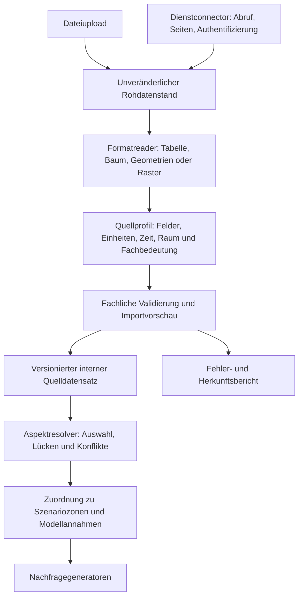

# Datenquellen: Importverträge und UI-Entwurf

**Stand: 28.10.2026.** Technische Ergänzung zum [Adapterkonzept](22-datenquellen-adapter-und-fallbackkonzept.md).
Die folgenden Abschnitte beschreiben das weitergehende Zielbild; vorhandene
Kleindatenreader und der erste Studioarbeitsbereich setzen nur einen Teil davon um.
Der verbindliche Mindestumfang steht in [§1.1](22-datenquellen-adapter-und-fallbackkonzept.md#11-verbindlicher-mindestumfang),
der tatsächliche Stand in [§19](22-datenquellen-adapter-und-fallbackkonzept.md#19-erste-experimentelle-umsetzung-und-verifikation).
Die Abschnittsnummern 16/17 bleiben zur Zuordnung des bisherigen Entwurfs erhalten.

## 16. Technische Konkretisierung: unterschiedliche Formate normalisieren

**Weitergehender Zielvertrag vom 28.10.2026; nur teilweise implementiert.** Nutzer und Dienste dürfen
unterschiedliche Transportwege, Dateiformate und fachliche Schemata bereitstellen.
Die Generatoren sollen ausschließlich validierte interne Fachverträge konsumieren.
Die Transformation erfolgt vor der Auswahl und Zusammenführung fachlicher Beiträge.

### 16.1 Beschaffung, Format und Bedeutung getrennt behandeln



| Schicht | Zuständigkeit | Beispiel |
|---|---|---|
| Beschaffung / `SourceConnector` | Bytes bzw. zusammengehörige Ressourcen beschaffen; Dienstprotokoll, Seiten, Wiederholung und Vollständigkeit behandeln | Upload, REST-Abfrage, Dateiarchiv |
| Lesen / `FormatReader` | Syntaktische Struktur und Quellpositionen erhalten | CSV-Zeile, Excel-Blatt/Zelle, JSON-Pfad, XML-Element, GeoJSON-Feature |
| Mapping / `SemanticMapper` | Quellfelder einem konkreten Fachvertrag zuordnen; deklarierte Einheiten-/Datums-/CRS-Konvertierung | `arbeitsplaetze` → beobachtete Arbeitsplatzanzahl |
| Validierung / `DatasetValidator` | Pflichtangaben, Referenzen, Wertebereiche, Mengenbasis und Abdeckung prüfen | Geheimhaltungsmarker ist kein Arbeitsplatzwert null |
| Ablage / `DatasetStore` | Rohquelle, Mappingversion, normalisierte Revision und Prüfbericht unveränderlich halten | `datasetId` plus `revisionId` |
| Auflösung / `AspectResolver` | Passende Datensätze auswählen und nach Fachregel kombinieren | Kommunales Register innerhalb seiner Abdeckung; OSM außerhalb |

Der bisher vorgeschlagene `SourceAdapter` kann diese Schritte als Fassade bündeln.
Innerhalb der Fassade werden Reader und Connector wiederverwendet. Es braucht somit
keinen eigenen „REST-JSON-Arbeitsplatzadapter“ und „Upload-CSV-Arbeitsplatzadapter“
mit jeweils duplizierter Geschäftslogik.

### 16.2 Mehrere typisierte interne Verträge

Das interne Format sollte eine **Familie versionierter Fachverträge** sein.
Bevölkerung, Pendler, Standorte, Fahrpläne und Unternehmenstouren haben verschiedene
Strukturen und Bedeutungen. Eine einzige universelle Datentabelle würde diese
Unterschiede lediglich in unkontrollierte Zusatzfelder verschieben.

Es sind außerdem zwei interne Ebenen zu unterscheiden:

1. **Normalisierter Quelldatensatz:** Erhält Quellbeobachtung, Geometrie, räumliche
   Auflösung, Zeitraum, Null-/Fehlwertstatus und Herkunft. Er ist möglichst unabhängig
   von einer konkreten Szenariozonierung.
2. **Aufgelöste Modelleingabe:** Enthält die für ein Szenario ausgewählten,
   zusammengeführten und zugeordneten Werte, einschließlich Ersatzannahmen.

Ein georeferenzierter Betriebsstandort bleibt zunächst ein Punkt mit Original-ID.
Er wird anschließend einer Szenariozone zugeordnet. Eine Gemeindesumme bleibt
zunächst eine Gemeindesumme. Ihre Verteilung auf 100-m-Zonen ist ein zusätzlicher
Modellschritt, keine reine Formatkonvertierung.

Ebenso bleiben Tonnen zunächst Tonnen. Eine Ableitung von Fahrzeugfahrten benötigt
ein eigenes Modell. Ein Monthly-OD wird beim Normalisieren nicht automatisch zur
beobachteten Tagesnachfrage. Die in `PopulationGridParser` heute bereits kombinierte
Formatlesung, Koordinatenumrechnung und teilweise räumliche Disaggregation zeigt,
welche Verantwortlichkeiten bei einem Umbau sichtbar auseinanderzuziehen wären.

### 16.3 Beispiel: zwei Formate, ein fachlicher Eingang

Illustrative Quelldaten, keine realen Messwerte:

```text
CSV eines kommunalen Arbeitsplatzregisters:
kennung;laenge;breite;arbeitsplaetze
betrieb-17;7.5000;51.5000;1250

JSON-Antwort eines anderen Datenanbieters:
{"items":[{"key":"betrieb-17","location":{"lon":7.5,"lat":51.5},"jobs":1250}]}
```

Zwei Mappingprofile erzeugen fachlich entsprechende Datensätze, **wenn** beide
Quellen dieselbe Definition von Arbeitsplatzanzahl, denselben räumlichen Bezug
und passende Bezugszeiten deklarieren. Unterschiedliche Herkunft bleibt erhalten.

Schematisches Profil für die CSV-Variante:

```yaml
profileId: municipal-workplaces-csv-v1
targetContract: opportunity-observations-v1
reader:
  format: csv
  encoding: UTF-8
  delimiter: ";"
mapping:
  sourceId: {column: kennung, type: string}
  longitude: {column: laenge, type: decimal, locale: en-US}
  latitude: {column: breite, type: decimal, locale: en-US}
  quantity: {column: arbeitsplaetze, type: decimal, locale: en-US}
semantics:
  purpose: work
  measure: workplaces
  unit: jobs
  crs: EPSG:4326
  coordinateOrder: longitude-latitude
```

Für JSON setzt ein anderes Profil einen expliziten Recordpfad `/items` und
Feldselektoren `/key`, `/location/lon`, `/location/lat` und `/jobs` relativ zum
jeweiligen Datensatz. Die genaue Mappinggrammatik ist noch festzulegen.
Zeitbezug, Abdeckung und die Arbeitsplatzdefinition sind zusätzlich verpflichtende
Datensatzmetadaten; das Beispiel ist allein noch keine vollständige Importkonfiguration.

Der Generator erhält danach beispielsweise `OpportunityObservation`-Objekte.
Er weiß nicht, ob diese aus Excel, CSV oder JSON stammen. Ein nachgeschaltetes,
versioniertes Attraktivitätsmodell übersetzt Beobachtungen in Zielwahlgewichte.
Damit kann die Software Beschäftigtenzahlen, Arbeitsplatzkapazität und rohe
POI-Anzahlen ausdrücklich unterscheiden.

### 16.4 Geodaten und große Datenbestände nicht zu Tabellen zerdrücken

Der Readervertrag darf unterschiedliche strukturierte Ausgaben liefern:

- Tabellen mit typisierten Werten und Zeilen-/Zellbelegen;
- Bäume/Records mit expliziten Selektoren und Eltern-Kind-Beziehungen;
- Features mit Geometrie, Attributen und räumlichem Referenzsystem;
- Raster mit Zellen, Auflösung, NoData-Maske und räumlicher Referenz.

Für XML/JSON ist beliebiges Flattening kein allgemeiner Ersatz für ein Quellschema:
Touren enthalten Halte und Aufträge; deren Gruppierung darf nicht verloren gehen.
GTFS ist ein relationales Tabellenpaket und benötigt Prüfungen zwischen den Dateien.
GeoPackage, Shapefile oder GeoTIFF wären eigene Formatreader, sobald der Bedarf und
die Laufzeit geklärt sind; sie werden hier nicht als bereits unterstützt behauptet.

Große Raster und nationale Bestände werden als Streams, Blöcke oder dateibasierte
Handles verarbeitet. Eine Vorschau liest nur eine begrenzte Stichprobe; ihre
erfolgreiche Prüfung ersetzt nicht die Validierung des vollständigen Imports.
Ein früher räumlicher Zuschnitt darf für die Aufgabe notwendige Außenziele nicht
abschneiden und muss als Verarbeitungsschritt dokumentiert werden.

### 16.5 Importablauf und Dienstbetrieb

Ein manueller Import durchläuft: **Bereitstellen → Profil wählen/zuordnen →
Vorschau und Fehlerprüfung → freigegebene Revision auswählen**. Die Vorschau zeigt
Beispielzeilen, Einheiten, Abdeckung, verworfene Zeilen, Summen und Quellbelege.
Numerische Codes ohne bekanntes Wörterbuch werden nicht automatisch interpretiert.
Dezimal-/Tausenderzeichen, Zeitzone, CRS und Achsenreihenfolge werden explizit
festgelegt; automatische Erkennung darf einen Vorschlag liefern.

Für einen wiederkehrenden Dienst wird dasselbe Mappingprofil gespeichert.
Bereits freigegebene Regeln können kompatible neue Datenstände ohne erneute manuelle
Zuordnung verarbeiten. Ein Quellstruktur-Fingerabdruck erkennt Veränderungen;
Pflichtfelder, Werte, Einheiten und Abdeckung werden trotzdem bei jedem Import
erneut geprüft. Schemaänderungen, unvollständige Pagination oder widersprüchliche
Einheiten verhindern die Veröffentlichung als verwendbare Revision.

Ein Vorschlag für die spätere API ist:

```text
POST /api/data-imports                         Quelle bereitstellen / Abruf starten
GET  /api/data-imports/{id}                    Zustand, Struktur und Diagnose
POST /api/data-imports/{id}/preview            Mapping auf Vorschau anwenden
POST /api/data-imports/{id}/materialize        vollständige Revision erzeugen und prüfen
PUT  /api/scenarios/{id}/data-bindings         konkrete Revisionen je Aspekt auswählen
```

Das sind neue Endpunktentwürfe, keine heute verfügbaren Routen. Ein erfolgreicher
Import und dessen Nutzung im Szenario sind getrennte Aktionen. Dienstzugänge gehören
in die Betriebskonfiguration; Szenarien speichern Referenzen und die fachliche Auswahl.
Ein Quellenplan kann die ausgewählte Revision für jeden Generierungslauf einfrieren,
auch wenn der Dienst inzwischen einen neueren Stand liefert.

### 16.6 Revisionen, Bilanzierung und Fehler

Jede erzeugte Revision referenziert Rohdatenhash, Connector-/Reader-/Mapperversion,
Mappingprofil, Zusatzmetadaten und den Zielvertrag. Der Cache-/Idempotenzschlüssel
umfasst alle diese verarbeitungsrelevanten Eingaben. Derselbe Upload mit einem anderen
Einheitenmapping ist ein anderes Verarbeitungsergebnis.

Die Materialisierung schreibt zunächst in einen Arbeitsbereich. Nur ein vollständig
validiertes Ergebnis wird atomar als verwendbare Revision veröffentlicht. Ein defektes
Dienstupdate verändert bestehende Szenariobindungen nicht. Ein älterer gültiger
Datenstand darf nur nach der konfigurierten Alters-/Fallbackregel weiterverwendet
werden; der Updatefehler bleibt sichtbar.

Prüfberichte benötigen eine Zeilen-/Objektbilanz und je Fachvertrag Mengenprüfungen.
Nicht passende Gebietszellen, ungültige Werte, Dubletten und statistisch geschützte
Angaben bekommen unterschiedliche Gründe. Teilimporte sind nur mit ausdrücklich
erlaubter Policy nutzbar; sie dürfen Vollständigkeit nicht vortäuschen.

Die technische Mindestprüfung umfasst zwei verschieden formatierte Quellen mit
fachlich entsprechendem Output, erhaltene Quellbelege, Schemaänderungen, Locale-/
Einheitenfehler, explizite Null-/NoData-Unterscheidung sowie fehlgeschlagene Updates
ohne Veränderung der zuvor ausgewählten Revision.

### 16.7 Konkreter erster Umsetzungsschnitt

Die folgenden Absätze halten die ursprüngliche Schnittplanung fest. Der gemeinsame
Reader und Mappingeditor sowie drei Kleindatenverträge sind inzwischen vorhanden;
Dienstconnectoren, freie CRS-/Einheitenkonvertierung und beliebige Geodaten sind
dadurch noch nicht implementiert.

Zunächst empfiehlt sich ein Arbeitsplatzimport über CSV/XLSX und JSON. Dafür werden
die wiederverwendbaren Teile des Tourenimports isoliert und an einem zweiten
Fachvertrag geprüft. Tourenspezifische Gruppierung und Betriebslogik bleiben in
`companytour`; eine universelle fachliche Mappingklasse entsteht daraus nicht.

Vorhandene Ansatzpunkte sind `TourTableReader` (Tabellenlesung), `TourSourceReader`
(Extraktionshülle und Quellbelege), `CompanyTourMapper` (begrenzte Mappingregeln),
`TourImportProfiles` (gespeicherte Regeln und Strukturprüfung) sowie
`CompanyTourImportService` (Vorschau und getrennte Aktivierung), siehe Q18.
Die damalige Formatunterstützung des Tourenimports war der Ausgangspunkt.
Die inzwischen extrahierten Reader versorgen zusätzlich die drei beschriebenen
Kleindatenverträge; beliebige Nachfrageaspekte sind damit weiterhin nicht abgedeckt.

Ein neuer Paketbereich `de.synthesis.data` könnte Connectoren, Reader, Profile,
Revisionen und gemeinsame Prüfberichte aufnehmen. Fachverträge und Fachmapper
liegen in getrennten Unterbereichen. Erst wenn dieser zweite Anwendungsfall
funktioniert, werden Bevölkerungs- und Güterquellen schrittweise angeschlossen.
Das grenzt den ersten Umbau ein und prüft die Abstraktion an realen Unterschieden.

### 16.8 Extraktionsplan aus dem vorhandenen Tourenimport

Der Tourenimport ist der Ausgangspunkt der gemeinsamen Importkomponente. Die
weitere Codeprüfung zeigt folgenden konkreten Schnitt; eine bloße Umbenennung
aller `Tour*`-Klassen würde die Fachkopplung nicht beseitigen:

| Heute | Wiederverwendbarer Anteil | Bleibt im Fachmodul / erforderliche Anpassung |
|---|---|---|
| `TourTableReader` | CSV-/TSV-/XLSX-Lesung, Tabellen-/Zeilenstruktur | Gemeinsame Datentypen; Größen-/Zeilenlimits als Importpolicy statt unveränderlicher Tourenkonstanten |
| `TourSourceReader` | Extraktionshülle für Tabellen, Records und Dokumenttext; Belege | PDF-Laufzeitkonfiguration von Tourenproperties lösen; bestehende JSON/XML-Tabellenextraktion nicht zum universellen Geodaten-/Hierarchievertrag erklären |
| `CompanyTourMapper` | Spaltenprofil, Zuordnung, Datums-/Zeitkonvertierung, begrenzte Regeln | `FIELDS`, `REQUIRED`, Synonyme, Gruppierung zu Touren/Halten/Aufträgen und deren Validierung sind fachlich |
| `TourMappingPlanner` | Lokaler LLM-Aufruf, begrenzte Antwort, kontrollierter Mappingvorschlag | Zielkatalog und Antwortprüfung aus Fachschema ableiten; Prompt referenziert heute direkt Tourenfelder |
| `TourSourceAnalysis` | Prüfung existierender Textstellen und Bilanz ausgelassener Blöcke | Tourenspezifische Extraktionsprompts, Flachzeilen und Materialisierung durch Fachmodul bereitstellen |
| `TourImportProfiles` | Gespeicherte Regeln und Struktur-Fingerabdruck | Zielvertrag/Fachschema versionieren; keine Kopplung des generischen Profiltyps an `CompanyTourMapper.Mapping` |
| `CompanyTourImportService` | Import, Vorschau, Profilanwendung und Bestätigungsablauf | Szenarioauswahl, Betriebskontext, Fahrzeuge, Geokodierungsziele und Ausführungsbereitschaft bleiben im Tourenservice |
| `CompanyTourImportComponent` | Upload, Tabellenwahl, Mappingeditor, Vorschau, Profilbedienung, Quellbelege | Statisches Feldarray ersetzen; Tour-/Auftragsansicht, Depot-/Fahrzeugfragen und Aktivierung bleiben spezifische UI |

Eine mögliche Verzeichnisaufteilung für den gemeinsam genutzten Code ist
`de.synthesis.data.importing` mit `reading`, `mapping`, `profiles` und `evidence`.
`companytour` konsumiert diese Bausteine und behält seine Fachmodelle. Ein
`workplaces`-Fachmodul registriert ein anderes Schema und einen anderen Mapper.
Das ist ein Modulschnitt innerhalb derselben Anwendung, kein neuer Dienst.

Ein Fachschema beschreibt Feld-ID, Bezeichnung, Typ, Pflichtstatus, erlaubte
Einheiten, Synonyme und erlaubte Transformationen. Es liefert UI und Vorschlagslogik
den gleichen Katalog. Fachliche Mehrfeld-/Mengen-/Gruppierungsregeln bleiben
serverseitiger Code des jeweiligen Moduls. UI-Metadaten ersetzen keine Validierung.

Schematische Erweiterungspunkte:

```java
interface ImportDomain<TDraft> {
    ImportSchema schema();
    MappingProposal suggest(ExtractedSource source);
    ImportPreview<TDraft> preview(ExtractedSource source, MappingPlan mapping);
    ValidationReport validate(TDraft draft);
}
```

Diese Schnittstelle bildet nur den fachlichen Import ab. Fahrzeugeinsatz,
Quellenauflösung und Fallbacks gehören nicht in denselben Vertrag. Ein gemeinsamer
Importservice orchestriert Reader, Mapping und Vorschau; die Tourenfassade ruft
anschließend ihre vorhandene Kontext-/Ausführungslogik auf.

**Vorhandene Verträge zuerst erhalten:** Der erste Extraktionsschritt lässt die
Touren-REST-Routen, serialisierten DTO-Namen/-Felder, Importdateien und
`executionHash`-Auswahl bestehen. Kompatibilitätsfassaden übersetzen zwischen alten
Typen und gemeinsamem Kern. Alte gespeicherte Profile bleiben lesbar; eine neue
Profilversion wird ausdrücklich migriert. Erst danach werden weitere Fachimporte
angeschlossen und gegebenenfalls gemeinsame neue Routen angeboten.

Der aktuelle Speicher ist dabei noch kein allgemeiner unveränderlicher
Rohdaten-/Revisionsspeicher: `Stored` enthält Extraktion, Mapping, Draft und
Tourenkontext; Änderungen ersetzen die Import-JSON atomar. Die Upload-ID beruht auf
den Eingangsbytes, die Originaldatei selbst wird in diesem Service nicht dauerhaft
abgelegt. Allgemeine Rohdatenarchivierung und getrennte Mappingrevisionen wären
deshalb zusätzliche Fähigkeiten und keine bereits vorhandenen Garantien.

**Erste Abnahme:** Der Tourenpfad läuft über die extrahierten Hilfsbausteine mit
denselben Ergebnissen und kann alte Importe/Profile weiterhin lesen. Ein zweiter
Arbeitsplatzimport verwendet dieselben Reader, Belege, Profile und den gleichen
Mappingeditor mit anderem Fachschema. Erst dieser zweite Verbraucher belegt die
beabsichtigte Wiederverwendung. Die bisherige Größen-/Kleindatenstrategie wird
nicht ungeprüft für nationale Raster übernommen.

Zusätzlich zu Q18 wurden für diesen Schnitt der aktuelle `CompanyTourController`,
`TourMappingPlanner`, `TourSourceAnalysis` und die Angular-Komponente
`frontend/src/app/features/studio/company-tour-import.component.ts` geprüft.
Dies ist die ursprüngliche Refactoringplanung. Die tatsächlich extrahierten Teile
und die erhaltenen Tourenfassaden sind im Umsetzungsstand getrennt ausgewiesen.

## 17. UI-Konzept: Datenarbeitsbereich im Studio

**UI-Zielbild vom 28.10.2026; erster Angular-Arbeitsbereich vorhanden.** Die
heutigen Uploads verteilen sich auf Bevölkerung, Pendler, GTFS, Güterverkehr und
Unternehmenstouren. Der umfangreiche Toureneditor steht im Studio neben den anderen
Szenarioparametern. Die MobileCity-Datenübersicht bietet bereits eine zielbezogene
Vorlage für Quellenstatus und Herkunft. Daraus soll ein gemeinsamer, szenariobezogener
Arbeitsbereich „Daten & Quellen“ entstehen.

### 17.1 Ein Arbeitsbereich mit drei Ansichten

| Ansicht | Nutzeraufgabe | Inhalt |
|---|---|---|
| Beiträge | Festlegen, welche Information wie ins Szenario eingeht | Fachliche Aspekte, aktiv/ausgeschlossen, Quelle, Lückenregel und erlaubter Fallback |
| Datenbestand | Eigene Daten hinzufügen und verwalten | Importentwürfe und geprüfte Revisionen mit Herkunft, Bezugszeit, Abdeckung und tatsächlicher Verwendung |
| Lauf prüfen | Vor dem Start die Quellen- und Annahmenlage beurteilen | Fehlende Voraussetzungen, Ersatzannahmen, unterstützte Zielwirkungen und noch ausstehende Prüfungen |

Die Beitragsansicht startet mit fachlichen Begriffen wie „Wohnbevölkerung“,
„Arbeitsplätze“ oder „Schwerlastverkehr“. Eine kompakte Liste wählt den Beitrag;
daneben stehen seine Details. Bei schmalem Fenster werden die Bereiche untereinander
angeordnet. Keine langen technischen Adapterlisten im Hauptformular.

Die globale Einstellungsseite bleibt für Dienstzugänge und Laufzeiten zuständig.
Welche Datenrevision und welche Annahme das Szenario verwendet, gehört in den
Szenarioarbeitsbereich. Ein globaler Datenkatalog ist später möglich, aber kein
Voraussetzungsumbau und keine automatische Freigabe privater Tourendaten für andere
Szenarien.

### 17.2 Quellenauswahl und Aspektumfang sind verschiedene Bedienelemente

Ein Beitrag kann bewusst ausgeschlossen werden. Innerhalb eines aktiven Beitrags
wählt der Nutzer eine primäre Quelle und gegebenenfalls weitere Quellen zum
Ergänzen. „Quelle nicht verwenden“ darf nicht denselben Schalter wie „diesen
Nachfragebeitrag ausschließen“ erhalten.

Ein Aktionsknopf „Daten hinzufügen“ öffnet den Importeditor bereits mit dem passenden
Fachschema. Über den Datenbestand kann derselbe Editor ohne vorausgewählten Beitrag
geöffnet werden. Eine gerade importierte Revision wird sichtbar angeboten, aber
nicht unbemerkt als Szenarioquelle aktiviert.

Bei Quellen mit mehreren Wirkungen zeigt die Detailansicht die betroffenen Aspekte.
Ein Arbeitsplatzregister ersetzt beispielsweise die Arbeitsgewichte, während OSM
weiter Straßen und andere Zielkategorien liefert. Die UI zeigt auch, ob ein Wert nur
MobileCity oder die gemeinsame Nachfrage beeinflusst.

### 17.3 Gemeinsamer Importeditor statt weiterer Spezialformulare

Der Editor erhält einen breiten Arbeitsbereich und drei Schritte:

1. **Quelle:** Datei oder konfigurierten Dienst wählen, Importprofil anwenden,
   relevante Tabelle/Struktur wählen sowie Quelle und Bezugsrahmen benennen.
2. **Zuordnung:** Gemeinsamer Feldeditor aus `ImportSchema`, Quellwerte als Vorschau,
   Einheiten, Datum, Raumbezug und erlaubte Umwandlungen. Optionaler lokaler
   LLM-Vorschlag; manuelle Bearbeitung bleibt möglich.
3. **Prüfung:** Normalisierte Vorschau mit Herkunftsstellen, Mengen-/Objektbilanz,
   Fehlern und Abdeckung. Vollständige Materialisierung und Veröffentlichung einer
   Revision nur nach serverseitig erfolgreicher Prüfung.

Die Schrittanzeige hilft bei der Orientierung; bereits gemachte Angaben bleiben
beim Zurückgehen erhalten. Ein gespeichertes kompatibles Profil kann die
Zuordnungsschritte verkürzen. Bekannte, freigegebene Dienstprofile dürfen Updates
automatisch prüfen, ohne jedes Mal eine manuelle Bestätigung zu verlangen.

Nach dem allgemeinen Import folgen nur die nötigen Fachfragen: Unternehmenstouren
brauchen Depot-, Fahrzeug-, Zeit- und Ortskontext; Arbeitsplatzdaten beispielsweise
ihren Mess-/Kapazitätsbegriff. Gemeinsamer Editor bedeutet nicht dieselben Fragen
für jede Quelle. Vorhandene `tourContextQuestions` können über ein generisches
Fragenpanel angezeigt werden; ihre fachliche Entscheidungslogik bleibt im Tourenmodul.

### 17.4 Fallbacks und fehlende Daten in verständlicher Sprache

Für jeden aktiven Beitrag steht unter „Wenn keine Quelle passt“ eine explizite
Ersatzregel. Ihr Status ist als Text lesbar, nicht allein als Farbe:

- „Quelle ausgewählt; Abdeckung noch zu prüfen“ für eine noch nicht geladene Quelle;
- „Mit Ersatzannahmen versorgt“ für einen erlaubten, vollständig konfigurierten Ersatz;
- „Eingabe fehlt“ bei unzureichender Information;
- „Bewusst ausgeschlossen“ bei abgewähltem Aspekt.

Beispiel Schwerlastverkehr: Fehlt eine OD-Quelle, kann der Nutzer ein vorgesehenes
Ersatzprofil erlauben und die dort geforderten Mengen-/Struktur-/Transitangaben
ergänzen. Ohne vollständige Eingaben bleibt dieser Beitrag unversorgt. Eine
beliebige Tagesmenge ist ein Annahmenszenario, kein Ersatz für einen empirischen
Vollständigkeitsnachweis. Die echte Profilkonfiguration muss deshalb Menge,
Binnen-/Außenumfang, Tagestyp und Verteilung nachvollziehbar darstellen.

Die Planprüfung blockiert einen Lauf nur bei fehlenden Voraussetzungen seines
ausgewählten Umfangs. Ein erlaubter Fallback allein ist kein technischer Fehler.
Für belastbare Auswertungen können vorher festgelegte Qualitätsanforderungen
zusätzliche Blocker liefern. Bekannte Fehler verlinken auf das entsprechende
Feld bzw. die Quellzeile. Nicht anwendbare Quellen und tatsächliche Fehler bleiben
unterscheidbar.

Eine Abdeckungsprozentzahl erscheint erst nach entsprechender Prüfung und nennt
ihren Nenner. Vor dem Abruf zeigt die UI keine erfundene Vollabdeckung. Zusätzlich
bleibt sichtbar, ob „geprüft“ syntaktische Gültigkeit, fachliche Verwendbarkeit oder
empirische Validierung meint.

### 17.5 Konkreter Angular-Schnitt

Vorgeschlagene Aufteilung des Zielbilds. Im ersten Schnitt bündeln
`DataWorkspaceComponent` und `MappingEditorComponent` mehrere dieser Aufgaben;
die folgende Liste behauptet keine bereits vorhandenen Einzelklassen:

| Komponente | Verantwortung |
|---|---|
| `ScenarioDataWorkspaceComponent` | Szenariobezogener Arbeitsbereich und Navigation |
| `AspectSourcePanelComponent` | Quellenwahl, Ausschluss, Lücken- und Ersatzregeln |
| `DatasetLibraryComponent` | Importstatus, Revisionen und Verwendung |
| `DataImportWorkbenchComponent` | Gemeinsamer Importablauf und Profilbedienung |
| `MappingEditorComponent` | Feldzuordnung aus typisierten Schemametadaten |
| `ImportPreviewComponent` | Prüfberichte, Quellbelege und normalisierte Vorschau |
| `SourcePlanReviewComponent` | Planprüfung und Ergebnisverweis |
| Touren-Fachansicht | Bestehender Betriebskontext, Fachfragen und Ausführungsauswahl |

Die wiederverwendbaren Teile von `CompanyTourImportComponent` wandern in die
Importkomponenten. Tourenspezifische Ansichten konsumieren deren Ergebnisse. Die
Backendverträge für Feldschema, Diagnose, Revision und Quellenplan erhalten
typisierte TypeScript-Spiegel. Fachliche Prüfentscheidungen und verfügbare
Adapterwirkungen kommen vom Backend; das Frontend erfindet keine zweite Resolverlogik.

Ungespeicherte Mappings und nicht veröffentlichte Importe sind vom gespeicherten
Szenarioquellenplan getrennt. Quellenänderungen markieren vorhandene Ergebnisse als
veraltet. Eine laufende Generierung zeigt weiterhin ihren eingefrorenen Plan;
spätere Änderungen gelten für einen neuen Lauf. Die vorhandenen Regeln zum
Deaktivieren geänderter Tourenausführungen bleiben erhalten.

### 17.6 Umsetzung und UI-Abnahme

Zuerst wird der Mappingeditor aus der Tourenansicht extrahiert, während der aktuelle
Tourenablauf bestehen bleibt. Danach prüft der Arbeitsplatzimport die Wiederverwendung.
Der Datenarbeitsbereich bündelt anschließend diese Importe und die bestehenden
Quellenanzeigen. Ein neuer Resolver/Fallback wird erst angeboten, wenn die zugehörige
Backendfunktion implementiert und abgenommen ist.

Ein separater klickbarer Gesprächsentwurf zeigt Beiträge, Datenbestand, Planprüfung
und schemaabhängige Feldzuordnung mit Beispieldaten. Er enthält keinen echten Upload,
keinen Dienstabruf und keine Generierung. Im lokalen Browser wurden fehlende Mengen,
erlaubte Ersatzmengen, Aspektabwahl, fehlende Zuordnung, unpassende Einheiten,
Import ohne automatische Aktivierung und anschließende Quellenauswahl geprüft;
die Layoutprüfung umfasste Breiten von 320, 390, 736 und 1.024 Pixeln.
Das ist eine Interaktionsprüfung des Entwurfs, keine Abnahme einer Angular-Integration.
